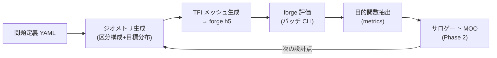

# ノズル設計ツール (design) — 現在仕様

forge を粘性評価器とする超音速ノズル設計ツールの現在仕様。設計判断の経緯・実現性精査は親計画
[`plans/active/tooling-nozzle-design-tool.md`](../../plans/active/tooling-nozzle-design-tool.md)、
技術的背景 (文献・理論) は
[`notes/investigations/nozzle-optimization-tool-survey.md`](../../notes/investigations/nozzle-optimization-tool-survey.md)
を参照。本文書は「ツールが現在どう動くか」のみを記す。

> 状態: Phase 0 (基盤)・Phase 2 (③ベル MOO + Rao 照合合格) 完了 (2026-08-13)。
> 次 = Phase 3 (①風洞: モード F + 帰還エンジン v1–v3 + CONTUR 照合)。本文書は実装と同期して更新する。

## 全体像

対象 5 機種 (① 風洞軸対称 / ② 風洞矩形 / ③ スラスタベル / ④ デュアルベル / ⑤ SERN)。
処理は 5 レイヤ:



壁の決め方は機種で分かれる (親計画 §4.6③/§4.7, 2026-08-13 改訂): **③ベルは TOP 直接幾何 dv**
($\theta_n, \theta_e, L/r_t$ — 下流壁は $P_a$ に C1 接続する TOP 放物線) で直接パラメータ化し、
**①②④⑤は「目標分布による逆設計」** (帰還エンジン — ①で初実装。v1 MOC 逆設計+δ\* 経験式 →
v2 Euler 帰還 [凍結特性線マップ] → v3 NS トレース) で決まる。壁座標そのものを最適化変数に
することはない (例外: ⑤ 3D FFD 段)。

## パッケージ構成

`design/` (リポジトリルート直下、Python パッケージ `forge_design`):

| モジュール | 責務 |
| --- | --- |
| `probdef` | 問題定義 YAML の読込・検証 (spec/derived/dv 3 区分、過拘束チェック) |
| `geometry` | 区分構成壁 (収縮 Bell–Mehta 5 次 / スロート円弧 $R_u,R_d,\theta_a$ / 下流壁)、中心線マッハ Bézier、Kliegel–Levine 遷音速級数 + kernel MOC (アンカー)、事前フィルタ |
| `meshing` | 構造化 TFI メッシュ生成 (トポロジ固定) → forge HDF5 直書き、品質ゲート |
| `evaluate` | バッチ評価 CLI: run ディレクトリ準備 → forge 起動 → 収束/NaN 自動判定 |
| `metrics` | `res_*.h5` からの目的関数抽出 (固定サンプリング格子補間) |
| `feedback` | 帰還エンジン (**v1/v2 実装済み** — 親計画 §4.7): `deltastar` (δ* 経験式 = Eckert 参照温度 + 乱流平板相関) / `euler_loop` (v2: 凍結 C⁻ マップ + PM 換算 + trust-region ω + 同一トポロジ再メッシュ + warm restart。case/41 で 0.45% Md 収束実証)。`geometry/moc_inverse` (逆 MOC 三角充填 + 壁流線抽出) と `geometry/wall_modef` (モード F 複合壁)、`evaluate/runner_wt` (①評価: Euler cell/slip) が対 |
| `report` | ノズル設計の標準出力 (図・評価量・条件表、`nozzle_report`) |
| `export` | CAD 書き出し: 物理壁の STEP (`wall_step`、FreeCAD の `freecadcmd` で書き出し・読み直し・回転面の検査) |
| `opt` | サロゲート MOO ループ (**実装済み**): `ehvi` (2目的 EHVI 閉形式・MC照合済) / `doe` (LHS) / `surrogate` (SMT KRG) / `moo` (NSGA-II+EHVI infill) / `driver` (バッチ評価: 2段起動・VERDICT/物理ゲート・warm seed) / `polish` (チャンク継続+ηドリフトゲート)。実行は `design/.venv-opt` |
| `menu` | 特殊解析メニュー (凝縮・高度スイープ — Phase 3〜) |

### 解析設定の出所 (機種の推奨設定 = プロファイル、2026-10-14)

生成器 (`evaluate/runner*.py`) の solverConfig は、機種と段ごとの推奨設定 (プロファイル。値の正本は
`solver_density_cuda/tools/recipes/recommended_settings.yaml`、表は `procedures/recommended-settings.md` 付録 A) から組む方針
(plan [tooling-generator-defaults-and-launch-gate](../../plans/active/tooling-generator-defaults-and-launch-gate.md) §4.0〜§4.2)。
**段取り 1 (今) は書き写しの照合と宣言**で、生成器の数値は変えていない: 各生成器が今書く設定を `recipes/regen_profiles.py` が
代表の問題 (固定の写し `recipes/fixtures/`、plan §5.1 #17) で全段の起動列を偽の forge で作って書き写し、
`design/tests/run_recipe_profiles_tests.py` が書き写しと生成器の出力の一致を確かめる。
2026-10-15 (plan §5.1 #11) から生成器は段の config を書くときに `evaluate/config_builder.py` を通す: (1) 機種のプロファイルに合えば
**明示すべきキー** (値に依存するのに省略していたキー、plan §5.1 #16) を旧い実効値で足す (文字の挿入だけ。値は変わらない:
`design/tests/run_generator_recipe_tests.py` が置き換えの前とのバイト同一 (例外 = 足したキー) を確かめる)、(2) 書いた後に段の宣言
`RECIPE.json` (と段の写し `RECIPE_<tag>.json`) を書く。問題 YAML (と `--cfl` などの引数) が明示した数値の上書きは、出所 (問題 YAML の
パスとキー) つきの理由のある逸脱に変換する。**代表 11 機種・30 段**の config が自分のプロファイルに PASS することを
`run_generator_recipe_tests.py` で確かめた。**全経路ではない** (plan §5.1 #27): 宣言を結線していない経路 (`runner.main` の単段、
opt/polish の CPG)、宣言を書かない段 (axis-Mach NS の `ramp`、SERN の `warm_adapt`)、プロファイルの無い機種・構成 (風洞 NS v1、
`euler_loop` の cell、CPG の axis-Mach、断熱壁の axis-Mach NS) は宣言を書かない (`RECIPE_<tag>.FAILED.json` に理由を残す段もある)。
生成器の値を変えたらプロファイルも書き直す (`regen_profiles.py --write`、差は plan に書く)。
手で作る run は `recipe_settings.py declare <run> --profile P --stage S` で宣言できる。投入の関門 `launch_gate.py` (`run_case.sh` が
forge の前に呼ぶ、#10) は実装済み: 宣言した run は宣言のプロファイル・段・逸脱と、変換の成果物から取った次元・格子の種類 (#28) で照合し、
FAIL なら起動しない。強制の開始は棚卸しの完了の後 (plan §4.7) で、それまでは宣言の無い run・来歴の記録の無いメッシュを WARN で起動する
(禁止キー・宣言した run の照合の FAIL・メッシュの FAIL は今も止める)。forge の終了の後は起動のエコーと要求値を照合し `LAUNCH_ECHO.txt`
に残す (#29、WARN のみ)。
**段取り 1 の完了と計画全体の完了は別**: 段取り 1 の残りは #26 (case/45 の台本の互換の統合) と result 段の再レビュー。生産レシピへの
既定の揃え (段取り 2、#12)・§1 に寄せる受入 (段取り 3、#15)・強制の開始は後続。

## 問題定義 YAML

1 案件 = 1 YAML。全パラメータは 3 区分で宣言する:

- `spec`: 案件仕様 (入口全圧/全温/組成、試験部径・設計マッハ、要求推力・背圧 等)
- `derived`: spec から決まる量。スロート径 $r^*$ は「閉ループ派生」(風洞: 無次元設計→出口径
  スケーリング、スラスタ: $C_d$ 実測補正) で、最適化の探索次元に入らない
- `dv`: 設計変数 (機種別の既定セットは親計画 §4.6)。どれでも固定値化できる

読込時検証: ($D_e$, $r^*$, $M_d$) の独立指定は 2 つまで (過拘束はエラー)、dv の bound、
Bézier 自由度勘定の整合。

> **移行中 (2026-09-27, plan [`tooling-design-problem-campaign-recipe`](../../plans/active/tooling-design-problem-campaign-recipe.md))**:
> 探索範囲 (dv の min/max)・目的・制約・評価手順 (Euler / δ\* NS) の選択は `campaign.yaml` へ移し、problem には基準値と作る物の物理条件だけを置く。
> 現状の axismach では dv の min/max は探索に使われず (範囲検査のみ)、設計が成立する範囲は runner が自分で計算して検査している。

## ジオメトリ (区分構成)

壁は上流から: 入口配管 → 収縮 (Bell–Mehta 5 次) → 曲率ブレンド → 上流円弧 $R_u$ →
スロート → 下流円弧 $R_d$ (終端角 $\theta_a$) → 下流壁 → 出口。

- 下流壁は `geometry.bell_type` で選ぶ: **`top` = TOP 放物線** ($P_a$ で接線 $\theta_n$・出口
  $(L,\sqrt{\varepsilon})$ で接線 $\theta_e$ の 2 次 Bézier。③の既定で、$\theta_n,\theta_e,L$ が
  そのまま dv。整合条件 $\tan\theta_n >$ 弦勾配 $> \tan\theta_e$ は構築時に検査) /
  **`hermite` = 3 次 Hermite** (同じ端点条件の旧初期壁・回帰対照。①②では逆設計の出発点で、
  精度は帰還の収束速度にのみ影響)。`theta_e_deg` は dv 宣言があれば dv、なければ geometry 固定値。
- 中心線マッハ Bézier: CP の x 等間隔固定で $M_c(x)$ は次数 $n$ の多項式。両端 C2 拘束で
  自由 CP 数 $k=n-5$ (`geometry/bezier.py`)。
- アンカー (始点 $x_k$ での $M,M',M''$): Sauer 遷音速解 (`geometry/transonic.py` — 幾何スロートと
  軸ソニック点のオフセット込み) の starting line から **kernel MOC** (`geometry/moc_kernel.py`:
  楔充填 + 規定壁ステーションの C⁻ フロントマーチ、放射源流厳密解 0.1%・平面単純波則 1%・
  格子収束 <0.5% で検証済み) が設計変数のみの決定的関数として与える。
  **既知の制約**: $R_d \lesssim 1$ は Sauer パッチが円弧終端を超えるため明示エラー
  (Kliegel–Levine 高次の実装が今後の課題)。
- **CFD アンカー (①モード F の逆設計)**: Sauer 一次解は実 CFD と $M'$ +25% / $M''$ 2.3 倍
  ずれることが実測され ([plan §9.2 B5](../../plans/active/tooling-nozzle-phase3-windtunnel.md))、
  接合波の主因は設計 Cauchy データと実流の不整合だった。`geometry.throat_anchor_run` に
  既存 run を指定すると、`feedback/cfd_anchor.py` の `CFDThroat` がその CFD 場から
  軸 $M(x)$ の局所多項式フィットと starting line の $M(r),\theta(r)$ (偶/奇多項式
  最小二乗) を抽出し、SauerThroat 互換 (`starting_line`/`mach`) で `design_chain` /
  `inverse_design` に供給する。$x_0$ は「CFD 軸 $M=M_{start}$」で決め ($M_{start}$ は
  `geometry.M_start`、既定 1.05 — 数値上の選択であり物理定数ではない)、アンカーは
  抽出元 run に**凍結** (遷音速場は下流壁にほぼ依存しない — 実測 ΔM 0.0024 — ため
  1 回の抽出で足りる)。**残課題 (ユーザ指示 2026-08-15)**: ブートストラップ元の
  初期壁品質と CFD 不要のプレビュー経路のため、初期遷音速解の二次化
  (Kliegel–Levine) は別途実装する。
- **目標曲線の起点 = $x_{\mathrm{reach,CFD}}$ (B10, plan §9.2 — 2026-08-17 以降の正本)**:
  設計 target と自由設計変数の起点を、$x_0$ (=$M_{start}$ の縦 starting line) では
  なく **$x_{\mathrm{reach,CFD}}$** にする。これは「自由壁が軸へ影響できる最初の位置」
  = **固定円弧終端 $J=(x_j,r_j)$ から出る CFD C⁻ 特性線の軸着地点**であり、
  実 CFD 場の $\theta$ と $\mu=\arcsin(1/M)$ から積分して求める (逆 MOC 場からは
  求めない)。$J$ と $x_{\mathrm{reach}}$ は別の $x$ 座標であることに注意。
  target は $[x_{\mathrm{reach,CFD}}, x_d]$ に**のみ**定義し、始端で CFD の
  $M,M',M''$ を継承 (C2)、終端で $(M_d,0,0)$。自由 CP 3 個は両拘束下で現行下流
  target との差を最小化する拘束付き最小二乗で決定的に射影する。
  $x<x_{\mathrm{reach,CFD}}$ には target を置かず帰還・収束判定から除外し、
  上流の軸 M・こぶ・圧力勾配は**別の物理診断**として記録する
  (旧 B7 の「実測こぶ曲線を上流評価 target へコピー」する帳簿処理は廃止)。
  $x_{\mathrm{reach,CFD}}$ は正式ゲートを通した cold 基準 run から一度取得し、
  帰還ループ中は固定する。
- **[旧] 目標曲線の $x_{\mathrm{reach}}$ 分割 (B7, plan §9.2)**: 設計壁始点 $x_0$ から
  $x_{\mathrm{reach}}$ (=設計壁の**最初に成功する** C⁻ が軸へ着地する位置。凍結
  v1 MOC マップ `build_cminus_map` の被覆下限として一意に決まる、taper 幅とは無関係の
  幾何量) までは、壁側の帰還がそもそも届かない区間である。ここへ**自由 CP が生成する
  グローバル Bézier の値**を目標として課すと、Bézier の大域台 (Bernstein 基底は局所
  支持を持たない) を通じて遠方 CP の形が押し戻り、到達不能な区間に「直しようのない
  ズレ」を最初から作り込む (実測: run_0018 の主残差 $x/r_t\approx1.38$ で
  $\Delta M\approx+0.05$、CP2 の基底重みが既にその位置で 11%)。そこで
  `design_chain` は 2 段構成にする: **① ブートストラップ**（$x_0$ アンカーだけの
  旧来の単一 Bézier で仮設計 → MOC マップ被覆から $x_{\mathrm{reach}}$ を得る)、
  **② 本設計**（$x_0\le x<x_{\mathrm{reach}}$ は $x_0$ と $x_{\mathrm{reach}}$
  両端の局所アンカー $(M,M',M'')$ だけで決まる**5 次 Hermite** (free_cp なしの
  `MachBezier.from_constraints`) を通し、$x\ge x_{\mathrm{reach}}$ だけを自由 CP
  の Bézier に担当させ、$x_{\mathrm{reach}}$ で $M,M',M''$ を接続する)。
  **区間全体を 1 本の曲線として直接フィットする方式は不採用** (実測 2026-08-15):
  この近スロート域は cell モードに軸上 DOF が無く軸方向のセル列が疎 (幅 1.4 $r_t$
  に ~30 列) で、高次多項式は Runge 振動・bin 平均は列疎密混入で非単調・等調回帰は
  勾配ごと潰す、と軒並み破綻した。$x_{\mathrm{reach}}$ でのアンカーは `CFDThroat`
  の `local_anchor()` ($x_0$ の点アンカーと同じ狭窓ローカルフィットを任意点に一般化。
  ただしセル疎な場所向けに既定を低次・広窓化: degree=2, halfwidth=0.4)、Sauer 時は
  `SauerThroat.mach()` (解析式、全域で有効) を使う。
- 事前フィルタ: CP 単調性、$dM_c/dx$ 凝縮上限 (足切りのみ)、壁 `validate()` (単調性・スロート最小)。

## wall-driven チェーン (①風洞・実装中 — 現行モード F と並存)

計画: [`plans/active/tooling-nozzle-walldriven-chain.md`](../../plans/active/tooling-nozzle-walldriven-chain.md)。
モード F (目標軸マッハ → 逆 MOC) と異なり、**壁を先に設計し $M_c(x)$ は診断量**とする:
U→T→D 低自由度多項式壁 → CFD (遷音速+初期超音速を実場で解く) → D からの C⁻ 特性線上の
データ抽出 → D 下流を wave-cancellation MOC で従属生成 → δ\* 補正 → 全域 B-spline。
凍結円弧とその接合 J が存在しないのが本質 (スロート曲率は条件 $r''(0)=1/R_t$ として残る)。

実装済み (Phase W1–W2): `geometry/wall_walldriven.py`。無次元 ($r_t=1$、スロート $x=0$)。

- **U→T** (`UpstreamThroatPoly`): 両端 6 条件の quintic Hermite。
  U 側 $(r_U,\,0,\,0)$ → T 側 $(1,\,0,\,1/R_t)$。単調収縮 ⇔
  $\mu=L_U^2/(R_t\,\Delta r)\le20$、すなわち $L_U\le\sqrt{20R_t\Delta r}$
  ($\Delta r=r_U-1$。勾配閉形式 $\frac{dr}{dx}=\frac{\Delta r}{2L_U}\xi^2(\xi-1)[5\mu\xi-3\mu-60\xi+60]$
  から導出、数値検証済み・必要十分)。
- **T→D** (`ThroatExpansionPoly`): 壁勾配 $q=r'$ を cubic Hermite で規定
  ($q(0)=0$, $q'(0)=1/R_t$, $q(L_D)=\tan\theta_D$, $q'(L_D)=0$) した 4 次壁:
  $$q(\xi)=\frac{L_D}{R_t}\xi(1-\xi)^2+\tan\theta_D\,\xi^2(3-2\xi),\qquad \xi=x/L_D$$
  D 半径は入力でなく従属: $r_D=1+\frac{L_D^2}{12R_t}+\frac{L_D}{2}\tan\theta_D$。
  途中変曲なし (全区間 $r''\ge0$) ⇔ $L_D\le3R_t\tan\theta_D$ (必要十分)。
- **合成** (`WallDrivenThroatRegion`): $r,r',r'',r'''$ 解析式 → $\theta,\kappa,d\kappa/ds$ も
  解析評価。T で κ は $1/R_t$ に連続、**κ' は一般に不連続** — 跳び量は診断値
  `kappa_prime_jump_at_throat` として常時出力 (許容可否は CFD で判定する)。
  `validate()` は解析条件と密サンプル検査 (単調性・変曲・$r>0$) の二重返しで、
  `dkds_max` を与えると $\max|d\kappa/ds|$ の上限も課せる (数値既定値は W3/W5 で決定)。
- **エラー 2 層方針**: 不正入力 (非有限・非正の長さ/半径・$\theta\notin(0,\pi/2)$・
  出口半径非正) は**構築時に `ValueError`** (係数生成前に遮断)。`validate()` は
  「幾何は定義できるが設計条件違反」のみを返す。全クラス共通。
- **geometry option** (`contraction_to_cone_quintic`): 直管→一定傾斜 $-\tan\theta_a$ への
  quintic 接続。曲率符号一定 ⇔ $\lambda=L\tan\theta_a/\Delta r\in[5/3,\,5/2]$、
  $\lambda=2$ で 4 次に退化。①主経路では未使用の保存知見。

テスト: `design/tests/run_walldriven_tests.py` (端点条件 1e-12・境界 ±0.1% 判別・違反ケース
検出・解析 κ/dκds と数値微分の一致・CFD 壁の C2 接続・不正入力拒否)。

**W3 (メッシュ/CFD 接続, 実装済み)**: `WallDrivenCFDWall` = 直管 + U→T→D +
θ_D 円錐 (D 発 C⁻ = W4 データ線を軸着地まで収める延長)。任意で戻しテーパ+円筒も
持てるが**既定は円錐のまま outlet で打ち切り** (`L_turn=L_cyl=0`)。評価は
`evaluate/runner_walldriven.py` (problem type `wind_tunnel_axisym_walldriven`、
node Euler、**段階起動必須** — soft 1次+cfl0.5 3000 step → 本段。cold 単段
conv1+cfl4 は D 発膨張波の軸反射が壁へ戻る帯で準 1D IC の過渡が破綻し初手発散)。
dv は `theta_D` / `R_t` / `L_D_frac` (L_D = frac × 3R_t tanθ_D)。

**訂正 (2026-08-15)**: 当初 cold 単段の発散を node の既知問題 (傾斜壁∩超音速
流出コーナー、`plans/active/boundary-node-nozzle-wall-outlet-stability.md`) と
誤診断し戻しテーパ+円筒を導入したが (`run_0042_walldriven_w3c`)、円錐のみ+
段階起動の切り分け (`run_0043_conecheck_staged`) で NaN なし完走・うねり指標も
同水準 (+0.00088 vs +0.0009) と判明 — **真因は cold 単段の CFL** で、既知問題
とは無関係。テーパ機能はコードに残すが生産既定は円錐のみ。

疎通実測: 軸うねり +0.0009 (円弧 R=5 の 1/11 — 接合こぶ実質消滅)、データ線
P0 変動 0.196% (WARN 帯、非回転 MOC 可)。

**W4 (特性抽出 + 壁生成、暫定近似が動作・軸対称厳密化は未完了)**:
`geometry/moc_cancel.py`。**検証済み**: `extract_dataline_cfd` (D 発 C⁻ +
$P_0$ 診断。線形補間で実測 WARN 0.18%)、`build_field` (内点充填。放射源流
厳密解と個々の点が <0.1% 一致、格子収束確認済み)、`_wall_cancel`/
`march_wall_from_dataline` (壁で $J^-_W=\nu(M_{\rm target})$ を課す方式。
退化チェック機械精度・流線自己整合性 ~1e-8・格子収束 <0.5%)。

**モデルとしての限界 (2026-08-15、外部レビューで確認)**: $J^-_W=\nu(M_{\rm
target})$ を全壁点で一定と置く現行の閉じ方は、**軸対称からの真の逆 MOC では
ない**。真に出口から逆走するなら局所 $M,\theta$ を更新しながら特性線を逐次
追跡する必要があり、かつ軸対称では $J^-$ が源項 $S^-(M,\theta,r)$ を持つため
保存量でない ($J^-_W=\nu(M_{\rm target})-\int_W^e S^-\,ds$ が必要、積分内
未知で単純代入では閉じない)。現行は積分をゼロと置く**平面流近似**である。
終端条件も壁点自身の状態のみを見ており、出口断面全体の一様性は未検証。
実 CFD (D の $M\approx2.26$ vs $M_d=4$、大きな $J^-$ ギャップ) では march が
発散するケースもある。**厳密化の 2 経路 (未実装)**: (a) 出口終端特性線から
源項込み backward MOC + $D$ 側 forward MOC との matching (自由境界問題)、
(b) 仮の壁で実 CFD を解き出口非一様性を目的関数に壁/$\theta_D$ を反復調整
(W5 outer loop と統合)。詳細は `moc_cancel.py` docstring と plan §4 参照。
Phase W5 以降は上記厳密化を経てから着手する。

## axis-Mach チェーン (①風洞・実装済み — 2026-08-15 起票・同日 A0–A5 完了の主線)

計画: [`plans/accepted/tooling-nozzle-axismach-chain.md`](../../plans/accepted/tooling-nozzle-axismach-chain.md)
(A0–A5) + [`plans/accepted/tooling-nozzle-axismach-throat-characteristic.md`](../../plans/accepted/tooling-nozzle-axismach-throat-characteristic.md)
(A8: 初期値線のスロート特性線化)。
軸中心 Mach 分布 $M_{\rm axis}(x)$ を**低自由度の一次設計変数**とする Sivells 型逆設計:

$$\text{Hall 遷音速解} \rightarrow M_{\rm axis}\ (\text{5次 Hermite},\ \text{自由度 } L_c) \rightarrow \text{逆 MOC} \rightarrow \text{Euler CFD} \rightarrow \text{characteristic 追跡でアンカー更新}$$

モード F の Bézier 軸分布 (自由 CP 3 個 — B10-c で「始端 C² と出口 C² を同時に満たせない」と
確定) を、**両端 6 条件をちょうど消費する 5 次 Hermite に差し替え**、残る自由度を加速区間長
$L_c$ の 1 個に集約する。wall-driven チェーン (W5 以降保留) とはスロート上流の壁表現
(`UpstreamThroatPoly`) を共有する。

### 点の定義 (A / E / F)

| 記号 | 定義 |
| --- | --- |
| $x_A$ | 軸 Mach 指定開始点 = **初期値線の軸着地点**。既定 (`start_line: throat_char`) はスロート特性線の軸着地。旧構成 (`vertical`) では $M_{\rm start}\approx1.05$ 縦線の軸位置で、CFD 反復時は $x_{\rm reach,CFD}$ (壁始点発 C⁻ の軸着地点) に更新した |
| $x_E$ | 軸上で初めて $M=M_d$ に到達する点。$M'(x_E)=M''(x_E)=0$。$L_c = x_E - x_A$ |
| $x_F$ | 物理出口 (断面全体が $M_d$, $\theta=0$)。$x_E \ne x_F$。第一近似 $x_F - x_E \approx r_F\sqrt{M_d^2-1}$, $r_F = r_t\sqrt{A_e/A_t}$ |

逆 MOC の target 軸配列は $x>x_E$ を $M=M_d$ 一定で $x_F$ 予測値+マージンまで延長する
(`x_end_margin`、既定 2.3 — これは**場の計算範囲**であって長さの決定要因ではない)。

**物理出口 $x_F$ は終端特性線で決める** (`moc_inverse.terminal_exit`, `exit_mode:
characteristic` が既定。2026-08-15 ユーザ指摘で置換): $E=(x_E,0)$ から出る C⁺
($dr/dx=\tan(\theta+\mu)$) を MOC 場の中で追跡し、**壁流線との交点**を $F$ とする。
この特性線は一様域の上流境界なので、$F$ 以降の断面は $(M_d,\theta=0)$ で埋まる。

**旧方式 (壁角しきい値) の何が問題だったか**: 壁流線の $\theta$ が 0.05° を切った点で
切っていたが、壁角は $F$ へ**漸近的に**ゼロへ近づくため、しきい値は $F$ の
**2.59 $r_t$ 上流**で発火していた ($M_d$=4, R=2 実測。半径差は 0.0005 $r_t$ = ほぼ円筒部)。
結果として**一様コアが出口面に届かず** (コア半径が出口半径の 80%)、使える試験流が
狭まっていた。特性線方式に変えると着地点で $\theta_w=1\times10^{-10}$ 度・
$M_w=4.0000000$ となり (設計の自己整合の検算になる)、**コアが出口全面を満たす**
(run_0048: コア面 65/65)。直線 Mach line 近似 $x_F=x_E+r_F\sqrt{M_d^2-1}$ とは 0.04% 一致。
$x_F$ は `x_end_margin` を 2.3→3.0 と変えても 0.08% しか動かない (長さは MOC が決めている)
が、margin が不足すると場が $F$ に届かず追跡が失敗するため**明示エラー**にする
(旧方式はここで黙って「計算した壁の終端」を返していた)。

**`wall_mode: cplus` の終端 C⁺ は $x_E$ を挟む 2 本の補間** (2026-10-16、plan [`tooling-nozzle-card-local-mesh`](../../plans/accepted/tooling-nozzle-card-local-mesh.md) §4.5・§6 V9):
cplus の閉包では $F$ を網の C⁺ と壁 (どちらも網由来の折れ線) の交点で取る。$x_E$ に**最も近い**軸の節点の 1 本を使うと、$x_E$ が節点の中点を
またぐたびに $x_F(L_c)$ が網の間隔 1 つ分跳ぶのこぎり歯になり (歯の中の傾き 0.29)、長さ合わせ (`Lc_mode: from_length`) が許容に届かなかった。
今は $x_E$ を挟む下流・上流の節点 $m_{hi}, m_{lo}$ の交点 $x_F(m_{hi}), x_F(m_{lo})$ を重み $w=(x_E-x_{lo})/(x_{hi}-x_{lo})$ で線形補間する
(`moc_inverse._terminal_bracket`・`_cplus_wall_cross`; $x_E$ が節点に乗れば 1 本の値、範囲の外・非有限は例外)。$x_F(L_c)$ は傾き 1.0000・直線からの残差 $10^{-6}\,r_t$ 程度、
網 2400 と 4800 の差は $2	imes10^{-6}\,r_t$。同じ設計入力なら切る前の網と壁は変わらず、切る位置 (と解き直した $L_c$) だけが動く。
`streamline`・`flux` の `terminal_exit` と `cplus` × `lip` は別の分岐で、変えていない。長さ合わせは雛形の網・カードの公差のまま収束するので、
`wt_card` は cplus × characteristic で長さ合わせが止まっても網の倍化・許容差の緩和をせずに例外で止める。

#### 全長を設計変数にする (`Lc_mode: from_length`, dv `L_total` — 2026-08-31)

計画: [tooling-nozzle-axismach-length-dv.md](../../plans/accepted/tooling-nozzle-axismach-length-dv.md)。
従来は加速区間長 $L_c$ (軸 M が極大 $M_d$ に達する $x_E$ までの長さ) を直接 dv に
していたが、設備・機体に効くのは**スロート→物理出口の全長** $x_F$ の方で、
$x_F-x_E$ (終端特性線の一様化区間) は $\approx r_F\sqrt{M_d^2-1}$ で $L_c$ に
ほぼ依存しない物理量である。`Lc_mode: from_length` は dv を
**`L_total`** ($=x_F$。スロート $x=0$ 起点・$r_t$ 単位) とし、$x_E$ (= $L_c$) を
**終端特性線込みの設計パスから逆算する**:
解析初期推定 $L_c^{(0)}=L_{\rm total}-x_A-r_F\sqrt{M_d^2-1}$ → ステップ $=-$残差の
固定点反復 (写像 $x_F(L_c)$ は傾き $\approx1$ の単調なので縮小率 ~0.05)。
離散 MOC の $x_F$ には解像度依存の**ノイズ床** (n_axis 500 で ~0.05 $r_t$ の階段) が
あり secant の局所勾配推定は壊れるため使わない。収束判定は `L_total_tol` (既定 0.05
$r_t$ = n500 ノイズ床相当。詰めるなら `n_axis_inv` を上げて tol を下げる)。
窓外の `L_total` は到達可能な $x_F$ を添えて**明示エラー**。全 `axis_law`
(quintic / knot / …) に共通で、knot の第 2 dv $M_K$ は独立のまま。実測では初期推定が
既に tol 内 (M4/R2, $L_{\rm total}$=20 で残差 0.036・設計パス 1 回; M6/R3 knot
$L_{\rm total}$=100 で 2 回)。診断は返り値 / `prepare_info.json` の `Lc_solve`
(`L_total_target` / `xF_residual` / `n_design_evals`)。従来の `explicit`/`max` は
回帰対照として不変。テスト: `design/tests/run_axismach_length_tests.py`
(往復一致 = 逆算した $L_c$ を `explicit` に渡すと bit 同一の $x_F$)。

### 逆 MOC の初期値線: スロート特性線 (`geometry/transonic.py::throat_characteristic`)

計画: [`plans/accepted/tooling-nozzle-axismach-throat-characteristic.md`](../../plans/accepted/tooling-nozzle-axismach-throat-characteristic.md) (A8)。

曲率のあるスロートでは幾何スロートの壁は既に超音速 (Hall, $R=2$, $\gamma=1.4$ で
$M_w=1.129$) なので、そこから右進特性線 $dr/dx=\tan(\theta-\mu)$ を Hall 場の中で
軸まで下ろせる。この **C⁻ が超音速 MOC の初期値線** (CONTUR の throat characteristic) で、
その軸着地点が $x_A$ = 「壁の設計が軸に影響を及ぼせる最初の位置」になる。
$r$ 等間隔に $n_{\rm start}$ 点へリサンプルして与える (`start_line: throat_char`、既定)。

**旧・縦 starting line ($M_{\rm start}=1.05$) の何が問題だったか** (2026-08-15 実測、$R=2$/$M_d$=4):

| | 縦線 | スロート特性線 |
| --- | --- | --- |
| 軸着地 $x_A$ | 0.2477 | 0.5369 |
| 壁足 | $(0.2477,\ 1.0153)$、$\theta$ は Sauer 線形化の過小評価を手当てして上書き | $(0,\ 1)$ 厳密・$\theta=0$ 厳密 |
| 壁流線の始点 | $x_A>0$ → $[T, x_A]$ を骨接放物線で埋める必要がある | スロートそのもの (**T 以降の壁は全域が MOC 出力**) |
| **到達不能帯** $x_{\rm reach,CFD}-x_A$ | **1.533** $r_t$ | **0.0019** $r_t$ |

縦線は特性線でないため、その壁足から実際に下ろした C⁻ は軸のはるか下流に着地する。
つまり $[x_A,\ x_{\rm reach}]$ の軸目標は**壁の自由度では原理的に到達できない帯**で、
設計が指定しても実現されない (B6/B7 の「到達不能域」の正体)。特性線構成ではこの帯が
構造的に消える (CFD 実測で 0.002 $r_t$ = ほぼ厳密一致)。副次的に (i) 単位過程の担体割当てが
線上で反転しないのでスロート直後の未計算楔が消え、(ii) 骨接放物線区間が不要になり、
(iii) 特性線着地点の $M''_A$ が小さい (0.032 vs 0.113) 分だけ $L_c$ の単調ゲート上限が
緩んで**同じ単一 quintic でより長いノズル**が引ける ($x_E$ 9.63 → 10.25)。

**A/B 実測** (case/41 run_0049 [縦線] vs run_0050 [特性線]、Hall アンカー pass0・
$n_{\rm axis}$=2000・終端特性線出口・差分は `start_line` と `ni` のみ):

| 指標 | 縦線 | スロート特性線 |
| --- | --- | --- |
| $\|\Delta M\|_\infty$ [% $M_d$] | 0.433 | **0.353** |
| $\Delta M$ rms | 0.0096 | **0.0082** |
| 軸うねり amp (deg3, 窓 0.55–2.5) | 0.00147 | **0.00043** |
| 出口 $\varepsilon_M$ rms | 0.041% | **0.020%** |
| 出口 $\|\varepsilon_\theta\|_{\max}$ | 0.0112° | **0.0062°** |
| 到達不能帯 | 1.533 $r_t$ | **0.0019** $r_t$ |

**アンカー更新なしの 1 パスで 0.5% $M_d$ ゲートを通る** (旧構成は 3 パス required で
0.451%)。CFD アンカー更新 (下記) は引き続き使えるが、必須ではなくなった。

#### 初期線の出所: Hall / CFD ピン (`geometry.initial_line`, 2026-10-05)

計画: [`plans/accepted/tooling-nozzle-cfd-pinned-initial-line.md`](../../plans/accepted/tooling-nozzle-cfd-pinned-initial-line.md)。

スロート特性線 (MOC の初期線) とそこでの軸アンカーの出所を problem YAML の 1 キーで選ぶ。

| `geometry.initial_line` | 初期線 $(x, r, M, \theta)$ | 軸アンカー $(M_A, M'_A, M''_A)$ と $x_A$ |
| --- | --- | --- |
| `hall` (既定) | Hall 級数場の中で壁足 $(0,1)$ から C⁻ を軸まで追跡 | Hall の解析微分 `axis_anchor(x_0)` |
| `cfd` (CFD ピン) | **凍結源の node Euler 場**の中で同じ C⁻ を追跡 | 下記 (線と同じ場から) |

- **凍結源の定義**: 同じ形 (縮流部・$R$)・同じガスで、**Hall 初期線の V0 型壁を Euler で解いた場**
  (`geometry.initial_line_run` + `initial_line_res`; run は problem ファイルの場所からの相対パスも可)。
  ピン壁自身の Euler から線を取り直すと循環定義になるので使わない。線は無次元で $r_t$・Re に依らないので
  $r_t$ を解き直しても同じ凍結源を使える。固定点反復はしない (基準 run から 1 回抽出して凍結)。
- **抽出** (`feedback/cfd_initial_line.py::CFDPinnedThroat`, `HallThroat` を継承し
  `throat_characteristic`・`axis_anchor`・`mach`・`theta` だけを上書き): 構造格子 (断面は $x$ 一定) の
  $M,\theta$ を $(x,\ \eta=r/r_w(x))$ 平面の 3 次スプラインで補間し、壁足は $(0,1,\theta=0)$ に厳密に置く。
  追跡は壁足の $10^{-6}$ 内側から $dr/dx=\tan(\theta-\mu)$ を RK4 ($ds=2\times10^{-4}$) で軸を跨ぐまで。
  壁足の $M$ は内側 10 点の線形外挿、軸端 ($r=0$) の $x_0, M, \theta$ は追跡点の $r\le0.05$ の 2 次多項式
  (偶関数当てはめは使わない — C⁻ は軸を斜めに横切る)。$r$ 等間隔の $n_{\rm start}$ 点へ再標本化する。
- **軸アンカー**: $x_A = x_0$ (線の軸着地)。$M_A$ = 線の軸端の $M$ (線と同じ出所)、
  $M'_A$ = 軸の evenfit (各断面の $r>0$ の 4 点に $M=a_0+a_2r^2$) の $x_0\pm0.25$ 窓 4 次フィットの 1 階微分、
  **$M''_A$ = Hall の式を $x_0$ で評価した値** (CFD の局所 4 次フィットの $M''$ は law を実測軸から離すので使わない)。
  CFD ピンでは 3 成分とも評価位置が Hall の $x_0$ から動く (case/45: 0.520 → 0.509)。
- **$m^*$**: 線上の $M,\theta$ を MOC のガスモデルへ写像した等エントロピー流束 (`_flux_along`)。CFD の保存量 $\rho u$
  の積分ではない。
- **入力の拒否**: node・軸対称・Euler の run でない、断面が $x$ 一定でない、追跡点が場の窓 ($-2\le x\le2.5$) の外、
  非有限、亜音速 ($M\le1$)、軸に到達しない — いずれも例外で止める。
- **凍結入力の契約** (2026-10-05, codex result M2): 凍結源の `solverConfig.yaml`・`bcondConfig.yaml` を YAML の構造として読み、
  node・軸対称・Euler (`viscMethod: 0` かつ `visc: 0`・`turbulence.model: none`・物理壁はすべて `slip`) を照合する。snapshot
  (`initial_line_res`) は必須 (省略すると最新場を黙って選ぶので拒否)。凍結源の `initial_line.source` が `cfd` (ピン壁自身の場 = 循環定義)
  なら拒否。使う側と**同じ形・ガス**かを照合する: $R$・$\gamma_{\rm Hall}$ (凍結源の `prepare_info`)、ガス (種類・$T_t$・組成 $Y$)、
  入口位置 ($L_U+L_{pipe}$)・$r_U$・縮流部の形 (凍結源メッシュの壁節点と使う側の U→T Hermite の差 ≤ 5e-6 $r_t$; メッシュ座標は float32 で
  case/45 の実測残差 5.1e-7)。食い違えば拒否する。
- **記録**: `prepare_info.json` の `initial_line` に出所 (`hall`/`cfd`)・run・res・$x_0$・アンカー・$m^*$ (線上の写像流束)・
  照合した設定と項目・snapshot/抽出線/熱力学条件 (ガス・$\gamma_{\rm Hall}$・`physProp`) の sha256 先頭 16 桁 (`sha256_16`) を残す。
  `anchor_source` は成分別 (CFD ピン `{"M": "cfd", "Mp": "cfd", "Mpp": "hall@x0_cfd"}`、Hall は全成分 `hall`)。
- **抽出器の検証** (`design/tests/run_cfd_initial_line_tests.py`): 合成 Hall 場 (Euler 格子に Hall 場を載せる)
  から Hall の線を 線 $|\Delta M|\le2\times10^{-4}$・$|\Delta\theta|\le0.004°$・$|\Delta x_0|\le2\times10^{-4}$、
  アンカー $|\Delta M|\le2\times10^{-5}$・$|\Delta M'|\le10^{-4}$・$|\Delta M''|\le10^{-3}$、$m^*$ 相対 $\le10^{-4}$ で再現する。

**出口較正 `geometry.Md_moc_offset`** (既定 0): MOC と軸 law (と壁 QA) に渡す設計マッハを
$M_{d,\rm MOC}=M_d+\Delta M_{\rm cal}$ にする 1 係数較正。CFD ピンでは $m^*$ が Hall 比 $+4.2\times10^{-4}$ 動き、
Euler の出口コア $M$ が設計値からずれる (case/45: 6.000416) ので、その偏差を打ち消す
(粗い Euler 格子 [ni 1100 × nj 65] での当初値 $\Delta M_{\rm cal}=-4.16\times10^{-4}$)。**較正は Euler 専用の格子 `mesh_euler` (壁に寄せない配点) で行う** (2026-10-07、plan verification-case45-euler-total-enthalpy §4)。
Euler の `prepare` は問題 YAML の `mesh_euler` を、NS の `prepare_ns` は `mesh` を読み、混ぜて補完しない (`mesh_euler` の無い問題は Euler の `prepare` が移行先を示して止まる)。
**節点数の上限** (2026-10-14、plan tooling-nozzle-mesh-size-guard): `prepare`・`prepare_ns`・要求カードの生成器は、実効の節点数 (`mesh2d.node_count`: ni × 実効の nj。`axis_gap_frac` では nj が導出値) を
格子を作る前に数え、2D の上限 30 万点 (`runner_axismach.MAX_NODES_2D`) を超えたら止まる。`mesh.max_nodes`・`mesh_euler.max_nodes` と `max_nodes_reason` の組で引き上げる (片方だけは誤り)。
`prepare_info.json` の mesh 欄に `n_nodes`・`max_nodes`・`max_nodes_reason`・`max_nodes_source` を残す。要求カードの生成器は Euler の ni に NS の ni を写す (明示の `mesh_euler.ni` は保持)。
切り離さない理由: case/70 で Euler の ni だけを 1800 → 900 → 600 にすると出口コア M が +1.5e-4・+3.8e-4 動き (case/70 の感度評価; 収束次数は未確定)、出口較正は Euler から設計に入る。`mesh_euler` の既定は全断面で壁の第 1 間隔の比 `wall_first_frac` 0.005 の等比 (スロートの別指定なし・軸側の cap なし)。
理由: NS と同じ壁に寄せた配点 (case/45 の G1: 1.3e-5・スロート 4.5e-6) の Euler は、スロート付近の全温が $T_t$ を数百 K 超えたまま整定せず、全域 0.005 の配点では同じ窓で全領域 $|T_0-T_t|\le0.103$ K だった (同 plan §9 E2。原因 [薄いセル・縦横比か、整定しない収束か] は切り分けていない)。
旧方針「生産 NS と同じ格子パラメータの Euler で較正」(plan tooling-nozzle-cfd-pinned-initial-line §5.1 #11f。Euler の出口コア $M$ は格子に依存し、case/45 で 1100 × 65 → G1 で $-7.9\times10^{-4}$) は取り下げた。case/45 の旧値 $\Delta M_{\rm cal}=+3.770\times10^{-4}$ は G1 の Euler 由来で、2000 × 97・全域 0.005 の `mesh_euler` でやり直した (同 plan §6 E4・E4V: 出口コア $M$ は最終断面の $\eta\in[0.05,0.7]$ を NS の基準格子 G1 の固定の $\eta$ の列に線形補間した平均)。**現行値は $\Delta M_{\rm cal}=6.8825\times10^{-6}$** (2026-10-07、E4V run_0164 で 13 枚すべて $|M-6|\le3.1\times10^{-6}$。適用範囲: legacy MOC・単調壁・凍結の初期線 run_0062・`mesh_euler` 2000 × 97 の Euler)。Euler の較正の合格を NS に移せるとは限らないので、NS の出口 $M$ は NS で判定する。**報告・評価の $M_d$ (`prepare_info` の `Md`、`collect` の基準) は
`spec.M_design` のまま**で、較正値は `prepare_info` の `Md_moc_offset` に別記録する。Euler の性質として据え置き、
NS では較正し直さない。

### 軸 Mach law: 5次 Hermite (`geometry/axis_law.py`)

$s=(x-x_A)/L_c\in[0,1]$、$M(s)=\sum a_i s^i$。両端 6 条件
($M_A,M'_A,M''_A$ / $M_d,0,0$) の閉形式:

$$a_0=M_A,\quad a_1=L_cM'_A,\quad a_2=\tfrac12 L_c^2M''_A,\quad \Delta M=M_d-M_A$$
$$a_3=10\Delta M-6a_1-3a_2,\quad a_4=-15\Delta M+8a_1+3a_2,\quad a_5=6\Delta M-3a_1-a_2$$

**設計ゲート**: $M'\ge0$ 全域 (hard — これで $M\le M_d$、overshoot 0 が自動保証) /
$M''$ 符号反転回数 $\le1$ (品質指標)。許容 $L_c$ は `admissible_Lc_range` (窓探索) で返す。

**実装で確定した構造 (2026-08-15)**: 単調ゲートは $L_c$ の**上限側**を縛る。
$L_c\to0$ では law が smoothstep に退化し常に単調 (下限は壁角/曲率 QA が課す) だが、
$a_2=\frac12L_c^2M''_A$ が $L_c^2$ で成長するため $M''_A>0$ では長い $L_c$ が単調性を
破る。Hall アンカー (R=2) の窓上限は 9.57 → 単一 quintic では $x_E\approx9.6$
(B8 の 14 より短い)。より長いノズルは区分 $C^2$ spline (A6, 下記 knot 則) を使う。

#### knot 付き区分 $C^2$ 則 (`KnotQuinticAxisLaw`, A6 — `geometry.axis_law: knot`)

計画: [tooling-nozzle-axismach-knot-law.md](../../plans/accepted/tooling-nozzle-axismach-knot-law.md)。
**高マッハで単一 quintic が成立しない理由 (M6, 2026-08-16 実測)**: 終端特性線 E→F は一様域の
上流境界なので $\mu_d$ の直線で $x_F-x_E=r_F/	an\mu_d$ (M6 で 55 $r_t$、M4.2 で 16)。
単一 quintic の $L_c$ 上限 (M6/R3 で 17.9) では壁の膨張区間がスロート 2 $r_t$ 以内に押し込められ、
$	heta_{\max}=27.7° > \mu_w=24.7°$ となる。逆 MOC は軸から C⁻ を後退させて壁へ届かせる構成
なので $	heta_w\ge\mu_w$ で後退線が折り返し**極限線 (fold)** を作り (C⁺ 線上に点が堆積・多価)、
閉包壁に Δθ 12° の折れが出て壁 QA が落ちる (解像度に依らない)。必要なのは長い $L_c$ であり、
スロート勾配 $M'_A$ を保ったまま伸ばすには序盤の急膨張と後段の緩い膨張を分ける自由度 = knot。

構成: 区分 1 $[x_A,x_K]$ は 5 次 Hermite (Hall アンカー → $(M_K, s_K, 0)$)、区分 2 $[x_K,x_E]$ は
4 次 $M=M_K+\Delta M_2(2u-2u^3+u^4)$ ($M'=2\Delta M_2(1-u)^2(1+2u)/L_2\ge0$、
$M''=-12\Delta M_2u(1-u)/L_2^2\le0$: 構成的に単調・凹、終端 $M'=M''=0$)。knot 勾配
$s_K=2\Delta M_2/L_2$、$L_1=2\Delta M_1/(M'_A+s_K)$ (台形則、1 次元 bisection)。
DOF は $(L_c, M_K)$ で **$L_c$ に上限なし**。ゲートは quintic と同じ。
M6/R3 では $L_c$ 25 でまだ fold (Δθ 3.9°)、35 で θ_max 17.5° < μ_w 19° (Δθ 0.9°)、45 で 14° (M4.2 並)。
**全長は $L_c+55\,r_t$ 以上** (出口 1 m で ≥ 5 m) が M6 の物理的必然。

**$M_K$ の選び方 (規則 `coarse_min_theta_v2`、2026-10-15、要求カードの既定; plan [`tooling-nozzle-mknot-fast`](../../plans/accepted/tooling-nozzle-mknot-fast.md) §4.1)**: 長さ (from_length で $L_c$ が決まる) を固定して $M_K$ だけを振り、制約を満たす範囲で**最大壁角 $\theta_{\max}$ の最小**を選ぶ。制約は旧版と同じ (網の内部の反転 0・交差 0・重なり 0・最小 sin 角 ≥ 0.02・壁での余裕 $\min(\mu_w-\theta_w)\ge1°$・軸則の $M''$ の符号反転 ≤ 1・prepare の入口と同じ MOC のゲート; `feasibility_reasons`。$\theta_{\max}$ が有限でも不成立の点はある)。$M_K$ は整数 $k$ の格子 $M_K=0.05k$ で持つ (浮動小数の比較で隣を決めない)。

1. **粗い掃引**: $M_A<0.05k<M_d$ で両端から 0.05 以上内側の全部の $k$ を、粗い網 $N_s=N_p/4$ (生産の `n_axis_inv` $N_p$ が 2400 なら 600) と長さの許容差 $L_s=0.1\,r_t$ で 1 回ずつ評価する。$L_s$ は候補づくり専用に事前に固定した値 (600 の網ではカードの長さの許容差のままだと from_length が全点で未収束)。各行に $L_c$・符号つきの長さの残差・停止の理由を残す。
2. **候補の区間**: 粗い網で成立し、両隣 ($k\pm1$) も成立している $k$ を候補とし、$k$ が続く候補を 1 つの区間にまとめる (不成立の点で分かれる)。候補から境目までの**推定の距離** = 最も近い粗い網の不成立の格子点までの距離 − 0.05 (粗い網の標本から推定した値。保証は標本上の境目まで 0.05 以上だけで、0.05 刻みの格子点の間にある狭い不成立域は検出しない)。
3. **谷の代表**: 区間ごとに粗い網の $\theta_{\max}$ の局所極小を全部拾う (区間の端も内側の隣より小さければ含める。等しい値が続く平らな列は 1 つの極小とし、代表は推定の距離が最大の点、同じなら小さい $k$)。
4. **谷ごとの確認とずらし** (生産の網 $N_p$、カードの `L_total_tol`): 代表 $v$ と $v\pm1$ を評価する。$v$ が不成立ならその谷を捨て、3 点とも成立なら谷の代表は $v$。$v$ が成立で片側だけ不成立なら反対側へ 1 つずらし (移動先が同じ区間にあるときだけ)、移動先で同じ確認をする (初回 + 移動 3 回まで)。区間の外に出る・両側が不成立・上限ならその谷を捨てる。
5. **谷の比較**: 代表が決まった谷の生産の網の $\theta_{\max}$ の最小 $\theta_{\min}$ から 0.01° 以内の谷を同点の集合として**一度だけ**作り (逐次比較しない)、推定の距離が最大 → $\theta_{\max}$ が小さい → $M_K$ が小さい順に 1 つ選ぶ。
6. 粗い網で成立点が無い・粗い網の長さ合わせが全点で未収束・候補が無い・代表が残る谷が無いときは例外 (表つき; 黙って旧の規則や 0.45 × $M_d$ に落ちない)。

出す値は格子の値 (例 2.05)。要求カードは最初の $r_t$ で選んで $r_t$ の固定点を回し、出力と**同じ実効の入力** ($r_t$・`n_axis_inv`・`L_total_tol`・`x_end_margin`) で 1〜5 を回し直す。終了は「固定点の残差が許容内」かつ「その選択が固定点に使った $M_K$ と一致」で、違えば新しい $M_K$ で固定点をやり直す (最大 2 回、超えたら例外)。自動調整 (`n_axis_inv` の倍化・`L_total_tol` の緩和・`x_end_margin` の変更) が起きたら評価を全部捨て、最初の選択からやり直す (評価の使い回しは同じ実効の入力の中だけ)。評価は並列で、並列の数は min(CPU 数, 4, ⌊0.7 × MemAvailable / 1 評価のピーク⌋) (算出が 0 なら評価の前に例外、MemAvailable が取れなければ 1、環境変数 `FORGE_MKNOT_WORKERS` で上限を下げる)。逆 MOC の結果の捕捉は from_length の最後の 2 回だけ (design_chain が採る壁は最後か 1 つ前の評価; 数値は変わらない)。M_knot に起因する時間 (選択と、選び直しによる $r_t$ の固定点のやり直し) は `M_knot_rule.elapsed_s` に入れ、カード全体の時間と並べて記録する。**受け入れた限界** (ユーザ決定 2026-10-15): 生産の網を 2 倍 (4800) にして初めて現れる不成立と、0.05 刻みの格子点の間にある狭い不成立域は検出しない (case/70 では境目が 2400 → 4800 で 0.00125 しか動かなかった、1 形状; 格子点の間の不成立域は合成の反例で確認、実際のノズルでの報告は無い)。境目からの距離は粗い網の格子点からの推定で、二分法で詰めた境目ではない。数値の `overrides: {geometry.M_knot: x}` は今までどおり固定 (探索しない)。記録は card_log の `M_knot_rule` (粗い掃引の全行・谷ごとの確認の行・選択の理由・$N_s$・$L_s$・$N_p$) とYAML の `_card.M_knot_rule` (要約; card_log の記録の sha256 で結ぶ)。長さを固定したとき $L_c$ は $M_K$ でほとんど変わらない (case/70 M5 で $L_c$ 21.49、差は $10^{-11}\,r_t$ の桁) が、厳密に同じではない (M_K 2.10 で相対 $6.9\times10^{-7}$ の反例、plan 段 jit の M1) ので、$L_c$ を評価の間で使い回さない。実データでの新旧の A/B と所要は plan §6.2・§6.4 (V3: 新旧の選択の $\theta_{\max}$ の差 ≤ 0.0015°、V4: カード 1 枚の M_knot の部分が AWS B の最終の版で case/70 81.7 s・case/71 72.1 s、目標 600 s 以下)。

**旧版 `min_theta_max_v1`** (2026-10-14〜15 の既定、plan [`tooling-nozzle-mknot-auto`](../../plans/accepted/tooling-nozzle-mknot-auto.md)): 目的と制約は同じで、0.1 の粗い格子 → 局所極小の前後 ±0.1 を 0.01 で詰める → 境目を二分法 (幅 ≤ 0.001) で N と 2N の両方 → 全部の境目から 0.05 以上 → 最小 → 同点 (1e-3°) の中で境目から最も遠い点 → 解像度のゲート (N/2N で選択の差 ≤ 0.01、窓の拡張) の規則。M5 (case/70) は 2.0693 (境目 約 1.972 から 0.097)。カード 1 枚に 45〜97 分かかり手順も重いので置き換えた。関数 (`select_mknot`・`resolution_gate`) と試験はモジュールに残す (カードからは呼ばない)。M6 の記録 (L_c 45・50、n_axis 600) に対しては、安全距離と同点の規則を切った目的関数の回帰で 2.6・2.7 を再現する (余裕最大は 3.0・3.1 で別)。

**$M_K$ 感度 (2026-08-17, M6/R3)**: $L_c\in\{30,35,40,45,50,60\}$、
$M_K=1.5$〜4.0 (0.1 刻み) を n_axis 600 で全 156 点、代表点を 1200/2400 で再評価した。
成立候補は全て $M''$ 反転 1 の単峰で、内部 flip / 非隣接交差 0。最小壁角は $L_c=40/60$ では
既定 $M_K=2.5$、$L_c=45$ では $M_K=2.6$ ($\theta_{max}$ 14.108→14.045°、
$\min(\mu-\theta)$ 1.777→1.841°)、$L_c=50$ では $M_K=2.7$ (12.953→12.739°、
2.407→2.534°)。後2点の knot 位置はともに $(x_K-x_A)/L_c\approx0.089$。ただし最小 sin 角は
$L_c=45$ で 0.0412→0.0388、50 で 0.0509→0.0444 と少し低下する。したがって既定2.5は広い長さで
良好かつ鈍感、設計上の微調整候補は 45/2.6 と 50/2.7。CFD未実施なので生産既定は2.5を維持する。
成果物: `case/42.isobutane_wt/sweep_axislaw_A_MK.{json,png}` / `_summary.csv`。

**最短ロバスト設計の評価順序**: 軸則 A の長さを詰める場合、「各 $L_c$ で
$\theta_{max}$ が小さい」ことを全体最適の意味での「最良」とはしない。まず軸則・壁 QA と
characteristic topology の hard gate、単峰条件、$\min(\mu-\theta)\ge1^\circ$、
$\min|\sin\angle(C^+,C^-)|\ge0.02$ を制約として課し、合格集合の中で閉包後端 $x_F$ を第一目的に
最小化する。同じ $x_F$ の候補間だけ $\theta_{max}$、曲率、余裕量で順位付けする。M6/R3 では
$x_F-x_E$ が終端 Mach と半径でほぼ固定なので、この探索では $x_F$ と $L_c$ の最小化は実質同値。
$1^\circ$ と 0.02 は数学的成立限界ではなく離散化・設計摂動に対する工学的余裕であり、別の余裕を
採る場合は「数学的最短」「ロバスト最短」を区別して報告する。

解像度は全候補を `n_axis=600` で探索し、最短境界の候補だけ `n_axis=1200` で再評価する。
`n_axis=2400` は、1200 点で閾値近傍・順位不安定・トポロジ極小が未収束の場合に限る。600 点では
$\theta_{max}$ と $\min(\mu-\theta)$ の順位は安定した一方、最小 sin 角は楽観側に出るため、
最終採否を600点だけでは確定しない。

**M6/R3 最短結果 (2026-08-17)**: `L_c` を35–40、`M_K` を同時に粗→細→0.01刻みで600点探索した。
600点では $(L_c,M_K)=(39.03,2.76)$ が $\min(\mu-\theta)=1.0003^\circ$ で最短だったが、
1200点では39.03/39.04が0.9975/0.9992°となり不合格。最短合格は
**$(39.05,2.76)$** で、$x_F=94.34865\,r_t$、$\theta_{max}=16.1281^\circ$、
$\min(\mu-\theta)=1.00095^\circ$、最小sin角0.04177、内部flip/交差0。$r_t=53.75$ mmでは
軸Mach指定長 $L_c=2.099$ m、閉包後端はスロート基準で5.071 m。これは0.01格子と1°工学余裕に
対する**設計上の最短境界**であり、生産既定変更にはCFD確認を別途要する。成果物:
`case/42.isobutane_wt/optimize_axislaw_A_shortest.{json,py}` / `_summary.csv`。
可視化結果ページは `case/42.isobutane_wt/report_axislaw_A_shortest.html`（生成器は同名 `.py`）。
最良候補の軸中心Mach図と逆MOC Machコンターは
`best_axislaw_A_shortest_{axis_mach,mach_contour}.png`、図示用場は
`best_axislaw_A_shortest_moc_field.npz`（生成器 `plot_axislaw_A_shortest.py`）。

**軸点列のスロート側細分 (`geometry.axis_dx0`, `moc_inverse._axis_grid`)**: 初期値線 (スロート特性線)
は自身が C⁻ なので担体として退化し、初期値線と壁の間の場は**軸点から後退する C⁻ だけで**埋まる。
スロート直後の壁点は最初の数本の C⁻ でしか決まらず、軸間隔が粗い (M6 は場が $x_{end}pprox L_c+127$
に伸び n_axis 1200 でも dx 0.15) と壁の最初の 0.3 $r_t$ が円弧から ±2e-4 $r_t$・±0.2° ジッタして
QA を落とす。初項 dx₀=0.03・公比 1.05 の等比で等間隔値まで細分する (全域等比は下流の出口平坦部に
1e-5 ジッタ → 不可)。M4.2 生産 (等間隔) は無変更、指定すれば κ₀R 1.034→1.016 と改善。

#### 軸則の滑らかさ比較: A (knot) vs B (monotone B-spline) vs C (非負 $d\nu/dx$ B-spline)

計画: [tooling-nozzle-axislaw-smoothness.md](../../plans/accepted/tooling-nozzle-axislaw-smoothness.md)。
A (knot 則) は knot で $M,M',M''$ が C² 連続だが $M'''$ が跳ぶ (基準条件 R=3, $L_c$=45,
$M_d$=6 で $M'''(K^-)\approx0.118$, $M'''(K^+)\approx-0.00060$)。この跳びが壁 fairness や
特性線網の質に実害を与えるかを、同一逆 MOC・同一条件で B・C と比較する。

**B: $M(x)$ 直接表現の C³/C⁴ monotone B-spline (`geometry.axis_law: bspline_M`)**

次数 $k=5$ (quintic) の clamped B-spline、単純内部ノットで構成的に C⁴。制御点
$c_0,\dots,c_{n-1}$ が未知数。端点条件は基底関数の値・1階・2階微分行 (`BSpline` を
one-hot 制御ベクトルで評価) を通じた線形等式:
$$M(x_A)=M_A,\ M'(x_A)=M'_A,\ M''(x_A)=M''_A,\ M(x_E)=M_d,\ M'(x_E)=0,\ [M''(x_E)=0]$$
最後の $M''(x_E)=0$ は既定ハード、過拘束の疑いがあるため soft (2 次ペナルティ) 版も比較する。
**単調性は制御多角形の非減少 ($c_{i+1}\ge c_i$) で構成的に保証** (variation-diminishing 性質。
密サンプル上の $M'\ge0$ チェックに頼らない)。平滑化目的は
$J_{\rm axis}=\int(M''')^2dx=c^\top Hc$ ($H$ は 3 階微分基底の Gram 行列、6 点
Gauss–Legendre で各ノット区間を厳密積分) を最小化する凸 QP (SLSQP, フォールバック
trust-constr)。内部ノット本数は「単調解が実行可能になる最小本数」と「$J_{\rm axis}$ が
頭打ちする本数」の両方を確認して選ぶ。

**C: 非負 $d\nu/dx$ B-spline (`geometry.axis_law: bspline_dnu`)**

Prandtl–Meyer 角 $\nu(x)=\nu(M(x))$ の勾配 $q(x)=d\nu/dx$ を次数 $k_q=4$ (quartic, C³) の
B-spline で表現する。**非負性は制御係数 $c_i\ge0$ で構成的に保証** (B-spline は非負基底の
凸結合 = partition of unity なので $c_i\ge0 \Rightarrow q(x)\ge0$ が全域で厳密)。
Hall アンカー $(M_A,M'_A,M''_A)$ は chain rule で $(q(x_A), q'(x_A))$ に変換する
($d\nu/dM$, $d^2\nu/dM^2$ は `moc_kernel.dnu_dM(M,gas,order)` — CPG は閉形式
$d\nu/dM=\sqrt{M^2-1}/[M(1+\frac{\gamma-1}2M^2)]$、semi-perfect は内部 $(M,\nu)$ テーブルの
3 次スプライン微分):
$$q(x_A)=\nu_M(M_A)\,M'_A,\qquad q'(x_A)=\nu_{MM}(M_A)(M'_A)^2+\nu_M(M_A)\,M''_A$$
端点条件: $\nu(x_A)=\nu(M_A)$、$q(x_A),q'(x_A)$ (上式)、$q(x_E)=0$、$[q'(x_E)=0]$ (既定ハード)。
**独立な等式拘束** $\int_{x_A}^{x_E}q\,dx=\nu(M_d)-\nu(M_A)$ も明示的に課す (端点条件だけでは
自動的に成り立たない)。平滑化目的は $J_\nu=\int(q'')^2dx$ (B と同じ Gram 行列パターン)。
$\nu(x)$ は $q$ の B-spline 反導関数 (`BSpline.antiderivative()`, quad との差 <1e-9 で検証済み)
から $\nu(x)=\nu(M_A)+F(x)-F(x_A)$、$M(x)=\nu^{-1}(\nu(x))=$ `gas.mach_of_nu(nu(x))`。
$M(x)$ の高階微分診断は一様格子上の $M(x)$ サンプルに 5 次補間 B-spline を当てて評価する
(生の非一様点への数値差分を避ける、壁曲率診断と同じ流儀)。

**E 側 $M''=0$ の単純削除案は主案にしない**: A 側 3 条件 + E 側 $M,M'=0$ の単一 4 次式は
M6/R3 の単調性上限 $L_c\approx14.18$、$M''(E)$ 自由の単一 5 次でも上限 $\approx24.1$
(いずれも $L_c=45$ を解決しない)。knot 後段を 4 次→3 次に落としても knot の $M'''$ ジャンプは
ほぼ不変で E に $M''$ ジャンプが増えるだけ (問題を下流へ移すのみ)。

**特性線網の位相条件について**: $\theta_w<\mu_w$ は一般的な物理法則の壁角上限ではなく、
本チェーンの逆 MOC (軸から C⁻ を後退させて壁に届かせる構成) で C⁻ が軸と上壁を単調・
一対一に結ぶための**位相条件**。`min(μ_w-θ_w)` はこの位相への余裕を測る補助指標として報告し、
健全性の一次判定は特性線網の signed area・orientation flip・退化セル・点堆積の直接検査
(`moc_diagnostics.py`) で行う。

**非隣接特性線の交差検査** (`characteristic_topology_diagnostics`): サンプルした C⁺ 折れ線の
非隣接組について線分交差を直接判定する。各折れ線対で全線分対の外積行列を作ると、折れ線長を
$N$ として時間・一時メモリが $O(N^2)$ になり、`n_axis=1200` では診断 5.85 s のうち 5.41 s を
占めていた。生産実装は、通常の x 単調な特性線に対して線分 x 区間を `searchsorted` で sweep し、
x/r の bounding box が重なる線分対だけへ従来と同じ外積判定を適用する。fold 等で x 非単調な
折れ線同士には、線分 bounding box をチャンク処理する汎用経路へフォールバックする。これにより
判定の定義を変えず、健全網では候補数に比例するほぼ $O(N)$ の検査とする。Numba 等の追加依存は
要求しない。M6/R3/$L_c=45$ の新旧一致ベンチマークでは交差数は全て 0 のまま、600点
1.110→0.015 s (74.6倍)、1200点 3.688→0.025 s (148.9倍)、2400点 23.740→0.052 s
(453.9倍)。さらに独立候補を解像度別 6/4/2 process で評価し、$M_K$ 感度全体を 32.4 s で完走した。

**比較結果 (2026-08-16, M6 R=3/$L_c$=45)**: A (knot) と B は hard gate 合格、C は前倒れ対策
(spread 拘束) を入れても解像度を上げるほど内部反転が増える恒常的な fold で不合格
(`case/42.isobutane_wt/compare_axislaw_ABC.py` の 3 解像度比較)。B は $M'''$ ジャンプを
5 倍改善する ($M'''_{\max}$ 0.30→0.06) が、その代償で $\theta_{\max}$ 14.1°→23.5°・
$\min(\mu_w-\theta_w)$ 1.78°→0.09° と壁側は悪化し、CFD 誤差も A の 12k 相当比で
約 4.4 倍 (0.04%→0.18%)。**軸則の見た目の滑らかさ ($M'''$ 連続性) は壁 fairness や CFD 精度の
改善に直結しない** — 生産は A (knot, $M_K$=2.5) を維持する。詳細:
[結果ページ](https://claude.ai/code/artifact/cf8a4c74-8d1f-44f4-a256-652cc122d00d)、
[比較計画](../../plans/accepted/tooling-nozzle-axislaw-smoothness.md)。

#### D: 端点アンカー + 内部補間点 1 点の C⁴ 区分 5 次則 (`OnePointC4AxisLaw`, `geometry.axis_law: onepoint`)

計画: [tooling-nozzle-axislaw-onepoint.md](../../plans/accepted/tooling-nozzle-axislaw-onepoint.md)。
A/B/C 比較の教訓「軸 $M(x)$ の数学的滑らかさを最小化しても、MOC 後の壁 fairness や
特性線網トポロジは改善しない」を受け、**自由度を増やさず、上下流アンカーを完全固定したまま、
内部補間点 1 点だけで膨張配分を変える**案。

**無次元設計変数**: 全長 $L_c=x_E-x_A$ を外側の設計変数とし、内部点 $P=(x_P,M_P)$ を
$$\xi_P=\frac{x_P-x_A}{L_c},\qquad \eta_P=\frac{M_P-M_A}{M_d-M_A}$$
で与える ($x_P=x_A+\xi_P L_c$、$M_P=M_A+\eta_P(M_d-M_A)$)。$x_P$ は**その候補自身の $L_c$**
で無次元化する ($L_{\max}$ ではない)。結果には $L_c,\xi_P,\eta_P,\ell_P=x_P-x_A,\ell_P/R$ を
すべて保存し、最適点が全長比・$r_t$ 基準・$R$ 基準のどれに支配されるかを事後に判断する。

**曲線構成**: $[x_A,x_P]$ (長さ $L_1$) と $[x_P,x_E]$ (長さ $L_2$) の 2 区間、各区間を局所座標
$t\in[0,1]$ の **5 次 Bernstein (Bezier) 基底**で表す (物理座標のべき乗基底で 12×12 系を
直接解かない — 条件数のため)。条件は A 側 3 ($M,M',M''$)、E 側 3 ($M_d,0,0$)、P での
$C^4$ 連続 5 ($M,\dots,M''''$)、$M(x_P)=M_P$ 1 の計 12 で、5 次式 2 本の 12 係数が一意に決まる。
Bernstein 係数では A 側 3 条件で $b_0,b_1,b_2$、E 側 3 条件で $c_3,c_4,c_5$、$M_P$ で $b_5=c_0$
が直接決まり、残る $(b_3,b_4,c_1,c_2)$ を P の $C^1$〜$C^4$ の 4 本の線形式で解く (4×4、
区間長 $L_1,L_2$ のスケールを微分階数分含める)。**P は Bezier 制御点ではなく曲線が
実際に通る内部補間点**。$x>x_E$ は $M=M_d$、$M'=M''=M'''=0$。

**なぜ $M_P$ を指定するか**: $M_P$ は「$x_P$ までに全膨張量の何割を消化したか」を直接決める。
$M'_P$ だけではそれ以前の膨張の前倒し/後ろ倒しを拘束できない。$M_P$ と $\nu(M_P)$ は一対一。

**単一 6 次式にしない**: 端点 6 条件 + 内部点 1 条件の単一 6 次式は、M6/R3/$L_c$=45 で
内部振幅をどう選んでも全域 $M'\ge0$ を満たせない (事前確認)。利用者が指定する形状情報は
1 点だが、数学表現は $C^4$ の区分 5 次式とする。

**ゲート**: 端点残差・P での 0〜4 階 jump・$\min M'$ (hard: $M'\ge0$ を MOC 前に課す)・
$M''$ 符号反転数・$\max|M'''|$・$\int(M''')^2dx$。**評価は軸則の見た目ではなく逆 MOC 後の
特性線網と壁で行う**。

**比較結果 (2026-08-16, M6 R=3, $L_c$ 60→30 continuation, n_axis 600/1200/2400)**: 単調可能領域は
$(\xi_P,\eta_P)$ 平面上の細い尾根 (η 幅 0.01–0.07、$L_c$=60 でほぼ消滅)。$\mu_w-\theta_w$ 余裕で
A を上回る候補は全て $M''$ 符号反転 3 = **内部プラトー** ($L_c$45 で x≈12–16 に $M'\approx0.007$)
由来で、A と同じ単峰条件 ($M''$ 反転 ≤1) を課すと**全 $L_c$ で A に劣る** ($\mu-\theta<0$、
$\theta_{\max}$ 21–27° = 前倒れ)。特性線網の最小 sin 角 (signed Jacobian 相当) も A の約半分。
1 点補間 + C⁴ では前倒れかプラトーの二択になり、knot 則の「序盤急・後段緩の単峰」を超えられない。
**D は不採用 (CFD なし)、生産は A を維持**。詳細:
[結果ページ](https://claude.ai/code/artifact/b3142a8a-0c48-47d5-b7bc-f4653cc939c0)、
[計画](../../plans/accepted/tooling-nozzle-axislaw-onepoint.md)。

### Hall 遷音速解 (`geometry/transonic.py::HallThroat`)

Hall (1962) の軸対称遷音速級数を CONTUR (Sivells AEDC-TR-78-63, `papers/nozzle_design/`
ローカル) の実装形で持つ: Kliegel–Levine の置換 $R^{-1}=S^{-1}+S^{-2}+S^{-3}$ ($S=R+1$) を
施した Appendix A 式 (A-1) [$u$]・(A-26) [$v$]、係数は軸対称用 (A-14)〜(A-25)・(A-34)〜(A-40)、
$\lambda=\sqrt{(1+\sigma)/((\gamma+1)S)}$、$x,y$ は $r_t$ 規格化・$x=0$ が幾何スロート。
速度は音速点規格化 ($u=q_x/a_*$) で、$M$/$\theta$ は速度ベクトルから厳密等エントロピー関係で
評価する (SauerThroat と同じ流儀)。**抽出の検算済み恒等式** (実装テストでも機械精度で確認):
スロート壁 $u(0,1)$ が本文 Eq. (8) に一致・$v(0,1)=0$ が係数表から厳密に成立
($V_{42}-V_{22}+V_{02}=0$ 等)。独立検証は $C_D$ 級数 Eq. (14)
$C_D=1-\frac{\gamma+1}{96S^2}[1-\frac{8\gamma-27}{24S}+\frac{754\gamma^2-757\gamma+3615}{2880S^2}]$
との照合、および $R\to\infty$ での Sauer 一次解への退化。
軸上アンカー $(M,M',M'')$ は同一級数の解析微分で返す (`axis_anchor(x)` — 生差分は使わない)。

### 壁の全体構成 (`AxisMachCFDWall`)

**入口直管** → **U→T 5次 Hermite** (`UpstreamThroatPoly` 流用: $r''(T)=1/\rho_t$ が Hall の
局所スロート曲率と整合) → **逆 MOC 壁流線** (スロート T から $x_F$ まで。端条件クランプ
5 次 B-spline 表現 = `ModeFWall` と同じ流儀)。**T 以降は全域が MOC の出力**で、円弧・放物線を
含む独立幾何を一切挟まない。T での接続は spline 左端クランプ $(r'=0,\ r''=1/\rho_t)$ と
U→T Hermite の端点条件の一致で $C^2$。

旧・縦 starting line 構成 (`start_line: vertical`) では壁流線が $x_A>0$ から始まるため、
$[T,\,x_A]$ を Hall 模型が仮定する骨接放物線 $r=r_t+x^2/(2\rho_t)$ で埋めていた
(幾何 DOF ではない)。`AxisMachCFDWall` は壁テーブルの先頭点でどちらかを自動判定する。

**設計区間の壁表現 `geometry.wall_repr`**: `interp` (既定、上記の補間 5 次 B-spline) / `lsq` (A14、下記) /
**`joint`** (位置 + 壁角の同時当てはめ、`JointFitCFDWall` / `joint_fit_wall`, 2026-10-05)。`joint` は MOC 壁点
$(x_j, r_j, \theta_j)$ に 5 次 B-spline $r(x)$ を当てはめる:

$$
\min_c\ \sum_j w_j\left[\frac{(r(x_j)-r_j)^2}{\sigma_r^2}+\frac{(r'(x_j)-\tan\theta_j)^2}{\sigma_\theta^2}\right]
+\frac{\lambda}{\sigma_r^2}\int (r''')^2\,dx
$$

($w_j\propto\Delta x_j$、$\sigma_r=10^{-6}$、$\sigma_\theta=10^{-4}$、$\lambda=10^{-9}$)。ハード拘束 (KKT) は
始点 $r(x_0)=r_0$・$r'(x_0)=x_0/R$・$r''(x_0)=1/R$ (スロート始点では $r'=0$・$r''=1/R$ で U→T Hermite と $C^2$) と
出口 $r(x_e)=r_e$・$r'(x_e)=\tan\theta_e$。ノットは始点から間隔 $h_0=0.0125$ → $h_1=0.5$ を $x_G=6$ まで
smoothstep で広げ、以降 $h_1$ (V0 型壁。case/45 の r″ の山 [x∈[0,0.3]] は Hall 初期線 0.534、CFD ピン 0.510)。
入口直管・U→T Hermite は `interp` と同じで、`validate()` のリンギング検査 (テーブル点上 $|\Delta\theta|\le0.2°$) も同じ。

**単調拘束オプション (2026-10-07 生産採用 (case/45 の M6)、plan [tooling-nozzle-throat-monotone-r2](../../plans/accepted/tooling-nozzle-throat-monotone-r2.md))**: `geometry.wall_fit_mono_r2: [a, b]` で、台が $[a,b]$ にかかる $r'''$ の B-spline 係数を $\le0$ に拘束する (凸包性により $r''$ が $[a,b]$ で単調非増加の十分条件、有効制約法)。
目的は上記の r″ の山の除去: MOC 壁点の始点付近の角度差 (case/45 で第 1 区間の曲率 0.515 相当) が $1/R$ の曲線を上回るため、始点 $r''=1/R$ 固定の当てはめは山を作る (高さは λ 依存)。
拘束すると第 1 点の流れ角ずれは下限 $\theta_1-\arctan(x_1/R)$ (case/45 で 0.022°) になる。未指定なら現行とビット同一。
case/45 では [0, 1.5] で、設計壁の r″ の最大 0.5102 → 0.5000、壁の差は最大 0.5 µm (物理壁 0.6 µm)。Euler (実務判定)・dry NS (ゲート)・凝縮 NS (準定常) に合格した。
始点付近の角度差そのものは、MOC の軸側の最初の間隔 `axis_dx0` に連れて減る (生産の MOC 単位過程の軸の 1 段目の誤差) — 原因側の修正は別 plan。

**積分法初期化の k_f (`deltastar_initializer`)**: C2 方式で較正した摩擦係数倍率 k_f は、問題 YAML の最上位キー
`deltastar_initializer: {model: contur, a_crocco: 1.0, cf_scale: k_f, n_scale: 1.0}` に書く。`prepare_ns` は initializer 引数が無いときにこれを読み、
`deltastar_loop --init-integral` も読む (2026-10-07 まで後者は YAML を読まず cf_scale 1 を使っていた: case/45 で出口半径 −2.4 mm)。
`prep_c2pin.py RUN K_F` は k_f を明示で渡す (同じ値なら同じ物理壁)。

### CFD-in-the-loop アンカー更新

反復 $k$: node Euler run → 壁始点発の C⁻ を CFD 場でトレースし $x_A^{(k+1)}=x_{\rm reach,CFD}$
(`geometry/cminus_cfd`) → 軸 $M(x)$ に平滑化フィットを当て**同一フィット関数から**
$M_A,M'_A,M''_A$ を評価 (生の 2 階差分禁止。窓/次数感度を併記) → Hermite 再構築 → 逆 MOC →
次の run。$[x_0, x_A)$ の軸 target は実測軸曲線をそのまま渡す (B10 と同じ帳簿方針:
そこは設計 target ではなく物理診断)。収束ゲートは
$\max_x|M_{\rm CFD}-M_{\rm target}|\le0.5\%\,M_d$・overshoot <1%・出口 $\sigma_M$/$\theta$。

評価 runner は `evaluate/runner_axismach.py` (problem type `wind_tunnel_axisym_axismach`、
node Euler・段階起動 — wall-driven W3 と同じ 2 段方式)。アンカー抽出は
`extract_x_reach` (壁始点発 C⁻) + `axis_curve_node` (node 軸 DOF の
`make_smoothing_spline` — M/M'/M'' を同一フィットから評価、λ 3 桁で安定)。

**逆 MOC の解像度要件 (2026-08-15 実測)**: 三角充填の壁流線は質量流束を
離散化誤差でリークし壁を細らせる (n_axis=500 で 0.79% → 分布 ΔM 誤差 −1.1% Md が
x≈6 にピーク)。解像度 2 倍で半減し $r_F$ は $C_D$ 整合値へ収束する。
**生産設定 = `n_axis_inv: 2000` / `n_start: 121` / `dx_wall: 0.005`**。
恒久対処の候補は `_CPlusMarch` (流束閉包) の完成。ただし**「壁を質量流束閉包で決める」
路線は一度 CFD で棄却されている** ([plans/archived/tooling-nozzle-moc-flux-closure-wall.md](../../plans/archived/tooling-nozzle-moc-flux-closure-wall.md),
2026-08-16): 同一場で壁の決め方だけ替えると ‖ΔM‖∞ が 0.353 → 0.507% $M_d$ と悪化する。
MOC 場は特性線適合関係から作られ離散レベルで質量保存を満たさないため、閉包を変えても
不整合は**壁半径から壁形状へ移るだけ**で、断面積分は近軸を含む半径方向プロファイル全体の
精度に依存する分だけ不利になる。`mdot_ratio_moc` はこの閉包では構成的に 1 になる**循環指標**。
副産物として `dx_wall` は 0.005 → **0.02** でよいことが確定した (精度に寄与しない)。

### 壁の決め方: C⁺ 線上の流束閉包 (`cplus_flux_wall`, A10)

計画: [`plans/active/tooling-nozzle-moc-wall-unit-process.md`](../../plans/active/tooling-nozzle-moc-wall-unit-process.md)。

逆 MOC には長らく**壁点を作る単位プロセスが無く** (順問題用の
`KernelMOC._wall_prescribed` はある)、三角充填で場を全部埋めてから Delaunay を張り、
補間場の中で流線 ODE $dr/dx=\tan\theta$ を積分して壁を後から探していた。この経路は
補間誤差を下流へ累積するため網を極端に細かくする必要があり (n_axis=2000 =
225 万点 = CFD メッシュの 95 倍)、設計 1 回 33 s の 82% が Delaunay に消えていた。

**古典法 (CONTUR/Sivells, Zucrow–Hoffman) は壁点を網の一部として求める**。定常流で壁は
流線 = 質量流束一定面なので、各 C⁺ 線に沿って
$\Delta\dot m = \rho V(\cos\theta\,\Delta r - \sin\theta\,\Delta x)\cdot 2\pi\bar r$ を
足し上げ、$\dot m^*$ を跨いだ線分を切れば壁点になる。

実装の要点は **三角充填の網と特性線網が同じもの**だと気づくこと: $L_k[i]$ は
$L_{k-1}[i]$ (C⁻ 担体) と $L_{k-1}[i+1]$ (C⁺ 担体) から作られるので、
**C⁺ 線 = レベル配列の反対角線** $L_k[m-k]$、C⁻ 線 = 添字固定の列。
`fill_levels` で添字を詰めずに保持すれば、C⁺ 線は**追加計算ゼロで添字から読める**
(`cplus_lines`。反対角線の傾きが $\tan(\theta+\mu)$ に一致することを機械精度 6.6e-15 で検証済み)。
物理出口 $F$ も $E$ 発の C⁺ = 網の反対角線なので、**Delaunay は設計経路から完全に消える**。

**網の充填の実装 (2026-10-15)**: 段のループ (段数 $N+40$ を逐次) と集計 (`MocFillDiag.add`) は Python のまま、
1 段の単位過程 (段の中の対は独立) を既定で numba の版 (`geometry/moc_fill_nb.py` の `pairs_nb`) で回す。段の中は対ごとの
スカラーのループで、式は numpy の版 (`moc_kernel.interior_vec`) と同じ。ただし**ビット同一は求めない**: ν→M の CPG の Newton は
対ごとに止め、前の反復の M から始める (numpy の版は配列全体の収束で止め、毎回 $1+\max(\nu,10^{-6})$ から始める)。
前の M で収束しなければ numpy の版と同じ初期値でやり直す (音速の点 $M\to1$ は $d\nu/dM=0$ で、そこに張り付いた M から始めると
Newton が往復して収束しない; 2026-10-15 に見つけて直した欠陥)。
反復で変わらない端点 A・B の源項 $\sin\mu\cdot\sin\theta/r$ は対ごとに 1 回だけ計算する。差は網の位置で $10^{-14}\,r_t$ の桁
(放射源流 n_ax 300)、受入は位置 $\le10^{-10}\,r_t$・θ/ν $\le10^{-10}$ rad。`FORGE_MOC_KERNEL=numpy` で numpy の版を選べる
(A/B の基準; 「既定はビット同一」の過去の保証は numpy の版について)。単位過程の関数を差し替える試験・台本は numba の版には
効かないので、差し替えを検出したら止める。速さは超越関数 (Newton の $\arctan$、$\tan$・$\arcsin$・$\sin$・$\cos$) の
計算量で決まり、放射源流 n_ax 2400・analytic + converge の充填で numpy の版 8.0 s に対し 2.4〜2.9 s (手元)。
C⁺ 流束閉包の壁 (`cplus_flux_wall`、float の γ と `GasSemiPerfect`) と網の検査の段ごとの走査
(`characteristic_topology_diagnostics` の隣接間隔と点の堆積) も numba の関数で回す (どちらも numpy の書き方と出力が完全一致。ただし網の検査の記録の
位置の一覧 `pileup_locs_interior` (先頭 20 件) は段・添字の順で選ぶようにした — 以前は対の集合の反復順で、20 件を超えると選ばれる 20 件が違う)。
したがって numba は backend の選択にかかわらず要る。
計画 [tooling-nozzle-mknot-fast](../../plans/accepted/tooling-nozzle-mknot-fast.md) §4.4〜§4.6、受入は同 §6 V5・§6.4。

| | 流線積分 (`streamline`) | **C⁺ 流束閉包 (`cplus`)** |
| --- | --- | --- |
| 壁の出所 | 場を作った後に補間場から探す | 網を作る過程で出る |
| 補間構造 | Delaunay が必要 | **不要** |
| 放射源流の厳密解誤差 (n=1120) | 1.478e-4 (12.6 s) | **1.329e-4 (1.3 s)** |
| 収束次数 | 1.01–1.03 | 1.02–1.04 |
| ノズル設計 1 回 (n=2000) | 31.0 s | **2.6 s** |

**診断の注意**: `cplus` では `mdot_ratio_moc` は構成的に 1 になり、$r_F$ も出口一様性から
$\dot m^*=\rho_e u_e\pi r_F^2$ で代数的に決まるため、**どちらも精度の証拠にならない**
(A9 で同じ罠を踏んだ)。代わりに**流線整合残差** $\max|dr/dx-\tan\theta_{\rm net}|$ を返す
(壁は流線でもあるはず、という独立な閉包どうしの食い違い。n=2000 で 2.16e-3、
n=4000 で 1.32e-3 と素直に減る)。採否の最終判定は CFD の軸 M / 出口一様性で行う。

**軸対称源項の修正 (A11, 2026-08-16)**: 適合式の源項 $\delta\sin\mu\cdot\sin\theta/r$ は
特性線分の両端で評価して台形平均するが、`_sin_over_r` は「2 点のうち**軸から遠い方**」で
評価していた (軸上の $0/0$ 回避が目的)。台形則の片端が別の点の値に置換されるため
**スキーム全体が 1 次精度に落ちていた**。点自身で評価するよう直すと、放射源流の厳密解で
誤差が 10–40 倍下がり収束次数が 1.02 → **1.7** になる。
**A5 で「逆 MOC の質量流束リーク (離散化誤差)」と診断し `n_axis_inv: 2000` を要求した根拠は
実際にはこのバグだった** — 修正後は流線壁と C⁺ 流束閉包の $r_F$ が 5 桁一致し
(3.26760 / 3.26759、修正前は 3.26550 / 3.26757)、両壁の差は 2.09e-3 → 2.33e-5 に縮む。
軸に寄りすぎた**軸外の点** ($r>10^{-9}$) だけは $\theta$ の誤差が $1/r$ で増幅されるため
`AXIS_LIMIT_FRAC` (相手点の半径に対する比、既定 0.05) を下回るときのみ相手から極限を
代用する。**この軸外の代用は生産ノズル経路では 1 度も発火しない** (n=2000 で 2695 万回中 0 回。
case/45 の生産問題 n_axis 2400・n_start 41 でも 298 万対中 0 回、2026-10-07)。
一方、**軸上の端点** ($r\le10^{-9}$: 軸節点と初期線の軸端) は $0/0$ なので**常に**代用の分岐に入る:
相手が軸外なら相手の $\sin\theta/r$ を借り、相手も軸上なら 0 にする。軸の第 1 段 (軸節点 2 個の対) は
両端とも 0 で評価されていた (case/45 で 4798 端点が 0、1 端点が借用)。
詳細は [`plans/accepted/discretization-moc-axisymmetric-source-term.md`](../../plans/accepted/discretization-moc-axisymmetric-source-term.md)。

**軸上の解析極限と予測修正の収束 (選択式、2026-10-07)**: 問題 YAML の 2 キーで単位過程を選ぶ
(`InverseMOC` / `moc_kernel.interior_vec`。axis-Mach の問題でキーが無ければ analytic + converge (2026-10-07 から; それ以前はキー無し = 従来とビット同一の legacy + fixed2)。計画
[discretization-moc-axis-limit-and-corrector](../../plans/accepted/discretization-moc-axis-limit-and-corrector.md))。

| キー | 値 | 意味 |
| --- | --- | --- |
| `geometry.moc_axis_limit` | `analytic` (既定、2026-10-07 から) / `legacy` | 軸上の端点の $\sin\theta/r$ を、その点の解析極限 $\theta_r$ にする / 相手の値で代用 |
| `geometry.moc_corrector` | `converge` (既定、2026-10-07 から) / `fixed2` | θ・ν の更新量 $\le10^{-12}$ rad まで (上限 50 回) / 予測 1 回 + 修正 2 回 |

不正値 (null・大文字違い・前後の空白・数値・真偽値) は既定に読み替えず例外にする。

`converge` の単位過程のゲート (反復の失敗・最終残差・壁の内側の幾何的棄却・軸端の接続) は設計チェーン (`design_chain`) では止めずに診断に記録し、**計算準備 (`prepare`・`prepare_ns`) の入口で合格を必須にする** (`require_moc_gate`。不合格・診断の欠損は run dir を作る前に例外。`fixed2` は合否を出さないので通す。2026-10-07)。

- **解析極限**: 軸の近くで $\theta\approx\theta_r r$。軸近傍の質量保存 $2\rho u\,\theta_r=-d(\rho u)/dx$ と、
  等エントロピー流の $d\nu=\sqrt{M^2-1}\,d\ln u$・$d\ln(\rho u)=(1-M^2)\,d\ln u$ から
  $$\theta_r=\tfrac12\sqrt{M^2-1}\,\nu_M(M)\,M'(x)$$
  (`moc_kernel.axis_theta_r`)。比熱一定なら $\tfrac12(M^2-1)M'/[M(1+\frac{\gamma-1}2M^2)]$ で、上の
  $-\tfrac12 d\ln F/dx$ と同じ量。semi-perfect の $\nu_M$ は MOC 本体と同じ ν(M) 表の 3 次スプライン微分
  (本体の ν と逆関数は線形補間なので補間関数は違う。case/45 のアンカーで勾配の差 0.0156 %、
  $\theta_r=0.104146$ rad/$r_t$。反復の許容差とは別の熱力学近似誤差として扱う)。
  $M,M'$ は軸則 (target) の値と解析微分 (`law.deriv`)、初期線の軸端はアンカー $(M_A,M'_A)$
  (`moc_inverse.axis_theta_r_init`)。CFD 反復のアンカーで $x_A\ne x_0$ のときは初期線の軸端を $x_A$ と扱わず、
  初期線の軸端の M と target の $dM/dx$ を使う。軸則に微分が無いときの代わりは軸端点の ν の 3 次スプライン微分で
  $\theta_r=\tfrac12\sqrt{M^2-1}\,d\nu/dx$ ($\nu_M$ を掛けない)。どちらを使ったか (`theta_r.source`) と、
  target (軸節点) と throat (初期線の軸端) の x・M・ν・$M'$ の接続検査 (`theta_r.connection`、許容差 $10^{-9}$) を記録する。
  既知の軸端点の $\theta_r$ は予測・修正を通じて固定 (反復中の $\theta/r$ から更新しない)。軸外の点は従来どおり点自身で
  評価し、`AXIS_LIMIT_FRAC` の分岐も変えない (真の軸端点の判定が先)。
- **収束する修正子**: 対ごとに更新量が $10^{-12}$ 以下になった時点で止める (同じ段の他の対の反復回数に結果が依存しない)。
  停止判定は入力が有限の対だけで行う。
- **診断** (`inverse_design(...)["moc"]` → `design_chain(...)["moc"]` → `prepare_info.json` の `moc`):
  対の 5 分類 (入力時点の対象 = もともとの欠損 + 幾何的棄却 [平行な特性線・軸より下] + 反復の失敗
  [反復中の NaN・Inf、上限到達] + 収束)、反復回数の分布、最終状態で幾何の交点式と適合式を再評価した残差の最大、
  源項の分岐の数 (軸端点の解析極限・借用・0、`AXIS_LIMIT_FRAC` の発火の数と位置)。
- **ゲート** (`moc["gate"]`、`converge` のときだけ合否): 反復の失敗が 1 対でもある・最終残差 $>10^{-10}$・
  幾何的棄却が壁の内側 (許す領域 = 対の両端が設計壁より上、または壁の x 範囲の外) ・`analytic` で軸端の接続不一致、
  のどれかで不合格。**設計自体は止めない** (検証・生産の手順がこの合否を読む)。

**放射源流の厳密解** (`design/tests/moc_axis_limit_radial.py`、壁の誤差 = x 1.4〜2.4 の 21 標本の最大相対誤差、
第 1 段 = 軸節点 2 個の対から作る点の θ の厳密解からの誤差、2026-10-07):

| n_axis × n_start | 壁: legacy+fixed2 (現行) | 壁: legacy+converge | 壁: **analytic+converge** | 第 1 段 θ の相対誤差 (現行 / legacy+converge / analytic+converge) |
| --- | --- | --- | --- | --- |
| 140 × 25 | 1.057e-4 | 9.765e-5 | **7.037e-5** | 50 % / 33 % / 1.8e-4 |
| 280 × 49 | 3.470e-5 | 2.949e-5 | **1.743e-5** | 50 % / 33 % / 4.8e-5 |
| 560 × 97 | 1.094e-5 | 8.738e-6 | **4.369e-6** | 50 % / 33 % / 1.2e-5 |
| 1120 × 193 | 3.314e-6 | 2.526e-6 | **1.100e-6** | 50 % / 33 % / 3.1e-6 |
| 最細区間の次数 | 1.72 | 1.79 | **1.99** | |

修正子をそろえても (legacy+converge) 第 1 段の θ は 1/3 ずれたままで、軸端の源項を解析極限にすると
$O(h^2)$ で消え、壁全体が 2 次になる。いずれも未収束の対 0 (修正子の回数 最大 31〜34、平均 3.6〜5.9)。
case/45 の生産問題 (n_axis 2400・n_start 41) では analytic+converge の修正子は平均 1.99 回・最大 34 回、
最終残差 5.0e-13 (適合式) / 2.2e-13 (幾何)。2026-10-07 にユーザ決定で生産に採用し、axis-Mach の問題の既定を analytic + converge に切り替えた (V5d の保留を明示した限定採用。旧方式は `legacy`・`fixed2` の明示で再現。MOC の関数の引数の既定は legacy + fixed2 のまま)。

**CFD 実測** (case/41。`wall_mode`・解像度・源項修正の有無以外は同一):

| 指標 | 流線 n2000 (修正前・旧生産) | cplus n2000 (修正前) | **cplus n2000 (修正後・生産既定)** | cplus n500 (修正後) |
| --- | --- | --- | --- | --- |
| 設計 1 回 | 31.0 s | 2.6 s | **2.6 s** | **0.39 s** |
| ‖ΔM‖∞ [% $M_d$] | 0.353 | 0.375 | **0.224** | 0.240 |
| ΔM rms | 0.0082 | 0.0087 | **0.0051** | 0.0057 |
| 出口 $\varepsilon_M$ rms | **0.020%** | 0.042% | 0.034% | 0.035% |
| 出口 $\varepsilon_\theta$ max | **0.0062°** | 0.0124° | 0.0098° | 0.0123° |

**生産設定 = `wall_mode: cplus` / `n_axis_inv: 500` / `n_start: 41`**
(`dx_wall` は cplus 経路では未使用 — 壁点の間隔は C⁺ 線の本数で決まる)。
**設計 1 回 0.39 s で ‖ΔM‖∞ 0.240% $M_d$** — 旧生産 (流線 n2000, 31.0 s, 0.353%) 比で
**誤差 −32% かつ 80 倍速**。精度を優先する場合は `n_axis_inv: 2000` / `n_start: 121`
(2.6 s / 0.224%)。$\varepsilon_M$ rms だけ旧生産が良く (0.020% vs 0.035%)、
源項修正後も残る未解明の残件 (下記)。

**$L_c$ の選び方 (2026-08-16 スイープ実測、run_0056–0068)**: 単調ゲートは上限
($L_c \le 9.9$、単一 quintic の表現限界 — より長くは A6 knot spline) を縛り、下限は
**内部衝撃波**が縛る。$M_d$=4/R=2 では **$L_c \ge 6$ が 0.5% ゲートの下限**
($L_c$=6 で 0.437%、5.5 で 0.895% と崖)。崖下では急峻な $M''<0$ 尾部の圧縮波が壁到達前に
集束し (逆 MOC の衝撃なし仮定が破れ)、$L_c$=3 で M 欠損 −0.70 (衝撃損失)。壁 QA は
これを検出できない (characteristic crossing チェック未実装)。ゲート内の全長短縮は
$x_F$ 22.85→19.11 (−16%) が上限 — **$x_F - x_E \approx 12.6\,r_t$ (終端特性線の一様化
区間) は $L_c$ に依らない物理の床**。詳細 =
[notes/investigations/nozzle-axismach-lc-sweep.md](../../notes/investigations/nozzle-axismach-lc-sweep.md)。
全長 ($x_F$) を直接指定して $L_c$ を従属させる場合は `Lc_mode: from_length` (上記
「全長を設計変数にする」節) を使う — このスイープの知見 (内部衝撃波の下限・一様化区間の床)
は $L_c$ と $x_F$ のどちらを dv にしても同じ制約として効く。

### 粘性 δ\* 補正 — 積分法初期壁 + 固定 Euler 基準・帯局所抽出 (2026-09-04 確定)

計画: [`plans/accepted/tooling-nozzle-deltastar-core-matched-euler.md`](../../plans/accepted/tooling-nozzle-deltastar-core-matched-euler.md)
(旧 A12 [`tooling-nozzle-axismach-viscous-deltastar.md`](../../plans/accepted/tooling-nozzle-axismach-viscous-deltastar.md) を置換)。
根拠: [調査ノート](../../notes/investigations/nozzle-deltastar-throat-review.md) — 旧方式 (平板相関 + ρU_x 最大縁抽出 +
$x<x_{lo}$ を相関×比で補完) は**スロート δ\* を NS 実効値の 3〜12 倍**に与えており、NS 質量流量が Euler 設計比 +0.8〜3.7 %、
試験部 M −0.2〜−0.7 % の主因だった。旧記述「相関 δ\* で十分」は撤回。

**現行仕様 (2 段構成)**:

1. **初回 NS 用の壁**: 境界層積分法 (`feedback/deltastar_integral.py`, CONTUR = Sivells AEDC-TR-78-63 §5 の軸対称 von Kármán
   運動量積分 + べき乗則プロファイル + Spalding–Chi 摩擦) を入口から前進積分し $\delta^*_n(x)$ を得る。断熱壁 / 指定壁温 (定数・テーブル)
   を同一実装で扱う。**初期値生成専用**で、CFD との一致率は合否条件にしない。半径方向補正 $\delta_r = \delta^*_n/\cos	heta_w$。
   **較正した CONTUR (M5.5 系の生産、2026-10-15〜16、plan `tooling-nozzle-card-local-mesh` §4.3)**: 壁の境界層の厚みを $\delta = (c_0 + c_1 x_m)\,\delta_{CONTUR} + \delta_0$ ($x_m$ は設計スロートからの実寸 [m]) で与える (`deltastar_initializer.delta_scale`・`delta_scale_slope_per_m`・`delta_offset_m`)。係数は 1 回目の NS の停止の場から抽出した $\delta_E$ に `feedback/contur_calibrate.py` が合わせる (スロートと出口で等式、$c_1$ は $x\ge0$ の $\Delta x$ 重みの最小二乗)。壁の補正のなめらかさを保つ (NS の生の $\delta^*$ を直接入れる経路は、case/71 の pass 1 で軸の M に片振幅 0.465 % の波を残した)。較正した壁での試験部の M の偏差は実測で示す: case/71 run_0014 (停止 46,171、η 0.03・x 4.0〜7.95 m) で最大偏差 0.062 %・片振幅 0.057 %。設計の合否は `feedback/wt_qualify.py` (出口コア M ±0.1 %・近軸の線 η 0.03 の最大偏差・片振幅 ≤ 0.1 %・壁解像・計算の成立・寸法の関門・成果物; 較正し直しは規則に当たるときだけ 1 回)。通しの手順は `procedures/design-chain-quickstart.md`。
2. **NS 後の固定点反復**: 設計 Euler run (設計壁・反復中固定) と NS run を**同じ物理 $r$** で比べる
   (`metrics/deltastar.py::deltastar_from_core_matched_euler`, 断面ごとの純関数は `band_local_deficit`)。
   参照 $q_{ref}$ は**境界層のすぐ外側の帯** $y\in[y_b, 1.5y_b]$ で比 $q_{NS}/q_E$ を $y$ の 1 次でフィットし境界層域へ延長して作る。
   $y_b$ は境界層内 ($1.5\delta_{in}$) から始め、帯内の比の変化が 1 % 未満になるまで 1.25 倍ずつ広げる適応帯 (δ99 の 1.1〜1.7 倍に落ち着く)。
   壁の異なる 4 場での δ_r ばらつき 3 %、尾部取りこぼしの系統バイアス −3 % (出口 M で ≤0.05 %)。
   **δ_r の平滑化は 5 次 P-spline** (3 階差分ペナルティ, ノット 2 r_t 相当, λ=1) — 壁曲率が滑らかになる (曲率ノイズ 2e-4 [1/r_t]; 3 次平滑化では 1e-3〜8e-3 で設計曲率並みに凸凹した)。壁更新は単調性ガード付き (非単調なら λ を強める)。
   符号付き質量欠損 $D=2\pi\int_{y<y_b}(q_{ref}-q_{NS})r\,dr$ を壁側の円環に詰め直した $\delta_r = r_{w,NS}-r_{eff}$ を
   **直管〜出口の全列**で取る ($x_{lo}$ なし・縁判定なし・相関補完なし)。
   **等価半径の探索は積分域に限る** (2026-10-13 実装 ae34f09e、plan [`tooling-nozzle-deltastar-band-root-zone`](../../plans/accepted/tooling-nozzle-deltastar-band-root-zone.md) §4.1):
   $r_{eff}$ は壁から帯の下端 $y_b$ までの累積流量 $F(y)=2\pi\int q_{ref}\,r\,dr$ だけで引き、区間の中で $F$ が単調でなければ hard の不合格にする。
   $q_{ref}$ は帯の 1 次フィットの外挿なので、帯の傾きが大きい断面 (遷音速のスロート直後) ではコアで $q_{ref}<0$ になり、全半径の $F$ で `np.interp` すると
   末尾が $D$ を下回って軸の半径を返し **$\delta_r = r_w$** になっていた (case/70 x ≈ 1〜3、case/45 run_0089 の縮流部)。この誤った値は edge の帯の位置を決める梯子にも入り、
   帯の位置の平滑化 (半幅 3・ノット 6 r_t) を通じて x ≈ 18 まで δ_E を動かす (case/70 run_0010: x = 10 で −9.3 %)。修正後のスロートの δ_E は流量からの実効値と 1.5〜5 % で一致する。
   符号で分岐する前に探索域の $q_{ref}$ が有限・正かを検査し、違えば `nonpos_ref` (hard)。NS 後の寸法 (`solve_rt_throat --prev`) は使用域 [0, x_e] に hard/held の点があれば止まり、
   補正の表の端は前の設計の入口端・出口に float32 の 2 回の丸めの範囲で揃え、区間で正規化した座標 s で今の設計へ写す。`wt_card --ns-correction PREV_RUN` はこの補正で
   実寸の長さを保ったままカードから r_t と壁を作り直し、`deltastar_loop --delta-r-csv` で NS を準備する。
   **設計壁の検査と出口の終点 (2026-10-13)**: 設計壁の単調性は 4000 点の隣接差分でなく、設計壁のスプラインそのもので「最小の壁角 ≥ −1e-4°・最大の累積減少 ≤ 1e-7 r_t」を見る
   (35ab6821; 旧検査は出口直前のほぼ平行な区間の 1e-9 r_t 級の減少で r_t ごとにまばらに落ち、点の間の狭い収縮は見逃していた)。cplus の閉包で x_F が終端の壁点の丸め下に来たときは
   その点を落とさず補間した交点を足す (de35cb0b; 旧規則では壁 = メッシュ = STEP が 1 点間隔短く、case/70 で 0.85 mm・case/45 生産で 5.35 mm)。
   **既知の限界**: 冷却壁 (case/70、T_w/T_aw ≈ 0.3) の NS には非常に遅いモードがあり、残差が床に着いた後も出口 M と流量が 10 万 step 単位で動き続ける。NS 後の作り直しの固定点はこのモードが
   定常になってからでないと閉じない (plan [`tooling-nozzle-cooled-wall-ns-settling`](../../plans/active/tooling-nozzle-cooled-wall-ns-settling.md))。
   **帯位置の切り替わり (2026-10-13)**: 縁 y* は梯子の R(y) が最初に |R| < ε を満たす段。梯子が平らにならない区間 (冷却壁のスロート付近など) では一番内側の段の R が偶然 ε の中に入るかで y* が「その段」と「NaN」に分かれ、1 枚ごとに δ_E が局所で 5e-4 r_t 動く。持続 (`edge_persist`、K 段続けて |R| < ε) は K = 4 で窓をまたぐ再現性と case/45 の非劣化を満たさず不採用 (既定 1)。設計の入力は 5 枚の窓の平均 (1 枚の切り替わりで 1.03e-4 r_t が残る既知の限界)。内側 30 % コアの単一倍率 α とコア RMS は診断
   (同じ $x$ でコア全体を合わせる方式は、上流の壁 δ 誤差が特性線で下流の軸へ運ぶ波を欠損に取り込み反復が収縮しなかった —
   case/45 run_0019)。実測: 壁の異なる 3 つの NS 場から同じ $\delta_r(x)$ が ±1 % で出る。
   壁更新は半径方向 $r^{k+1}_{phys} = r_{inv} + (1-\omega)\delta^k_{in} + \omega\,\delta^k_{ext}$ ($\omega$=0.5 → 1.0)。
   真のスロート探索 (A13) と上流 Hermite 再生成は維持 (joint 壁は下記「joint 壁の物理壁」の解析経路)。反復ドライバは `feedback/deltastar_loop.py`。
   **`delta_r_next.csv` の列** (2026-10-05 明示): 第 2 列 `delta_target` = 緩和・再平滑化後の次 pass の壁入力 $\delta^{k+1}_{in}$、
   第 4 列 `delta_E` = 未緩和の平滑化抽出値 $\delta^k_{ext}$ (`read_delta_r_next` で列名で読む; 旧ファイルは同じ並びで旧称)。
   **出口の閉包 ($\delta_E/\delta_C$、`solve_rt` の $r_t$ 解き) は `delta_E` で取る** — 第 2 列を読むと ω=0.5 で偏差が約半分に見える
   (case/45 run_0090: 1.0036 と誤報 → 正 1.0072、run_0092: 1.0019 → 1.0038; codex result M1)。
3. **帳簿 (必須)**: NS/Euler 質量流量比 (= 有効音速スロート面積比) と質量流量由来の等価スロート補正量 $r_{t,W}-\sqrt{\dot m_{NS}/\dot m_E}$
   を `collect` が出す。ゲート $|\dot m_{NS}/\dot m_E - 1| \le 0.3\,\%$。

廃止 (生産経路から): 温度縁 / ρU_x 最大縁の生産抽出 (`deltastar_from_run` は比較用に残置) / $x_{lo}$ / 上流相関補完 /
積分法と CFD のブレンド / Md トリム / law 側 Mach 帰還。

- **RANS チェーン**: coarse SST 中継 (y+~50) → y+1〜1.4 低 Re SST 本計算 (`prepare_ns` / `run_staged_ns`: 3 段起動・ω 底層フロア・整合背圧)。
- **到達点 (2026-09-04)**: case/45 M6 (run_0022/0023) ṁ_NS/ṁ_E 0.999〜1.000・出口面コア M +0.01〜0.06 %・軸 M ±0.15〜0.45 % を **Md トリムなし**で;
  case/42 M5 (run_0108) +0.02〜0.05 %、case/44 (run_0107) 0.00〜+0.03 % (設定不変)。**積分法初期壁の pass 0 だけで主ゲートを満たす**ので、
  生産は「積分法初期壁 + 抽出 1 pass (ω≤1)」。反復を重ねると抽出ノイズ (3 %) が壁の波 → 軸 M ±0.5 % の波になるため、ゲート達成後は止める。
   **NS の起動 (warm start)**: `--stages none --cfl 5 --implicit-relax 0.7 --steps 12000` (soft/mid 不要、全残差が cfl1/30000 step と同水準に
   5000〜9000 step で到達、出口 M は 8000 step で凍結; NS 1 本 ≈ 95 s — case/45 run_0026)。cold start は **中継 (y+~50 の踏み台 run) 不要**: Euler 場から直接 y+~1 メッシュへ cross-mesh し `--stages full` (soft/mid は必要: 抜くと step 1 で NaN) + 本段 cfl 5/relax 0.7 12000 step (case/45 run_0029/0031)。Euler は cfl 6 + implicitRelax 0.7、soft + 本段 12000 (run_0028, ALL PASS)。
- **旧方式の実測 (記録)**: v1 相関 / v3 (ρU_x 最大縁, x≥x_lo) の到達点は case/42 M5 −0.29 %, M6 −0.43 %, case/45 −0.24 % (出口コア)。
  「1〜2 反復で固定点」は $x\ge x_{lo}$ のみの確認で、スロートは検証外だった。

**壁表現の方針 (2026-08-16 確定)**: MOC 壁テーブルは**平滑化せず補間** 5 次 B-spline で
表現し、スロート端は**必ず上流 (U→T Hermite) の $(r'=0,\ r''=1/R)$ にクランプ**する
(ユーザ判断)。近似スプライン・曲率連続の構成的表現は不採用 — 有効な設計域
($L_c\ge6$) では MOC 壁自身の要求曲率が $1/R$ に 2–7% で自然一致しており矛盾が
存在しない一方、$L_c\le5$ の矛盾は**設計の自己不整合** (遷音速場の仮定と超音速壁の
要求の矛盾) であり、表現を柔らかくして通すのは矛盾を壁の変形に隠すだけだから。
代わりに **2 つの検出ゲート**を設けた: (i) `wall_qa(..., R=R)` の**スロート曲率整合**
($r-1=\frac{\kappa_0}{2}x^2$ の LSQ で $|\kappa_0 R - 1|\le0.15$ + フィット残差 ≤2e-3)、
(ii) `AxisMachCFDWall.validate()` の**リンギング検査** (テーブル点上の
$|\theta_{\rm spline}-\theta_{\rm tbl}|\le0.2°$)。生産解像度 (n=500) では両ゲートが
$L_c\le5.5$ を設計段階で弾き、**CFD の内部衝撃波の崖 ($L_c$=6 合格/5.5 不合格) と
一致**する。ただしこれは兆候の検出であり、真の衝撃予測 (characteristic crossing) は
未実装のまま残件。

**物理スロート (A13, `PhysicalNozzleWall`, 2026-08-17)**: δ\* の弧長は**入口起点**
(縁 Mach: 上流は $A/A^*$ の亜音速枝) でスロートで $\delta^*_t=0.0125\,r_t>0$。
オフセット後の輪郭から**真の幾何スロート** ($r_W'=0$、放物線フィット) を探索し
($x_{t,W}=-0.0085$, $r_{t,W}=1.0125$, $\kappa=0.528$)、下流はその点にクランプした補間
B-spline、**上流はその点へ Hermite を作り直す** (下流がマスター、C² 一致)。遷音速の
設計基準 (Hall・軸 law) は据え置き — 物理壁で解き直すと二重計上。実際の遷音速場の
変化は CFD で測り、必要ならアンカー帰還 (Codex 整理)。NS v1 で overshoot +0.30% →
+0.03%、残差は x≈5.4 の設計側の谷のみ (run_0073)。

**joint 壁の物理壁 (解析経路, 2026-10-05)**: 設計壁が `wall_repr: joint` (`JointFitCFDWall`) のとき、`PhysicalNozzleWall` は
上記のスロート再推定 ($\kappa_t$ の窓 LSQ)・上流 Hermite の作り直し・オフセット点群の補間スプラインでの作り直しを**しない**
(計画: [`plans/accepted/tooling-nozzle-cfd-pinned-initial-line.md`](../../plans/accepted/tooling-nozzle-cfd-pinned-initial-line.md) §5.1 #6b)。
物理壁は

$$
r_W(x) = r_{\rm design}(x) + s(x)\,\delta_r(x),\qquad
s(x)=\begin{cases}0 & x\le x_{lo}\\ u^3(10-15u+6u^2),\ u=\frac{x-x_{lo}}{x_{hi}-x_{lo}} & x_{lo}<x<x_{hi}\\ 1 & x\ge x_{hi}\end{cases}
$$

で、$r_W', r_W'', r_W'''$ も設計壁の解析微分 + $(s\,\delta_r)$ の解析微分 (Leibniz) で返す。**この式は上流の作り方 `pw_upstream: ramp`
(旧来、2026-10-07 から明示したときだけ) のもので、既定の `poly` は下の「上流の作り方」(上流に $\delta_r$ を足さず $Q$ 1 本)**。ランプ区間 $[x_{lo}, x_{hi}]$ は
problem の **`geometry.pw_ramp`** (`prepare_ns` が渡す)。省略時の既定は「直管接合の直後 (設計縮流部で $r'<-0.05$ になる最初の $x$)
から $-0.5\,L_U$」(`default_pw_ramp`; case/45 の $L_U=12$ で $[-10.71, -6]$)。case/45 の CFD ピン設計は `pw_ramp: [-11, -6]` を明記する
(run_0090〜0094 と同じ壁: run の δ_r 表から作り直すと `wall_physical.csv` と 8.9e-16 m で一致)。$x\le x_{lo}$ (入口直管と縮流部の入口側) は
設計のまま、$x\ge x_{hi}$ (スロート直上流) には δ_r を全量入れる。**ランプのゲート**: $[x_{lo}, x_{hi}]$ で
$|r_W''-r_{\rm design}''|\le5\times10^{-3}$ かつ $r_W'<0$ でなければ例外で chain を止める (結果は `prepare_info.json` の `pw_ramp_gate`)。
短い縮流部では $\delta_r s''$ が縮流部の曲率を壊す — 標準の $L_U=3.5$ ($r_U=2.5$) では既定ランプ $[-3.24, -1.75]$ で 6.2e-3 になり
ゲートで止まる (`design/tests/run_physical_wall_analytic_tests.py`)。その形状で joint を使うには `pw_ramp` を広げるか $L_U$ を見直す。δ_r は導関数を返せる関数 (`delta_r_from_table(x, d)(x, deriv)`、
表の範囲外は値を端値クリップ・導関数 0) に限り、返せない関数 (積分法の `smooth_delta_quintic`) や δ_r 無しは例外で止める
(差分で代用しない)。物理スロート $(x_t, r_t, \kappa_t)$ は $r_W'=0$ の根 (IC の 1D 等エントロピー用)。
$x=0$ では設計壁の $C^2$ がそのまま残り、$r_W''(0)=1/R+\delta_r''(0)$。非 joint の壁は従来経路のまま
(`analytic=False` で joint にも従来経路を強制できる)。

**上流の作り方 `geometry.pw_upstream` (`poly` が既定、2026-10-07)**
(計画: [`plans/accepted/tooling-nozzle-upstream-poly-and-throat-sizing.md`](../../plans/accepted/tooling-nozzle-upstream-poly-and-throat-sizing.md) §4.1)。
上のランプ式 (`ramp`) はスロートより上流の縮流部にも $\delta_r$ を足す。**既定の `poly` は上流に $\delta_r$ を足さず**、配管〜設計スロートを
5 次多項式 $Q$ 1 本にする:

$$
r_W(x)=\begin{cases}r_U & x_{in}\le x<-L_U\\ Q(x) & -L_U\le x<0\\ S(x)+\delta_r(x) & 0\le x\le x_e\end{cases}
$$

$Q$ の端条件は $x=-L_U$ で $(r_U, 0, 0)$、$x=0$ で下流の物理壁 $S+\delta_r$ の $x=0^+$ の $(r, r', r'')$ (6 条件で一意、
$\xi=(x+L_U)/L_U$ 基底の 5 次 Hermite)。接続点は**設計スロート** $x=0$ で、物理スロートではない。$[0, x_e]$ は `ramp` とビット同一。
$Q$ は接続端の $\delta_r, \delta_r', \delta_r''$ に依存するので、上流の形が $\delta_r$ と無関係になるわけではない。

- **キー**: `ramp` (旧来、`pw_ramp` を使う) | `poly`。joint 壁の物理壁の解析経路でだけ有効で、キー無しは `poly`。`ramp` は明示したときだけ。
  `poly` (明示・既定とも) と `pw_ramp` の併記・不正値 (null・大文字・空白・数値)・joint でない壁への `poly`・`ramp` + `physical_wall_repr:
  single_bspline` は run dir を作る前に例外。Euler の `prepare` (物理壁が無い) に `poly` を明示しても例外。解決済みの値は `prepare_info.json` の
  `pw_upstream` (`value`・`source` = explicit / default) に書く。
- **物理スロート = 物理壁の大域最小** (`wall_global_min`): $Q$ と下流の $S+\delta_r$ の**全ノット区間**で、$r'$ を区間ごとの 4 次式として
  復元し (区間内の別の 2 点で照合、合わなければ区切り不足として例外)、その実根・区間の端・継ぎ目を候補にして $r$ を比べる。固定の
  囲い込み (旧 $(-0.3, 0.2)$) や「最小は $Q$ の中」の仮定は使わない ($\delta_r'(0)<0$ なら $x=0$ より下流にもなる)。
- **ゲート** (`prepare_info.json` の `pw_upstream_gate`、不合格は例外): 正の半径・最小点が一意・その前で $r'\le0$・後で $r'\ge0$ (根で切った
  小区間の中点で符号、丸めの許容 $10^{-12}$)、$[-L_U, 0)$ で $|Q''-H''|\le5\times10^{-3}$ ($H$ は設計の上流 Hermite。差は 3 次式なので区間端と
  極値で厳密。今のランプのゲートと同じ値の**幾何の変化の上限**で、流れの品質の保証ではない)、継ぎ目 ($-L_U$・0) の値・1 階・2 階微分の
  跳び $\le10^{-8}$ (左右の極限)。診断として既定ランプの壁との差の最大と位置 (`vs_ramp_default`)。
- case/45 の単調壁 (run_0147 の入力) では、物理スロートの今との差が位置 $-1.46\times10^{-9}\,r_t$・半径 $-3.8\times10^{-13}\,r_t$、
  $\max|Q''-H''|=1.184\times10^{-3}$ ($x\to0^-$)、今の壁 (`pw_ramp: [-11, -6]`) との差は縮流部で最大 $-0.52$ mm ($x=-7.08$、$Q$ の方が細い)。
- Euler の評価は設計壁を使うので、上流の変更は Euler では検出できない (物理壁の NS で確かめる)。
- 移行: `pw_ramp` を書いた問題 YAML は `pw_upstream: ramp` を明示しないと止まる (case/45 の 12 本は明示済み)。

**寸法の決め方: 出口径から (`solve_rt`) / 物理スロート径から (`solve_rt_throat`)** (同 plan §4.2)。設計は $r_t$ 無次元で不変なので、
寸法は $r_t$ の 1 変数で決まる。

- `feedback/deltastar_loop.solve_rt(problem, R_exit_m, prev_run=None)`: $r_t\,r_W(x_e; r_t)=R_{exit}$。
- `feedback/deltastar_loop.solve_rt_throat(problem, R_throat_m, prev_run=None, delta_r_out=None, delta_next=None)`:
  $r_t\cdot\min_x r_W(x; r_t)=R_{throat}$ (最小は上の大域最小)。スロート径を固定するときは出口径を同時に固定条件にしない
  (そのとき決まる出口半径は戻り値に記録するだけ)。
- **CFD 前** (prev_run なし、両関数): 反復のたびに `prepare_ns` と同じ経路 (`integral_delta_r`: `deltastar_initializer` の $k_f$
  (`cf_scale`)・熱条件・5 次 P-spline の平滑化・`delta_r_from_table`) で $\delta_r$ を作り、同じ壁の構築 (`runner_axismach.build_physical_wall`、
  `pw_upstream`・`physical_wall_repr` に従う) で $r_W$ を求める。2026-10-07 までの `solve_rt` は未較正・未平滑化の `integral_bl` を直接
  呼んでいて、生産の壁と $\delta_r$ が違った (同じ $r_t=0.0766539$ m で出口の補正 0.70149 対 0.73276 $r_t$、出口半径で 2.40 mm)。
  $k_f$ を較正し直したら寸法も解き直す ($k_f$ はスロートの $\delta_r$ も変える)。
- **NS 後**: `solve_rt` は抽出 $\delta_E(x_F)$ 1 点の $Re^{-0.2}$ 換算 (C2 方式、変えていない)。`solve_rt_throat` は
  `delta_r_next.csv` の **$\delta_E$ の全分布** から補正関数 $\delta(x; r_t)=\delta_E(x)(r_t/S_{prev})^{-0.2}$ を作り、同じ関数で寸法と壁を作る
  (解いた $r_t$ での表を `delta_r_out` に書き、次の壁は `prepare_ns(delta_r_csv=...)` でその表から作る)。$Re^{-0.2}$ は予測の近似。
- **反復**: 各反復で今の $r_t$ の残差 $r_t\,r - R$ を評価し、\|残差\| ≤ 許容差で止める (返す残差 = 最終の寸法で評価し直した値)。
  30 回で収まらなければ `SizingNotConverged` (不合格)。許容差は経路で違う (`deltastar_loop._resolve_sizing_tol`、引数 `tol_R_m` で明示も可):
  CFD 前は**初期見積もり**として、スロート `SIZING_TOL_PRE_CFD_THROAT_M` ($10^{-7}$ m)・出口 `SIZING_TOL_PRE_CFD_EXIT_M` ($10^{-5}$ m)。
  NS 後の `solve_rt_throat` は `SIZING_TOL_M` ($10^{-9}$ m)。NS 後の `solve_rt` は固定回数の反復で許容差を判定しない。
- **CFD 前の寸法の既知の制約**: CFD 前の $\delta_r$ (`integral_bl` の RK45 rtol $10^{-6}$ → P-spline) は $r_t$ に対して滑らかでなく、
  寸法を少し変えたときの物理半径の局所の散らばりはスロートで $7.4\times10^{-9}$ m、出口で $2.6\times10^{-6}$ m (2026-10-07、U2c)。
  rtol を $10^{-10}$ にしても出口に $5\times10^{-8}$ m 残り (計算費は約 20 倍)、原因は確定していない。そのため $10^{-9}$ m では止まらず、
  CFD 前の許容差を上のとおり初期見積もり用に分けた (未使用の目標で 3 評価で収まり、近傍 11 点でも許容差内、U2d)。
  **CFD 前の寸法は初期見積もりで、精密な寸法・感度の評価には未検証**。計画 [tooling-nozzle-upstream-poly-and-throat-sizing](../../plans/accepted/tooling-nozzle-upstream-poly-and-throat-sizing.md) §6 U2〜U2d。
- 寸法の決め方は問題 YAML の `spec.sizing: {method: exit | throat, target_m}` (任意) に書くと、`prepare_ns` が `prepare_info.json` の `sizing` に
  実際の壁の物理スロート半径・出口半径と目標との差を並べる (無ければ `method: null` = 未記録)。
- CLI: `python -m forge_design.feedback.deltastar_loop --problem P --euler-ref X --run-dir Y --solve-rt-throat R [--prev RUN --delta-next CSV --delta-r-out CSV]`。

**物理壁の表現: 全域 1 本の 5 次 B-spline と STEP (`geometry.physical_wall_repr`, 2026-10-07 実装、生産未採用)**
(計画: [`plans/accepted/tooling-nozzle-wall-single-bspline.md`](../../plans/accepted/tooling-nozzle-wall-single-bspline.md)、係数の求め方は
[`tooling-nozzle-upstream-poly-and-throat-sizing.md`](../../plans/accepted/tooling-nozzle-upstream-poly-and-throat-sizing.md) §4.1b)。
上の解析経路の `poly` の物理壁は、区間ごとに別の式 (直管の定数・$Q$・S + $\delta_r$) で、**全区間が $x$ の 5 次の区分多項式**である。
これを、設計の中身を変えずに、入口から出口まで **1 本の $x$ の 5 次 B-spline** に**ノット挿入で代数的に**作り直し (当てはめなし)、
メッシュ・初期値・報告・CAD が同じものを使えるようにした (`SingleBSplinePhysicalWall`, `geometry/wall_axismach.py`)。
**`pw_upstream: poly` の壁だけ**が対象で、`ramp` の壁 (ランプ区間の $s\,\delta_r$ は区間ごとに 10 次で厳密に表せない) との組み合わせは例外
(最小二乗の版は 2026-10-07 のユーザ決定で外した)。

- **キー**: 問題 YAML の `geometry.physical_wall_repr` = `legacy` | `single_bspline`。**キー無しは、`pw_upstream: poly` の壁なら
  1 本で表せる構成のとき `single_bspline`** (2026-10-07 ユーザ決定の既定; 表せない構成 [offset normal・旧 starting line・δ_r の表が出口を覆わない等] は
  区分表現のまま作り、理由を `prepare_info.json` の `physical_wall` に記録)。ランプの壁はキー無しで区分表現 (壁ファイルなし)。
  ソルバ入力は区分表現とビット同一 (W3・W4)。`legacy` を明示すると区分表現のまま壁ファイルを書く。joint 壁 + 解析経路 (offset radial) 専用で、他の壁・
  Euler の `prepare` に `single_bspline` を書くと例外。値は完全一致 (大文字・空白・null は例外)。
- **作り直し** (ノット挿入): 直管は定数の係数、$Q$ は 5 次多項式の Bernstein 係数 ($[-L_U, 0]$ の Bézier)。$[0, x_e]$ は S と $\delta_r$
  (`delta_r_from_table` の補間スプライン) を、$\delta_r$ は $x=0$・$x_e$ で重複度 6 まで挿入して切り出し、内部ノットの和集合
  (重複度は大きい方) にノット挿入 (Boehm、係数の凸結合だけ) で揃えて係数を足す。区間ごとの表現を重複度 6 で並べたものから、継ぎ目
  ($-L_U$・0) のノットを 3 回ずつ除去して重複度 3 ($C^2$) にする (NURBS Book A5.8、除去の誤差を記録し $10^{-12}\,r_t$ を超えたら例外)。
  次数 5、両端の重複度 6、他の内部ノットは重複度 1。$\delta_r$ の表が $[0, x_e]$ を覆わなければ例外。case/45 の単調壁 (plan U3、
  2026-10-07) で係数 1588・異なるノット 1580、ノット除去の誤差 $\le8.1\times10^{-15}$、元の区分表現との差は各ノット区間の内部と継ぎ目の
  左右の極限で半径 $1.1\times10^{-14}$・$r'$ $1.0\times10^{-13}$・$r''$ $3.6\times10^{-11}$ ($r_t$ 単位、組み立て 0.5 s)。区分表現と 1 本の
  B-spline で `prepare_ns` まで作ったソルバ入力 (`nozzle.h5` の全データセット・設定) はビット同一 (全域 1 本の plan の W3)。
- **許容誤差** (元の壁との差、各ノット区間の内部の密な点と区間多項式の極値で検査): 要求の上限 $|\Delta r|\le1.3\times10^{-7}\,r_t$、
  $|\Delta r'|\le10^{-7}$、$|\Delta r''|\le10^{-5}$ を超えたら例外 (ノットを足して合わせ込む処理は持たない)。
- **スロートとゲート**: 物理スロートと曲率を 1 本の B-spline から大域最小 (`wall_global_min`、ノット区間ごと) で求め直す。上流のゲート
  (一意な最小・前後の単調性・$|r''-H''|\le5\times10^{-3}$・継ぎ目の跳び) も 1 本で評価し直し、不合格なら例外。
- **下流への属性**: `PhysicalNozzleWall` と同じ属性 (`x_in`・`x_e`・`r(x, deriv)`・`theta`・`validate()`・`x_throat`・`r_throat`・
  `kappa_throat`・`offset_mode`・`pw_upstream`・`_dstar_hist` ほか) を必須属性として構築時と `validate()` で検査する。必須属性は
  上流の方式別 (`required_attrs`: `ramp` は `_ramp`・`ramp_gate`、`poly` は `upstream_gate`・`upstream_poly`、1 本の B-spline はさらに
  `spline`・`joints`・`fit_diag`)
  (下流に `getattr(..., None)` で読まれて欠けても止まらない属性があるため)。`r(x)` は定義域の外を外挿しない (座標の float32 丸め分
  だけ外れた点は端で評価、それより外は例外)。IC (`evaluate/ic.py`) は物理壁のスロート属性が欠けたら例外 (設計スロート (0, 1) に黙って戻さない)。
- **保存した壁の復元 (壁ファイル `wall_repr.json`、版 2)**: キーを書いた run は、形式 (`forge_design.nozzle_wall`)・版・表現の種類・
  **上流の方式 `pw_upstream`**・単位 (長さは $r_t$、`scale_m`)・定義域、設計壁 (直管 $r_U$・上流 Hermite の係数と区間 $[-L_U, 0]$・S のノットと
  係数と有効域 $[0, x_e]$)、物理壁 (1 本の B-spline / `legacy` の `ramp` なら ランプと $\delta_r$ の B-spline と表の範囲 / `legacy` の `poly` なら
  $Q$ の係数・基底・区間と $\delta_r$) を書き、`prepare_info.json` の `physical_wall` にも写す。必須要素は方式別。**版 1 (方式の記録が無い)
  は `ramp` として読む**。版 2 の `single_bspline` は `poly` だけ。`poly` の復元は $Q$ の端条件 (継ぎ目の跳び $\le10^{-8}$) も確かめる。
  読み込みは共通の `load_wall_file`: 要素の欠損・版・種類の違いは例外、復元した評価関数は有効域の外で例外 (scipy の BSpline の既定の
  外挿をしない — 保存済みの `wall_fit.spline` は S だけで、上流で評価すると黙って誤った値を返す: case/45 で $x=-6$ が 10.0 $r_t$、正しくは
  上流 Hermite の 4.8675)。
- **報告** (`report/nozzle_report.py` の壁の図): 壁ファイルがあれば保存した係数から物理壁と設計壁 (直管 + 上流 Hermite + S) を復元して入口から
  評価し、無い旧 run は旧経路 (`wall_physical.csv`・`wall_design.csv` の再補間) で図にその旨を書く。評価量 (2 階微分の高周波) の格子は
  両経路で同じ (物理スロート〜出口)。
- **STEP** (`export/wall_step.py`): 平面の B-spline 曲線 $C(u)=(x(u), r(u), 0)$ を 1 本だけ書く。助変数 $u=x$ [mm] (ノットも mm、
  換算 $1000\cdot$`scale_m`)、制御点 $P_i=(\bar x_i, c_i)$ ($\bar x_i$ はグレビル点 — B-spline は 1 次関数を正確に表すので $x(u)=u$)、
  次数 5・重み 1。原点は設計スロート、物理スロートの位置・入口端と出口端・全壁辺の「弦 − 曲線」の分布は添え書き (JSON) に書く。
  書き出し・読み直し・回転面の作成は FreeCAD (`freecadcmd`) で行い、読み直した曲線を自前の de Boor (scipy を使わない) と比べる
  (位置は z を含む 3 次元で $\le10^{-6}$ mm、接線方向の角度 $\le10^{-9}$ rad、曲率 $\le10^{-9}$/mm または相対 $10^{-9}$)。構造の検査は
  次数・ノット・重複度・制御点数・非有理・辺 1 本に加え、平面性 (全制御点の $|z|\le10^{-6}$ mm)・辺の助変数の範囲が定義域の全体・
  辺の頂点 (実際の端点) が曲線の両端と一致すること (2026-10-07 result 段レビューで追加: z の移動と途中で切れた辺を検出していなかった)。
  CLI の終了コードは転送の判定と回転面の妥当性 (`isValid`・面 1 枚以上・面積 > 0) の両方で決まる。STEP の実数は 13 桁で書かれ、
  case/45 の転送誤差は位置 $5\times10^{-10}$ mm。回転体 (内面) にするのは CAD 側の作業。
- **CAD の形と CFD の形**: STEP の曲線と 1 本の B-spline は丸めの範囲で一致し、1 本の B-spline と今の物理壁の差は許容誤差 (半径
  0.01 µm) まで。CFD が解くのは壁の上の節点を直線でつないだ多角形で、曲線との差 (弦 − 曲線) は case/45 の生産メッシュ
  (ni 2000) で $-5.6$〜$+1.1$ µm (縮流部で内側、スロートで外側)。加工公差との比較は指定された公差で行う。
- 試験: `design/tests/run_wall_single_bspline_tests.py`。

**壁表現の A/B (A14, 2026-08-17)**: 制約付き最小二乗 B-spline (`LSQBsplineCFDWall`、
拘束 $r,r',r''$@T + $r,r'$@F、弧長重み、KKT) を CFD で補間壁と比較。LSQ は曲率振動を
50 倍抑える ($\int\kappa'^2ds$ 11.4 → 0.2) が、壁角の系統乖離 (32 CP で 0.34°) が
軸 M を 0.24 → 0.95% $M_d$ に悪化させ**位置のみ LSQ は棄却**。曲率振動指標は CFD 性能を
予測しない。棄却範囲は「$r$ のみ目的関数の 32 CP」に限り、再挑戦なら $r$ と $r'$ を両方
目的関数に (Codex)。CAD 化は現行壁を weight=1 NURBS で STEP 出力できるので再近似不要。
補間壁を維持、`wall_repr: lsq` は残置。

### ガスモデル: semi-perfect (NASA-9/CEA, frozen 組成) — `forge_design/gas/`

計画: [`plans/accepted/tooling-nozzle-semiperfect-gas.md`](../../plans/accepted/tooling-nozzle-semiperfect-gas.md)。

`gas.model: semiperfect` + `gas.species {名: 質量分率}` で、forge 内蔵 DB (`thermo_d.cu`, CEA
McBride–Gordon 2002) と**同一の NASA-9 係数**から $\nu(M)$・$A/A^*$・$\rho V$・$T(M)$・$\gamma(T)$ を
等エントロピー膨張の $T$ パラメトライズで数値積分してテーブル化する。**MOC は $\nu\leftrightarrow M$
変換と流束密度だけ差し替えれば thermally perfect でも成立** (適合条件 $\theta\pm\nu$ 一定は不変)。
MOC カーネル (`pm_nu`/`pm_mach`/`_mass_flux_density`/`area_ratio_isentropic`) は γ の位置にガスモデルを
受ける (`_is_gas`)。Hall 遷音速級数は定数 γ 前提なので**スロート局所 γ\*** を渡す。一定 cp 種で CPG に
1e-7 で退化。forge 側は組成を `mixture_pseudo_species` で単一擬似種 (係数の質量分率加重、厳密) に畳み
`speciesDBFile` + `thermalMethod: 2` で渡す。IC は TP の $e(T)=h(T)-RT$ で `roe` を構成。
**イソブタン燃焼ガス (φ=0.9) では γ が 1.31 (スロート) → 1.38 (M4.2) と変化し、一定 γ の CPG は
出口径を 8% 誤る** — semi-perfect が必須。**申し送り**: forge の thermally-perfect × node 軸対称は
現状発散する (`nodeAxisDirichlet` が TP 不可、`axisymMethod:1` は CPG でも出口軸コーナーで発散、
`axisRFloor` は中域軸で破綻) ため、CFD 検証は当面 CPG(γ\*) で設計・CFD の熱力学を揃えて行う
(`evaluate.cfd_gas: cpg` — **設計だけ semi-perfect にすると壁と CFD が食い違う**ので設計も落とす)。

**今後の課題** (2026-08-16 時点、ユーザ判断で後回し):
RANS 軸 M の law 側帰還 / 粘性の出口一様性 (BL 除外) 評価 / 出口 $\varepsilon_M$ の差の原因究明 / MOC の 2 次精度化 (軸上の解析極限
$\partial\theta/\partial r|_{r=0}=-\frac12 d\ln F/dx$・適合式の Simpson 化・軸点の非一様配置) /
`AXIS_LIMIT_FRAC` のしきい値不要化。
軸上の解析極限と予測修正の収束は plan [discretization-moc-axis-limit-and-corrector](../../plans/accepted/discretization-moc-axis-limit-and-corrector.md) で選択式として実装した (2026-10-07、上の「軸上の解析極限と予測修正の収束」。既定は従来のまま)。
なお **ΔM の支配残差 (x≈6.2 の谷) は壁の抽出法に依存しない** ため、
これ以上は逆 MOC ではなくアンカー/軸 Mach law 側の課題。

**逆 MOC の計算コスト (A8 で 2 段階の高速化、数値は不変)**: 生産解像度の設計 1 回は
当初 ~400 秒で 1 パスの 91% を占めていた。(i) 三角充填をレベル単位でベクトル化
(`InverseMOC.fill_arrays` — 1 レベル内のペアは独立なので numpy 呼び出しはレベル数 $n$ 回
で済む。スカラー版と機械精度一致、369 s → 2.4 s)、(ii) Delaunay 分割を 1 個に共有
(`field_interpolator` — $(\theta,\nu)$ をまとめた補間器を壁流線・質量流束診断・終端特性線で
使い回す。従来は同じ分割を 6 回構築していた) で、**設計 1 回 33 秒**になった
(壁は前後でビット一致を確認済み)。1 パス = 設計 33 s + メッシュ/IC 2 s + node Euler 30 s。

**A5 実測 (case/41 run_0044–0047, Md=4)**: pass0 (Hall アンカーのみ) ΔM_max
1.12% Md → pass2/3 (アンカー更新+高解像 MOC) **0.451/0.463% Md ≤ 0.5% ゲート**
(反復固定点)。overshoot なし。出口 $\varepsilon_M$ 0.049–0.051% /
$\varepsilon_\theta$ 0.012°。軸うねり (deg3 窓 0.55–2.5) **0.0019 = 円弧 R=2 の
1/11** (接合こぶ実質消滅)。B8 比較は計画 §10 の表を参照。

**凝縮計算向けの species 分割 (`evaluate.tp_species: split_h2o`, 2026-08-17)**:
計画 [tooling-nozzle-tp-split-h2o-condensation.md](../../plans/accepted/tooling-nozzle-tp-split-h2o-condensation.md)。
既定 (`pseudo`) は全組成を単一擬似種 `MIX` に畳むため、H₂O 凝縮 (`condensation: 1`, `condGasSpecies`)
の凝縮種を指せない。`split_h2o` は**H₂O 以外を 1 つの擬似種 `MIXDRY`** (`mixture_pseudo_species_split`,
NASA-9 の質量分率線形混合 — 厳密)、**H₂O を独立種**とする 2 種 TP (`species: [MIXDRY, H2O]`,
`condGasSpecies: 1`) で CFD を回す。設計 (MOC) は従来どおり**全組成の frozen semi-perfect** で行うので、
dry では `pseudo` と `split_h2o` は熱力学的に同一 (混合則が線形、同じ datum `thermoHrefTemp`) —
CFD 側の差は多成分輸送の離散化誤差だけ (検証: M4.2 で軸 M 差 ≤1e-4)。液相 (H₂O(l)) は凝縮モデルの
モーメント方程式 ($g$=液相質量分率 [$\beta$]、$Q_0..Q_2$) で解く ([methods/condensation.md](../condensation.md))。
IC は `paste_isentropic_ic(species_Y=)` が `roY{s}` を書き、入口 BC は `Y0/Y1` を bcond に書く。
低温側は forge の `Tlo`=200 K クランプ (cp 凍結・h 線形接続) と設計側 `T_FLOOR` が一致する。

**組成入力と species 分割の統一スキーマ (2026-09-16 実装, plan [thermophysics-cea-mole-fraction-species](../../plans/accepted/thermophysics-cea-mole-fraction-species.md))**:

```yaml
gas:
  model: semiperfect            # ノズル (SERN は frozen_tp)
  composition_basis: mole       # mole | mass (既定 mass = 後方互換)
  species: {H2O: 6.09135e-2, N2: 6.64860e-1, O2: 2.16072e-1, AR: 7.97588e-3, CO2: 4.90034e-2}   # Σ≠1 は正規化してログ
  condensing_species: H2O       # 凝縮種は名前が正本 (condGasSpecies は生成値)
  species_db: null              # パスを書けば cea_thermo_to_species_db.py が thermo.inp から作った CEA 直読み DB を正本にする
evaluate:
  tp_species:
    mode: full | lumped         # full = 各種を CEA NASA-9 の係数で独立種; lumped = 下の lumps に畳む
    lumps:                      # lumped のみ。畳む対象 (組成の部分集合 or 流れ)
      MIXDRY: {from: composition, exclude: [H2O]}    # ノズル: 旧 split_h2o
      EXH:    {from: stream, stream: inflow}         # SERN: 作動点の排気組成
      AIR:    {from: stream, stream: external}       # SERN: 外気 (spec.external.composition / 乾燥空気)
    keep: [H2O]                 # 独立種のまま残す種 (凝縮種は必ずここ)
```

- **解決済み DB を 1 つ構築して全経路へ渡す** (`gas/composition.py` の `ResolvedSpeciesDB`): 内蔵 `SPECIES_NASA9` に `gas.species_db` を上書きしたものを、
  モル→質量換算 (`mole_to_mass`; SERN の `frozen.mole_to_mass` はここへ委譲)・`GasSemiPerfect` (MOC)・擬似種生成・IC・`species_db.yaml` 出力のすべてが使う。
  実種の原子組成 (CEA の元素欄) も持つ。
- **旧形式は入力時の別名**: `tp_species: pseudo` = 全部を 1 lump `MIX`、`split_h2o` = `{lumps: {MIXDRY: composition exclude [H2O]}, keep: [H2O]}`、SERN の
  `[EXH, AIR]` = `{lumps: {EXH: stream inflow, AIR: stream external}}`。競合指定 (文字列と mapping の両方) は拒否。
- **流れごとの質量配分が正本**: 各流れ (ノズルは 1 流れ、SERN は排気/外気) で `keep` の種を先に取り出し、残りをその流れの lump に配分する
  (純排気でも `keep: [H2O]` なら $Y_{EXH}=1-Y_{H2O}$)。未配分・二重配分・空 lump・擬似種名と実種名の衝突・凝縮種が `keep` に無い・`pseudo` 相当で凝縮 ON は入力段階で拒否。
- **`species_db.yaml` の各エントリに由来をコメント**で残す (`# source: CEA thermo.inp ...` / `# lumped: {N2: 0.7089, ...} (mole fractions within the lump)`)。
  **`species_meta.yaml`** (run dir) に実種の原子組成、lump の展開行列、各流れの正規化済み組成 (X と Y)、輸送種順序、トレーサの有無を機械可読で保存し、
  後処理・restart は問題 YAML を再解釈せずこれを使う。`prepare_info.json` にも `gas.X` / `gas.Y` / DB の出典。
- **`full` の SERN**: 輸送種 = 排気組成 ∪ 外気組成。IC は領域ごと (排気側 / 外気側) にその流れの Y ベクトル、BC も流れごと。排気率 ξ は、輸送種に純粋な流入元ラベル (排気入口 1・外気入口 0 の種; 旧 `[EXH, AIR]` の $Y_{EXH}$) があればそれ、無ければ
  (full、lumped+keep) 受動スカラ `roXi` (forge `physProp.tracer: exhaust`) で輸送し、`species_meta.yaml` の `exhaust_fraction` に保存した定義を `gas.composition.exhaust_fraction(run_dir)` が返す。
  作動点変更の warm start は ξ 以外の組成を捨て、目標作動点の入口ベクトルから $Y_t = \xi Y_{in} + (1-\xi) Y_{ext}$ を再構成する (`warm_from_run` / `convert_species_field.py --mode reinit`)。段階 restart (`restart_by_index` / `warm_from_same_mesh`) は全種とトレーサを引き継ぐ
  (従来は 7 変数のみで ΣY が壊れていた)。作動点変更時の組成再構成は `convert_species_field.py` (情報を落とす初期化操作)。
- **熱力学の等価性**: `full` ≡ `lumped` は「同じ解決済み DB・同じ温度域処理・同じ datum・非粘性 frozen・各 lump の内部比が空間的に一定」のときのみ厳密
  (質量分率線形混合)。粘性 run は種ごとの拡散係数と種エンタルピー拡散で一般に異なる (仕様として記録)。SERN 3D SST の `full` は輸送式 2 → 11–13 本で
  step 時間 +50–100 % の見込みなので、MOO 探索は `lumped`、最終評価や凝縮・化学の前段は `full` と run ごとに選ぶ (既定は変えない)。

## 既存 run の条件変更 (rerun_conditions)

作成済みのノズル (既存 run の `nozzle.h5` に物理壁の格子が入っている) で、**形状を変えずに**入口条件・背圧・入口分率だけを変えた
run を作るツール `solver_density_cuda/tools/rerun_conditions.py`
(plan [`tooling-rerun-conditions.md`](../../plans/accepted/tooling-rerun-conditions.md) §4)。problem YAML を書き換えて runner に通すと
`design_chain` が壁を作り直すので、run ディレクトリを直接複製・編集する。**run の準備までを行い、forge は起動しない**
(起動は `runner_axismach.run_staged_ns` / `run_staged`、判定は既存の `check_*`)。

```
python3 solver_density_cuda/tools/rerun_conditions.py REF_RUN NEW_RUN [--res res_N.h5]
    [--Pt P] [--Tt T] [--Y NAME=v ... | --Y1 v] [--balance NAME] [--k K] [--omega W]
    [--Ps P | --keep-Ps] [--Tw T | --keep-Tw] [--steps N] [--out-interval M] [--cfl C]
    [--scale-ic none|pt] [--override-recommended] [--forge BIN] [--dry-run]
```

### 対応入力 (v1 の入力契約; NEW_RUN を作る前に検査)

- `bcondConfig.yaml` は 1 行 1 境界の flow 形式で、境界種別は **単一の `inlet_Pressure`**・**単一の `outlet_statPress`**・
  `wall` / `wall_isothermal` (floats に `Ts`)・`slip` (Euler 対参照の滑り壁、壁温なし)・`axis` だけ。
  入口組成は floats の `Y{s}` 形式で全輸送種 `Y0..Y{n-1}` がそろうこと。
- 値の範囲: 指定値と参照の実効値が有限で、$P_t$・$T_t$・$P_s$ (出口の逆流用 $P_t$・$T_t$ も)・等温壁 $T_s$ > 0、$k \ge 0$、$\omega > 0$、
  `cfl`・`cfl_pseudo` > 0、`--steps`・`--out-interval` > 0。入口 $Y$ は**変えないときも**参照の値を各成分 $[0,1]$・
  $|\sum_s Y_s - 1| \le 10^{-9}$ で検査する (参照 BC の $\sum Y = 1.0001$ は forge が黙って正規化するので拒否; `--Y` で全種を書き直せば通る)。
- `solverConfig.yaml` の `mesh.meshFileName == mesh.valueFileName == "nozzle.h5"`。ファイル参照は run 内相対で複製の許可リストにあるもの
  (`physProp.speciesDBFile` → `species_db_external.yaml` 等) だけ。
- 複製は**許可リスト**: `nozzle.h5`・`nozzle.xmf`・`bcondConfig.yaml`・`solverConfig.yaml`・`species_meta.yaml`・`resolved_species_*.yaml`・
  `species_db_external.yaml`・`probe.yaml`・`prepare_info.json`・`wall_*.csv`・`target_axis_M.csv`・`delta_r_initial.*`・`MESH_QUALITY.txt`。
  系譜・ログ・VERDICT・series・report・`res_*` は持ち込まない。NEW_RUN が既にあれば失敗、途中で失敗したら NEW_RUN ごと消す。

### 書き換え

- bcond は**対象行の floats の当該トークンだけ**を置換し (他の行はバイト一致)、書き換え後に YAML で読み直して要求値と照合する。
- 入口: `--Pt`・`--Tt`・`--k`・`--omega` (k・ω は指定時だけ。設計チェーン自身も固定値)。参照と同じ値の指定は変更に数えない。
- 組成: `--Y NAME=v` (名前は `physProp.species`) / `--Y1 v`。**全種を書き** $\sum_s Y_s = 1$ を $10^{-12}$ で検査する
  (forge の起動検査は $10^{-3}$ で、入口カーネルが黙って正規化するため、書いた値と実効値がずれうる)。吸収種は 2 種なら自動、
  3 種以上は `--balance` 必須。`species_meta.yaml` の `streams.inflow.Y_transport` と実種 `Y` (lump の展開行列で展開) を同期し、
  `X` は実種の MW が内蔵表でそろうときだけ作り直す。
- 出口: `--Ps` は `outlet_statPress` の `Ps` と `Pt` をそれぞれ照合し、違うほうを指定値に揃える (`Tt` は据え置き; Pt だけ違っても変更として記録)。現行の出口カーネルは逆流時も静圧で拘束する (`boundaryCond_d.cu:593` 付近) ので、`Pt` は旧来の書式として Ps と同値にそろえておくだけ。
- 等温壁: `--Tw` は全 `wall_isothermal` の `Ts` を書く。
- `solverConfig.yaml`: `--steps` (`nStepOuter`)・`--out-interval` (`outStepInterval`) は `nStepOuter % outStepInterval == 0` を強制、
  `--cfl` は `time.deltaT.cfl`・`cfl_pseudo` の両方を書く。いずれも YAML の値ノードの位置だけを書き換え (`yaml_strict.replace_scalars`; コメント・引用符付きキー・空白の揺れ・flow/block 形式に対応)、読み直して要求値との一致と他の値の不変を検査する。

### Pt を変えたら出口 Ps の指定が必須

node 離散化の出口は壁列が常に亜音速で `Ps` を見る (`boundaryCond_d.cu` の `outlet_statPress`)。Pt だけ下げて Ps を据え置くと、
出口列の不安定要因になる。そこで Pt を変えるときは `--Ps P` か `--keep-Ps` を必須にし、無ければ止めて
$f = P_{t,\rm new}/P_{t,\rm ref}$、参照の出口圧 $P_{\rm exit,ref}$ (参照 res の**出口断面 (最終 $x$ の節点列) の内部節点の静圧 $P$ の中央値**。
壁 (`wall`/`wall_isothermal`/`slip`)・軸の BC 節点は除く。出口が単一 $x$ に並ばなければ出口 BC の節点と同じ $x$ の節点で代替し、
それも取れなければ停止せず `P_exit_ref: null` と警告を記録する。`res_outlet_*` の `Ps` は課した値そのものなので使わない)、
`--keep-Ps` のときの比 $P_s/(f\,P_{\rm exit,ref})$ と、参照と同じ比になる $P_s = f\,P_{s,\rm ref}$ を表示する。指定したときもこの比を記録する。

### 初期場: 状態変換であって境界値問題の相似ではない

1. config から**必要保存量集合**を決める: `forge_species.required_conserved` ($\rho$, $\rho\mathbf{U}$, $\rho e$, $\rho Y_s$, トレーサ $\rho\xi$) +
   SST → `roK`・`roOmega` + 遷移 → `roGamma`・`roReth` + 凝縮 → `rog_*`・`roQ2_*`・`roQ1_*`・`roQ0_*`。
   参照 res (SRC) と参照 `nozzle.h5` (DST) で、存在・形・有限・$\rho>0$・$0 \le \rho Y_s/\rho \le 1+10^{-6}$・
   $|\sum_s \rho Y_s - \rho| \le 10^{-6}\rho$ を検査する。DST の `/VALUE` に集合と `wall_dist` 以外があれば拒否
   (`restart_field` は SRC に同名があれば写すので、設定と食い違う量が持ち込まれうる)。ただし**乱流モデルなし (Euler・層流) の run** では、
   変換器が既定で作る `roK`・`roOmega` の入れ物を「使われない余りの量」として許し警告に記録する (必要保存量に含めず、スケールもしない。
   `restart_field` はそのまま写すが forge は読まない)。
2. `restart_field.py REF_res NEW/nozzle.h5 --dst-run NEW` で保存量を index コピーする (`VERDICT: OK` 行と、SRC と同じ `species_hash` が必須。
   SRC が倍精度なら `--keep-src-dtype`)。化学種の照合に `forge --resolve-species` を使う。
3. **`--scale-ic pt` のときだけ** (明示 opt-in) 必要保存量を全部 $f$ 倍する:
   $$(\rho,\ \rho\mathbf{U},\ \rho e,\ \rho Y_s,\ \rho k,\ \rho\omega,\ \dots)_{\rm new} = f\,(\cdots)_{\rm ref}$$
   これは $T$・$\mathbf{U}$・$Y_s$・$k$・$\omega$ (と $e(T)$) を保ち圧力と密度だけを $f$ 倍する**初期場の状態変換**であって、
   境界値問題の相似ではない。Re が $f$ 倍になるので境界層は変わり、出口 Ps・壁温は別の境界条件として与える。
   検査は `allclose(d_new, f·d_ref, rtol=1e-6, atol=0)` (比で検査しない — ゼロ成分で NaN になる; ゼロはゼロのまま)。
   `allclose` は掛け算の正確さしか見ないので、変換後の場にも 1. と同じ検査 (有限・$\rho>0$・$Y$ の範囲) をかける。
   凝縮 block・Tt 変更・組成変更と同時には使えない (凝縮モーメントと温度・組成は状態変換で保てない)。

### 拒否条件 (いずれも非ゼロ終了・NEW_RUN なし)

- `--lump` (乾き成分 lump の組成変更): restart_field (互換ハッシュ不一致)・`convert_species_field` conserve (実種ごとの $\rho Y$ 保存検査)・
  reinit ($\xi$ の出所なし)・forge (旧ハッシュ属性) の全経路が拒否するので v1 では停止する。
- 入力契約違反: `X{s}` 形式・`inletProfile: 1`・inlet / outlet が複数・対応外の境界種別・`valueFileName` が別名・外部参照・flow 形式でない bcond。
- 条件の不整合: Pt 変更で `--Ps`/`--keep-Ps` なし、等温壁で Tt 変更なのに `--Tw`/`--keep-Tw` なし、`--Tw` なのに等温壁なし、
  3 種以上で `--balance` なし、$Y$ が $[0,1]$ の外・参照の $\sum Y$ が 1 から外れる、`--scale-ic pt` の併用禁止条件、
  値の範囲 (上記) の違反、NS 参照で `recommended_stages` と生成 config の本段 cfl・step 数が食い違う (下記; `--override-recommended` なしのとき)。
- 初期場の検査不合格、`restart_field` の失敗、スケール検査の不合格 (後 2 つは作成後なので NEW_RUN を消す)。

### 記録と recommended_stages

`NEW_RUN/RERUN_CONDITIONS.json` に参照 run/res、bcond の変更前後の全 floats、solverConfig の変更、必要保存量集合、`scale_ic` と $f$・スケール検査、
$P_{\rm exit,ref}$ と $P_s/(f\,P_{\rm exit,ref})$、restart_field の VERDICT 行、forge の sha256、ツールの commit、`recommended_stages` を残す。
`prepare_info.json` は幾何を据え置き、`ic_from` を参照 res で上書きし `rerun_of` を足す (`nozzle_report` が読む)。

`recommended_stages` は、条件 (Pt・Tt・Y・k・ω・Ps・出口 Pt・Tw) を変えなければ `none` (参照の `cfl`・`cfl_pseudo` をそれぞれそのまま保持して参照場から継続; 推奨 cfl との照合はしない)、
**Pt を変えれば `full`・本段 cfl 1・60000 step・`--scale-ic pt` 推奨** (下記の検証で確定; scale none には警告)、
Tt・Y などそれ以外を変えれば `full` (本段は参照 cfl; 整定長は生産利用で確定する — plan §5.1 #11)。
`--steps`・`--out-interval`・`--cfl` は条件に数えない。`run_staged_ns(stages="full")` の本段は**生成 config の cfl・nStepOuter で回る**ので、
NS 参照で推奨の本段 cfl・step 数 (Pt 変更なら cfl 1・≥ 60000) と生成 config が食い違えば、必要な引数 (`--cfl 1.0 --steps 60000` 等) を
示して作成前に停止する (意図して違う config で作るなら `--override-recommended`; 警告と `config_effective.override` に残る)。
Euler 参照 (分類は下の「NS / Euler の分類」の条件) は `run_staged` で回し、推奨と生成 config の食い違いは停止せず警告だけ記録する
(Euler 対参照の実績は plan §6 (ii) 腕 E: stages none・cfl 2・6000 step)。記録の `recommended_stages.runner` と表示する回し方は
`run_staged_ns` / `run_staged` を区別する。
NS run の条件を変えたときは、δ_E の評価に**同条件の Euler rerun を対で作る** (旧条件の Euler 参照では edge 帯の判定が動く;
旧条件参照の `mdot_ratio_vs_euler` は診断量として記録するだけ)。

### `run_staged_ns` の段の記録と段終了ゲート

`runner_axismach.run_staged_ns` は段 (`S1_soft`・`S2_mid`・ランプ段 `R<i>_cfl<c>`・`main`) ごとに実効設定を
`stage_manifest.json` (`solver_density_cuda/tools/stage_manifest.py`) に書き、残差履歴を `residual_history_<tag>.csv` に残す
(段の `res_*` は従来どおり消す)。`check_convergence.py <run> --segment` はこの manifest の最後の区間 (1 次の前段は別区間) で判定する。
**判定の正本は 2 つ** (AGENTS.md「収束確認」、`procedures/calculation-workflow.md` の「判定の道具の選択」、plan
`tooling-settle-convergence-and-monitor` §4.9 の 2・§5.1 #7c): 準備で判定の基準 `settle_criteria.yaml` を書いた run (要求カードの雛形の NS)
では、本段を `check_settled.py` (基準に書いた量の AND; 結果は `SETTLE_VERDICT.json`。雛形の既定 `wt_nozzle_v3` は流量の収支と目的の量の準定常で、残差は止める判定から外して非有限の見張り (`residual_finite`、非有限なら DIVERGED) だけ — 2026-10-16 ユーザ決定、plan §4.4・§5.1 #8; `wt_nozzle_v1`・`v2` は残差の準定常も判定) で判定し、
`check_convergence.py` の低下の桁数は使わない。`check_settled.py` は既定で本段の開始の記録 `MAIN_STAGE_STARTED` (本段の forge の直前に
書く) と今の solverConfig.yaml・最後の forge の起動 (`forge_launches.jsonl`)・基準の sha256 を照合し、食い違い・起動の記録の欠けは
`INDETERMINATE` (旧の道具へ切り替えない)。前の段 (S1・S2) を `check_convergence.py` で判定するのは、記録が無く `stage_manifest.json` に
本段の段が無い (前の段と独立に確かめられた) ときだけで、確かめられない run (例: 最初の段 S1 の後処理の時点はまだ段の記録が無い) は
判定不能になる (段の終了ゲートは場で見る)。道具の選択は `check_settled.py --select <run>` で確かめる。基準の無い run は従来どおり
`check_convergence.py` (`--segment`)。
前段の 1 次化は `convMethod: 1`/`2` → 0。段の最終 res の必要保存量が非有限・$\rho \le 0$ なら次段へ進まず停止する
(非有限の場を `restart_field` で次段の初期場へ写さない)。段の CFL・step 数は変えていない。
段の config の変更 (`cfl`・`cfl_pseudo`・`convMethod`・`nStepOuter`・`outStepInterval`・`nStepInner`) は YAML 上の位置で値を読み、
その値トークンだけを書き換えて読み直し、要求値と「他の値が変わっていないこと」を検査する。起動前に各段の実効値
(convMethod・cfl・cfl_pseudo・nStepOuter・outStepInterval) を照合し、違えば forge を起動せずに例外。旧実装の正規表現置換は
`convMethod:  2` (空白 2)・`cfl: 5.0e+0` (指数表記)・block 形式の `deltaT` で黙って外れ、前段が 2 次・CFL 5 のまま回りえた。
`run_staged` (Euler) も同じ方式 (前段の 1 次化は旧来 `convMethod: 1` だけだったのを 1/2 → 0 に)。

**Pt を変える rerun の起動 (2026-10-06 の検証)**: 粗格子 NS の Pt 0.8 倍では、段階起動 (full) でも本段 cfl 5 で出口の壁際の角 (scale あり) / 入口 (scale なし) から発散し、`--scale-ic pt` + full + 本段 cfl 1 は準定常に達した。ツールは Pt 変更に `recommended_stages` = full・本段 cfl 1 と `--scale-ic pt` を推奨し、scale none には警告を出す。scale none + full + 本段 cfl 1 は入口配管の壁際に逆流域を残したまま別の状態に向かった (2026-10-06)。


**NS / Euler の分類と Euler 参照の推奨 (2026-10-06)**: NS か Euler かは実効 config で決める (粘着壁 `wall`/`wall_isothermal` があれば NS、壁が全部 `slip` なら Euler; `prepare_info.viscous` は照合のみ)。Euler と扱うのは、全壁 `slip` に加えて輸送が無効と確認できる設定だけ: 乱流・遷移モデルなし、`viscMethod: 0` かつ `visc: 0` (viscMethod 0 の μ は定数 `visc` で、粘性流束は viscMethod によらず毎反復評価される)、`thermCondMethod: 0` なら `thermCond: 0`、`physProp.transport` なし (化学種・受動種の拡散は `viscMethod ≠ 0` のときだけ働く)。全壁 `slip` でも輸送が有効な config (例 `viscMethod: 2` + `transport`) は未対応として作成前に拒否する。Euler 参照の `stages: none`・cfl 2・6000 step は「Pt だけを変え、`--scale-ic pt` で Ps も同じ比」の条件でしか検証していない (run_0120)。Tt・組成を変えた Euler 参照は同じ設定では準定常に達しなかった (run_0134) ので、full で STEADY まで回す。NS で Pt と Tt・組成・壁温を同時に変える (または凝縮 run で Pt を変える) 複合条件は、起動・整定が未検証で推奨対象外 (`recommended_stages` は full・本段 cfl 1・60000 step と警告を記録)。`--scale-ic pt` の禁止条件は Tt・組成・凝縮だけで、壁温 Tw は禁止条件でない (Pt + Tw は `--scale-ic pt` を受理する)。

**入力 YAML の重複キー**: solverConfig・bcondConfig・species_meta と、`run_staged`/`run_staged_ns` の段 config 検査は `solver_density_cuda/tools/yaml_strict.py` で読み、全階層 (flow・block 形式) の重複キーを拒否する (PyYAML は後勝ち・solver の yaml-cpp は先勝ちなので、PyYAML で読んだ値は solver の実効設定と違いうる)。 **merge key (`<<`) も全階層で拒否する** (yaml-cpp は merge を展開しないので、PyYAML で展開した値と solver の実効値が食い違う)。**使用禁止・廃止キー** (`mesh.bndFirstOrder`、`procedures/recommended-settings.md` §9 の削除キー・node 廃止キー・旧乱流キー) を持つ参照 run は作成前に拒否し、旧既定・非推奨の値 (sst の旧既定、`wallTreatmentSST: 1` など) は警告する。

`run_staged` (Euler) も `run_staged_ns` と同じく、各段 (soft・mid) の restart 前に段終了ゲート (`stage_gate`) をかけ、段ごとの `residual_history_<tag>.csv` (tag = soft / mid / main) と `stage_manifest.json` を残す。段の CFL・step 数は変えていない。

**他の runner の段の記録 (2026-10-14、plan [tooling-generator-defaults-and-launch-gate](../../plans/active/tooling-generator-defaults-and-launch-gate.md) §5.1 #9)**:
`runner_wt.run_staged` (① モード F)・`runner_walldriven.run_staged` も段 (`soft`・`main`) ごとに `stage_manifest.json` と
`residual_history_<tag>.csv` を残し、段間は段終了ゲート + `restart_field.py` (`runner_wt._staged_handoff`。それまでは同一メッシュに
`interp_field.py` を使っていた)。`runner_sern.run_staged` (2D・3D・`opt/driver_sern`) は段 (`warm_adapt`・`warm_cfl<c>`・`soft_cfl<c>`・
`mid_cfl<c>`・`main`) ごとに manifest と `residual_<tag>.csv` を残す (段間は `restart_by_index` のままで、段終了ゲートは無い)。
段の config の文字列は変えていない。起動の全経路の表は
[`notes/investigations/2026-10-14-launch-path-inventory.md`](../../notes/investigations/2026-10-14-launch-path-inventory.md)。


**外部ファイル参照 (2026-10-06)**: ファイル名を取る設定キーは完全修飾パスで検査する (拡張子では判定しない)。`mesh.meshFileName`/`valueFileName` は `nozzle.h5` だけ、`physProp.speciesDBFile` は run 内の実在する `species_db_external.yaml` か空だけを通し、`physProp.chemistry.mechanismFile`・`conjugate:` ブロック (暗黙に `conjugate_state_<id>.h5` を読む)・bcond の `inletProfile`/`wallProfile`・その他ファイル参照に見えるキーは値によらず作成前に拒否する (v1 対象外)。

## メッシュ (構造化・トポロジ固定)

構造化 (i,j) quad メッシュを壁曲線から代数生成し (x: スロート細分の間隔関数逆積分 /
r: 壁側幾何級数クラスタリング)、**gmsh msh4.1 テキストを直接書き出して既存
`convertGmshToForge` に通す** (Gmsh バイナリ非経由。wall_dist・幾何量・境界構造は検証済み
変換器が計算)。物理タグは inlet=1 / outlet=2 / wall=3 / axis=4 / fluid=5 固定。
同一トポロジで再生成するため、帰還パス間の場移植は同 index コピーで済む (補間ノイズなし)。
生成のたび `check_mesh_quality.py` ゲート (AR≤1000 / skew≤0.9) を通す。

### SERN 3D の全ヘキサ・マルチブロック (gmsh Python API, 方式検証中 2026-09-21)

計画: [`plans/active/tooling-sern-mesh-blocking.md`](../../plans/active/tooling-sern-mesh-blocking.md)。

SERN 3D の現行メッシャ `mesh_sern3d.py` は x-station × y-band × z の**テンソル積**で、薄板 (カウル・側壁) を同一座標の双子ノードで表す。この構造は (1) 厚さ 0 の面が 2 つ交わる線で ρ が床に張り付く欠陥 (格子細分で悪化) を持ち、(2) **断面 (y–z) の隅フィレット**を作れない (隅ノードで格子線が同じ円弧に接し skew → 1)。
後継として、**固体を有限厚で明示し、流体をその補集合としてブロックに切る**方式を検証している: ダクト内はバタフライ型の C リングで隅フィレットを受け、外部は H 型、x 方向は物理端点で区間を切って transfinite 体積でつなぐ。壁が終わった下流は格子帯を潰さず内部ブロックとして延ばし、板の後ろはスロット後流ブロックで埋める。出力は msh4.1 で既存の `convertGmshToForge` (node) に乗る。**旧メッシャは互換用に保持し既定のまま**。

### 壁の熱境界条件 (断熱 / 等温) と壁温影響の評価 (2026-09-12 起票、検証中)

計画: [`plans/active/tooling-nozzle-isothermal-wall-chain.md`](../../plans/active/tooling-nozzle-isothermal-wall-chain.md)。

NS 評価の壁は既定で断熱 (`wall`) だが、問題定義 `spec.wall_thermal: {mode: isothermal, Tw: <K>}` で
**等温壁** (`wall_isothermal`, floats `Ts`) に切り替える。同じ値が (i) bcond 生成 (`runner_wt._bcond`、SERN の runner も共通)、
(ii) 積分法初期壁 (`feedback/deltastar_integral.py` の `thermal_bc = prescribed_temperature`)、(iii) 帳簿 (`prepare_info.json` /
metrics の壁熱流束積分 $Q_w$・実測 y₁⁺) に入る。δ\* 抽出 (ρu 質量収支) は熱境界条件に依らない定義なので変更なし。
壁処理は **low-Re SST (`wallTreatmentSST: 0`) のみ** — 壁関数 × 等温壁の Kader 熱流束は圧縮性冷却壁で過大 (+87 %,
[`plans/active/turbulence-sst-thermal-flux-model.md`](../../plans/active/turbulence-sst-thermal-flux-model.md) §7) のため設計チェーンでは使わない。

**冷却壁とメッシュ**: 壁単位の $y^+ = y_1\sqrt{\rho_w\tau_w}/\mu_w$ は同じ $y_1$ でも冷却で上がる ($\rho_w$ 増・$\mu_w$ 減・$\tau_w$ 増)。
ノズル出口相当 (M 4.2, $T_w/T_{aw}$≈0.26) で ×4〜5 の見積り。断熱で y⁺1 のメッシュは冷却壁で y⁺4〜5 になるので、
`wall_first_frac` は冷却壁の実測 y₁⁺ で決め、AR ゲートと競合するときは `ni` を増やす (許容 y₁⁺ は平板の掃引で確定、plan §4.2)。

**実装 (2026-09-12)**: `Problem.wall_thermal` / `wall_bcond_line` / `wall_thermal_bc_integral` (`probdef.py`)、`runner_wt._bcond`・`runner_sern` の壁行、
`prepare_ns` (thermal_bc を spec から強制、`prepare_info.wall_thermal`)。**符号付き δ\***: `metrics/deltastar.py::_negative_delta_r`
(参照 ρu を壁値で外へ延長し $r_{eff}^2 = r_w^2 - D/(\pi q_w)$; `negative_deficit` は soft)、P-spline の `positive` は断熱のみ True。
**x 依存の第一セル**: `mesh2d.Mesh2DParams.wall_first_frac_throat` (+ `wall_first_blend_x0/x1`, `wall_first_up_x0/x1`) でスロート近傍だけ
第一セルを詰める (問題 YAML の `mesh:` に同名キー)。case/44 冷却壁の実例: ni 4001 / nj 113 / 1.8e-5 / 2.5e-6 / throat_refine 30 で AR max 846。
平板の実測 (case/48): 冷却で y₁⁺ は ×5.7、δ\*/θ は y₁⁺ ≤ 3.6 で 2 % 内、$q_w$ は y₁⁺ ≤ 1 で 1.5 % 内。
**表で与える第一セルと x 方向の密度** (2026-10-08、plan §5.1 #13): `wall_first_frac_table` ([[x, 第一セル厚/局所半径], ...]、log 線形) と
`x_density_table` ([[x, 相対密度], ...]、スロート細分・局所細分の密度に掛ける)。どちらも opt-in で、表が格子の x 範囲を覆わなければ例外
(端値で外挿しない)。指定しなければ既存の格子はビット同一。case/45 (燃焼ガス M6、$T_w/T_{aw}$ ≈ 0.2) の 300 K では y₁⁺ が断熱の 8.5〜9.4 倍になり、
必要な第一セルが入口直管・スロートと試験部で 40 倍違うため、smoothstep 1 本では y₁⁺ ≤ 1 と AR ≤ 5000 を同時に満たせなかった。
設計は `case/45.isobutane_m6_d155/cold_pair_mesh.py` (断熱 NS の y₁⁺ 分布 × 局所の冷却倍率 → 第一セルの表、AR の上限 → 密度の表、ni 4496 × nj 121)。

**主流と軸付近の間隔の上限 `axis_cap_frac`** (2026-10-10 記載、plan tooling-nozzle-core-grid §4.2): 各列で壁から $g_k=\min(f_i q_i^k,\,c)$
($f_i$ は第一セル厚/局所半径、$c$ = `axis_cap_frac`) とし、$\sum_k g_k=1$ になる比 $q_i$ を列ごとに二分法で解く (`mesh2d._radial_fracs_capfixed`)。
nj は全列で共通なので、第一セルが最も薄い列 (スロート) で $q_i$ が最大になる。`generate_axisym_mesh` は解いた $q_i$ を返さないので、
比の上限は呼び出し側で同じ関数を使って確かめる (`case/45.isobutane_m6_d155/core_grid_mesh.py select`)。
第一セルの表 (`wall_first_frac_table`)・壁法線の層 (`wall_normal_layer`) と併用できる (`axis_gap_frac` とは併用不可)。
**$c$ は壁法線の層で座標を動かす前の分布のパラメータ**であり、物理的な間隔の上限ではない。層のつなぎ目 ($d_n<d<d_b$) では半径方向の辺が
$c\,r_w$ を最大 25 % 超える (case/45、$c=0.03$)。軸から変形の及ばない範囲 ($d\ge d_b$) では $c\,r_w$ のまま。
主流の節点は $\eta=j\,c$ に固定されるので、$f$ が $x$ で急に変わっても格子線は折れにくい。逆の形 (比を全列で固定し、上限を列ごとに解く) は、
上限が $f$ に敏感 ($dc/df\approx-1.4\times10^4$) で、case/45 の入口〜縮流部で格子線が最大 20.9° 折れた (同 plan §4.9)。

**積分法 (CONTUR) の熱力学・輸送の整合** (2026-10-08、plan §4.7、実装中): 今の CONTUR は温度分布 (Eq. 69) を温度で書き、断熱壁温を
一定 γ の式に縁の局所 γ_e を入れて作り (燃焼ガスでは全温を超える)、粘性は空気の Sutherland、運動量式の加速の項も一定 γ の式である。
`closure_version: contur_v2` では、温度分布をエンタルピーで書き ($h(v)$ の 2 次式 → $T = h^{-1}$)、$h_{aw} = h_e + r(h_0 - h_e)$、
粘性を NS と同じ輸送物性に、加速の項を $(2 + H - M^2)\,d\ln u_e/dx$ にする。CPG で同じ物性なら熱閉包と加速の項は式として `contur_v1` と一致する (Sutherland の定数は今の CONTUR 273.15 / 110.4 と NS 273 / 111 で違うので、v1 のビット再現とは別に試験する)。
熱閉包の書き方だけで 300 K の δ_r が断熱比で最大 2.8 % 変わる (plan §5.1 #10a)。どちらが NS の冷却の効果に合うかは plan §6 V-c45 で決める。

**検証の物差し** (plan §4.3): 摩擦は van Driest II ($C_f(Re_\theta; M_e, T_w/T_{aw})$、非圧縮基準 Kármán–Schoenherr)、
熱流束は Reynolds アナロジー係数 $2St/C_f$ 1.0–1.2、積分厚さは CONTUR 積分法 (同じ $T_w$) と Crocco–Busemann 温度–速度関係、
コード間は同一メッシュ SU2 (素 SST)。

**壁温影響の評価方針** (plan §4.6): $T_w$ は dv ではなく作動点と同じ**環境シナリオ**。公称形状で断熱と $T_w^{\rm nom}$ の
2 run から目的量の感度ブラケットを取り、設計公差より小さければ断熱設計 + ロバスト性記録、大きければ公称 $T_w$ で設計
(等温 δ\* 反復)、壁温不確かさが支配するならシナリオを作動点として束ねたロバスト MOO。$T_w(x)$ 未知の連成は
フル CHT の前に「弱 CHT ループ」(NS の $q_w$ → 1D 壁伝導 + 冷却剤モデル → $T_w(x)$ → `wallProfile`) を使う。

## ③ベルの TP 排気評価 (2026-10-11、plan [tooling-nozzle-bell-two-mode](../../plans/active/tooling-nozzle-bell-two-mode.md))

③ベルの評価器は、問題 YAML に `gas.model: semiperfect` と `gas.exhaust: <排気ファイル>` を書いたときだけ TP のロケット排気で動く (書かなければ従来の CPG とビット同一)。

- **排気ファイル** (`gas/rocket_exhaust.py`、schema `forge_rocket_exhaust_v1`): CEA2 (FCEA2) で推進剤・燃焼室圧・O/F から燃焼室の平衡組成と温度を解き、燃焼室で凍結した組成を記録する。反応物の状態、凍結位置、CEA の凍結計算の表、来歴を同じファイルに残す。生成物は forge の熱物性・輸送データにある種に限り、除いた種は `omitted_species` に書く (LOX/LH2・10 MPa・O/F 6 では H2・O2・H2O・OH・H・O、除いた HO2・H2O2・O3 の影響はモル分率 4.5e-5)。
- **共通の契約** (`RocketExhaust`): 同じ質量分率・種 DB・燃焼室温度から、MOC 用の `GasSemiPerfect`、forge の lump `EXH` (`thermalMethod: 2`、`thermoHrefTemp: 298.15`、`viscMethod: 2` + 輸送物性)、1D 計算用の `FrozenGas` を作る。3 つの気体で $R$ と $h(T)$ が一致することを試験で確かめる。
- **1D 理想値** (`ideal_1d`): 凍結 TP の等エントロピー膨張で、凍結音速でチョークする。$\dot m_{1D}$・出口状態・$F_{1D}$ は CEA の凍結計算と $\varepsilon$ 10〜100 で相対 6.8e-5 以内 (`design/tests/run_bell_tp_tests.py`)。
- **runner の TP 経路**: 真空の出口は `outflow`、IC と壁の平滑化は TP の $e(T)$ で組む、段は soft → mid → main (`prepare(..., stage=)`)。段の継続は同一メッシュの `restart_field.py` (`StageManifest` で区間を記録)。
- **推力の検査体積 (CV) 会計** (`metrics/extract.py` の `thrust_cv`): 入口面・内壁・出口面で閉じた CV の全境界で $\Pi_x=\int[\rho u_x(\mathbf u\cdot\mathbf n)+(p-p_a)n_x-(\boldsymbol\tau_{eff}\mathbf n)_x]\,2\pi r\,ds$ を積み、壁会計 (入口面 + 内壁) と出口面会計 (出口面、粘性応力込み) を出す。node の壁の摩擦は `twall` の符号を反転して牽引力にする。圧力は保存量から TP の $e(T)$ を逆に解いて復元する (`tp_pressure_from_conserved`)。CV 残差 $cv=(F_{wall}-F_{exit})/F_{1D}$。$\eta=F/F_{1D,vac}(\varepsilon)$ は出口面会計を主、壁会計を照合とする。runner がスナップショットごとの時系列を `thrust_history.csv` に書く。壁ダンプに `twall` が無いときは止める (Euler の slip 壁だけ `wall_model="slip"` で内壁の traction を 0 にする — 下の Euler の項)。
- **受理ゲート** (`opt/driver.py` の `tp_gates`、plan §4.1): (i) 残差は `check_convergence --segment` の VERDICT を記録し、FAIL は DIVERGED と有意な末尾上昇だけ (`NOT CONVERGED (stalled)` は併記)、(ii) 壁会計・出口面会計・$\eta$ (出口面・壁) を drift・osc 1.5e-4、$\dot m$ を 1e-3 で `check_quasisteady --series-csv` が STEADY (末尾窓 8 点以上、本段の出力間隔は本段長の 1/20)、(iv) 最終スナップショットの $|cv|\le1\times10^{-4}$、(v) メッシュ品質 (壁法線の近壁層で AR ≤ 5000 のときは AR > 1000 の全セルでスキュー ≤ 0.1 を `MESH_AR_RELAX.json` に記録) と局所 $y_1^+$。`--gate-only` で既存 run を判定し直せる。継続 (`opt/polish.py` の `polish_run_tp`) は同一メッシュの `restart_field.py`。`space.pRef` は置かない (燃焼室と出口で静圧が 3 桁違い、代表値が無い)。
- **格子**: `mesh.wall_normal_layer` (壁法線の近壁層、`meshing/mesh2d.py`) で $y_1^+\le1$ と AR ≤ 5000 を両立させ、`mesh.wall_normal_end_stations` で入口・出口面の数ステーションを平面 (半径線) に戻す。TOP の基準ケースで $y_1^+$ 最大 0.82・AR 最大 2700 (case/68 run_0008)。
- **拡大部の作り方** (`geometry.bell_mode`): 既定は従来の `bell_type` (TOP・hermite)。**`direct_bspline` = (D) 直接モード** (`geometry/wall_bell_c2.py` の `design_bell_c2`): 拡大部を等間隔 16 区間の clamped 5 次 B-spline にし、スロート ($r=1,r'=0,r''=1/R_t$)・最大壁角の点 $x_m$ ($r'=\tan\theta_{max},r''=0$)・出口 ($r=\sqrt\varepsilon,r'=\tan\theta_e$) の 7 拘束の下で $\int(r''')^2dx$ を最小化する。設計変数は $(L,\theta_e,\theta_{max})$、$x_m$ は 0.5〜4.0 $r_t$ を走査した成立区間 (端は二分法で 1e-6 $r_t$ まで詰める) の中で $J$ 最小を黄金分割で内部決定する。成立条件は $r'\ge0$、$[0,x_m]$ で $r''\ge-tol$・$[x_m,L]$ で $r''\le tol$、$|\kappa|\le1/R_t$。成立しなければ `WallInfeasible` (理由つき) を driver に返す。壁の決定は `WALL_DESIGN.json` に記録する。
- **`moc_rao` = (M) 特性曲線モード** (2026-10-12、plan §5.1 #6 (W1)): runner は生成器 (`geometry/rao_axisym.py` の `design_rao`) を回さず、生成器の壁ファイル `geometry.rao_wall_file` (`<tag>_wall.npz` と同じディレクトリの記録 `<tag>.json`) を `load_rao_wall` で読む。壁は `RaoWall` (円弧 kernel は閉じた式、BE は罰則付き 5 次 B-spline で B の $r,r'$ と E の $r,r'$ を拘束 — T4 の評価と同じ作り方) に (D) と同じ収縮部 (U→T 5 次 Hermite) と入口直管をつないだ `geometry/wall.py` の `RaoBellWall` で、スロートで C2、B で C1 (曲率は跳ぶ: L100 で $\Delta\kappa_B=-0.922$、L70 で $-0.998$)。dv は照合用の `L_over_rt` だけで、壁ファイルの $L$ (終点 $x_E$)・$\varepsilon$ ($r_E^2$)・$R_t$ (円弧の $1/\kappa_B$)・排気ファイル (キャンペーンの要約の `setup`) が問題と相対 1e-9 で合わなければ run ディレクトリを作る前に止める。`WALL_DESIGN.json` に壁ファイルと記録の sha256・生成条件・照合・接合・当てはめの記録と、生成器の推力の 2 会計を runner の単位に換算した参照値 (`rao_moc_reference`: $F\,[\mathrm N]=F_{nd}\,\rho^*a^{*2}r_t^2-p_a\pi(r_Er_t)^2$、$\eta=F/F_{1D}$; $\rho^*,a^*$ は同じ凍結 TP の 1D スロート状態) を残す。
- **Euler** (`evaluate.model: euler`、既定 `ns`; plan §4.1「Euler の設定」): `viscMethod: 0`・`visc: 0.0`・`thermCond: 0.0` (`viscMethod: 0` は定数粘性なので係数も 0)・`turbulence: none`・物理壁は `slip`。node のキーは `isAxisymmetric`・`axisCentroidShift` だけ (`nodeWallDirichlet`・`nodeInletCornerWall` は wall / wall_isothermal の節点にだけ作用するので書かない)。段・陰解法・出力は NS と同じ。格子は壁際を細分しない: 壁法線の近壁層・スロートだけ詰める第一セル・AR 緩和は書けない (case/45 で NS 用の壁際細分化格子の Euler はスロート付近の全温が整定しなかった)。推力の CV 会計は同じ式で、`thrust_cv(..., wall_model="slip")` が内壁の粘性 traction を 0 とし壁ダンプを読まない (forge の slip 境界の壁ダンプには `twall` が無い)。場の $\mu_{eff}$ (vis_lam + vis_turb) が境界の全 DOF で 0 でなければ止め、NS (既定 `wall_model="viscous"`) で壁ダンプに `twall` が無ければ止める (摩擦を黙って 0 にしない)。開境界の粘性項は式のままで、`viscMethod: 0` の vis_lam = visc = 0 なので 0。時系列は NS と同じ step の集合 (step 0 を入れない)。(M) の run では metrics に MOC の参照値との差 $\eta-\eta_{cs}$ (出口面・壁会計) と推力の相対差を載せる。受理ゲートは (i)〜(iv)・メッシュ品質が NS と同じで、壁解像 ($y_1^+$) は回さず GATES.json に「対象外 (slip 壁で境界層が無い)」と書いて ok 扱い (`tp_gates(..., flow_model="euler")`)。
- **前進 MOC ゲート** (`geometry/moc_forward.py`、①の配列版 `interior_vec` の analytic・converge 経路を共用): 与えた壁で前進 MOC を解き、C⁻ 間隔比の最小・反転・交差から pass / reject / undecidable を返す (初期線不整合と軸近傍 j ≤ 2 は undecidable)。初期線は Hall (R_t ≤ 1 で n ≤ 321 に制限)。③の真空の比較では制約にせず `MOC_GATE.json` に記録だけする (④の基部と海面作動で使う)。
- **変換器の終了時の GPUassert** (`evaluate/runner.py` の `run_converter`、main の 2026-10-13 の版に統一): HDF5 を書き終えた後の GPU の後片付けで落ちる既知の症状で、出力に MESH/COORD と VALUE があるときだけ通し、出力の隣に `<stem>_converter_exit.log` を残す (③ベルの 2026-10-11 版 `_run_converter` は 2026-10-15 の main の取り込みで置き換えた)。

## 実寸の要求カードと成果物一式 (STEP・gmsh・Fluent・Excel) — 2026-10-13 実装・検証済み

計画: [`plans/accepted/tooling-nozzle-wt-deliverables.md`](../../plans/accepted/tooling-nozzle-wt-deliverables.md)。
実装: `design/forge_design/intake/wt_card.py`・`design/forge_design/export/deliverables.py` ほか。検証は case/45 の生産の壁と case/70 (M5 空気)。**Fluent での読み込みは未確認** (実物の 2D の Fluent メッシュと書式・面の向きを照合済み)。

### 要求カード (実寸入力 → problem YAML)

風洞ノズルの要求は実寸で与えられることが多い (全圧・全温・ガス・出口マッハ数・物理スロート径・入口半径・
入口直管長・縮流部長・スロート→出口長・壁温)。問題 YAML は寸法を $r_t$ 単位で持つので、両者の橋渡しを
**要求カード** (`forge.wt_card/v1`) が受け持つ。カードは実寸 [m] で書き、生成器が $r_t$ で割って
`geometry.r_inlet`・`geometry.L_pipe`・`geometry.L_U`・`dv.L_total` (`Lc_mode: from_length`) と
`spec.wall_thermal`・`spec.sizing` に写す。

- 長さの起点: `L_total` は設計スロート ($x=0$) から物理出口 $x_F$ まで (`Lc_mode: from_length` の定義)。
- 壁の熱条件 (plan [`tooling-nozzle-wall-temperature-profile`](../../plans/accepted/tooling-nozzle-wall-temperature-profile.md)、2026-10-13 実装): 断熱 / 等温 (一様 `Tw`) / 等温 (分布 `Tw_profile: {s|x_m, Tw_K}` か `Tw_profile_csv`)。`s` は区間で正規化した座標 (入口直管 [−2,−1]・縮流部 [−1,0]・拡大部 [0,1]; 区切りの点はその設計の壁から取る) で長さを振っても分布が追従する。`x_m` は実寸で原点は設計スロート。表は壁の全長を覆うこと (端値クランプに頼らない)。分布は `forge_design.wall_temperature` が呼ぶたびにその場の寸法で実寸に写し、積分法には `Tw_table` (x / 実効の r_t)、NS には `wall_profile_3.csv` (空白区切り `x Ts`、`wallProfile: 1`) で渡す。run の `wall_temperature_profile.json` と CSV が正本で、`prepare_info.json` の sha256 と NS の各段の起動前・成果物の書き出しの前に照合する。成果物は Fluent の point profile (`fluent/wall_temperature.prof`、Fluent メッシュの壁面中心の値; Fluent での読み込みは未確認)。格子の見積もりは断面ごとの局所の T_w を使う。case/70 `run_0011_ns_walltemp_demo` で場の壁ノードの T が表と最大 1.5e-5 K、壁温だけを変えた A/B で積分法の δ_r の差が物理壁へ 7e-17 m で伝わる。対応範囲: s の表は s = 0 を点として含み、直管長 > 0 (直管なしは x_m)。`rerun_conditions.py`・SERN・`wall_thermal_bc_integral` を直接使う較正スクリプトは分布の問題では止まる (未対応)。
- スロートの曲率: `throat.curvature_radius_m` (設計壁の曲率半径の実寸) か `throat.curvature_ratio` (= `geometry.R`) を任意で与える。設計壁はスロート付近で $r_w = 1 + x^2/(2R)$ ($r_t$ 単位) で、同じ $R$ が遷音速解 (Hall) の出発線と縮流部の 5 次多項式の端の曲率に入る。無ければ雛形の $R=2$。
  `L_U` は縮流部の始まり ($x=-L_U$) から設計スロートまで、`L_pipe` はその上流の直管。
- 物理スロート径を固定する場合、$r_t$ は `solve_rt_throat` で決まり、$r_t$ が変わると $r_t$ 単位の長さが
  実寸からずれる。生成器は「$r_t$ を解く → 長さを割り直す」を相対変化が許容値を下回るまで繰り返す
  (CFD 前の寸法。NS 後に $r_t$ を解き直したときも同じ割り直しを行う)。

#### カードの版 2 と承認の記録 (2026-10-17、plan [`tooling-design-orchestrator`](../../plans/active/tooling-design-orchestrator.md) §4.7.1)

AI が変えてはいけない「ユーザが決めた欄」と「判定の条件」を、承認の記録 (`card_approval.json`) に固定する。

- **カードの版 2** (`forge.wt_card/v2`): v1 の欄に省略可の節を足す。`qualification` (V5b・V5c の公差、評価の線の η・x の窓・点数 `line_n`、
  無くてもよい成果物 `optional_parts`)・`budget` (GPU 時間・ディスクの承認値)・`mesh_limits`・`run_policy` (反復と較正し直しの上限)・
  `requirements_without_gate` (判定器の無い要求)・`sources` (欄の出所 `user` / `recipe_default` / `derived` / `proposal`)・`approval` (試行の入力から承認の記録への参照)。
  生成器は v1 と v2 の両方を受け付け、足した節は問題 YAML の生成に使わない。
- **保護する条件** (`forge_design/intake/approval.py` の `protected_conditions`): 承認の対象はカードの節でなく、生成した後の実効の条件で決める。
  要求 (カードの入口条件・組成・形・壁温・公差)、判定の条件 (カード → 既定)、実行の方針、予算、物理モデル (問題 YAML のガスのモデル・輸送・組成・
  壁の熱条件・物理に効く `evaluate` のキー)、評価 (停止規則のプリセットの中身の sha256・`evaluate.settle`・区間・閾値・評価の線)。
- **出所の検査**: カードに書いたユーザ欄の葉は `user` (ref つき) か `recipe_default` (既定の提供元の値と一致) でなければ preview が止める。
  既定で埋めた欄は提供元 (`wt_card.DEFAULT_TOLERANCES`・`wt_qualify.DEFAULT_TOLS`・停止規則のプリセット・`wt_qualify.MAX_ITERATIONS` など) と一緒に記録する。
- **preview → write → check**: `python -m forge_design.intake.approval preview` が表を作ってファイルに固定し、ユーザが承認した後に `write` が同じ内容を
  承認の記録にする (上書きしない)。`check` は、承認の原本のカード、または承認の記録を参照する試行の入力 (較正の係数を足した `card_p1.yaml` など) から
  解決した保護する条件が承認の値と一致するかを見る。格子・較正の係数だけの変更は通り、保護する条件の変更は止まる。`check --run` は run の停止規則の基準
  (`settle_criteria.yaml`) を、承認した `evaluate.settle` を今のコードで解決し直したものと比べる。
- **判定の正式な入口** (`wt_qualify --approval card_approval.json`): 公差・窓・点数・無くてもよい成果物・反復と較正し直しの上限は承認の値だけを使い、
  CLI の指定は値が同じでも拒否する (`--iteration` は必須)。run の基準が承認の評価の条件と違えば `incomplete`、判定器の無い要求があれば accepted にしない。
  `--approval` なしの使い方 (開発・手順書の試走) は今のまま。
- **判定専用の環境** (`forge_design/feedback/gate_env.py`、`python -m forge_design.feedback.gate_env judge --approval card_approval.json -- <wt_qualify の引数>`): 承認の commit の sparse checkout (`design`・`solver_density_cuda/tools`・`solver_density_cuda/data`、`~/.cache/forge-gates/<commit>`) と、承認のときに記録した 判定の Python (実体・prefix・配布物ごとの RECORD の sha256) と外部の道具 (gmsh 用の Python・FreeCAD・変換器の実体と sha256) で、隔離のモード・許した環境変数だけで `wt_qualify` を回す。checkout の HEAD・追跡ファイルの変更・探索先の未追跡/ignored のファイル・環境の指紋が違えば判定しない。`wt_qualify --approval` は、この環境の印・import の元・checkout の HEAD を確かめ、外で回されたら止める。
- **中間の判定の再検査**: 成果物は、必須の部品の `pass` (cad・mesh・fluent)・MANIFEST の総合と部品・寸法の矛盾・必須のファイル (`deliverables.REQUIRED_FILES`、MANIFEST の列挙と別) で見る (承認の有無によらない)。承認のモードでは、停止の判定 (`check_settled --end-step <停止> --no-write`) と計算の格子の品質 (承認で固定した AR・skew) を判定専用の環境で回し直し、成果物は判定専用の環境で書き出したもの (`gate_env deliverables`、MANIFEST の `gate` が承認と合う) だけを使う。
- **run の物理の照合** (`approval.check_run_physics`、`check --run` と `wt_qualify --approval` が使う): 本段の solverConfig・bcondConfig・準備の記録を、承認と照合済みの問題 YAML の期待値と比べる。入口の Pt・Tt・組成 (輸送種の配置の質量分率)・熱力学・種ごとの輸送と粘性のモデル・NS の乱流 (承認の時点の雛形の値)・軸対称・壁の熱条件・出口の静圧。数値の設定 (CFL・リミッタ・段階起動) は照合しない (AI が直してよい範囲)。入口の分布の run は対象外で止める。
- 承認の記録は真正性を証明しない (sha256 と `user_ref` は「指定した承認の記録との整合」だけを示す)。
- **格子の節点数の上限の承認** (2026-10-18、plan tooling-design-orchestrator §4.6・§5.1 #8): 版 2 のカードの `mesh_limits` {max_nodes_ns, max_nodes_euler} (書かなければ既定 30 万) が承認の対象で、`overrides` の `max_nodes`・`max_nodes_reason` は書けない (生成器が `mesh_limits` を問題 YAML の上限に写す)。照合の場所: (1) 最初の全格子の生成の前に、カードが承認の原本か試行の入力か・カードだけで決まる保護の条件が承認と同じか (`approval.check_card`; recipe の問題の段の前、`hand_mesh.py build --approval` の先頭)、(2) 書く予定の問題 YAML の実効の節点数 (`check_node_budget`、導出の nj を含む) が上限の内か (超えれば YAML を書かない)、(3) 問題 YAML の上限 ≤ 承認の上限 (`approval.check`・`check_run`)、(4) recipe の Euler・NS の段の直前に、使う YAML の上限 (`note` で受け入れた変更でも省かない)。手組みの格子 (`hand_mesh.py`) は承認の上限と承認元を書き、固定の文と自動の拡大はしない。雛形の格子の段は `forge_design/campaign/mesh_stage.py` の `check_template` (承認の照合 → 実際の準備の経路 `prepare`・`prepare_ns` を forge なしで → `MESH_STAGE.json`)。試験 `design/tests/run_mesh_limits_tests.py`。
- **解析の成立の回し直し** (2026-10-18、plan tooling-design-orchestrator §4.2「解析の成立の読み方」・§5.1 #5c): 停止規則 v2 の run (`settle_criteria.yaml` がある) では、`wt_qualify` が `judge_run.py <run> --out <出力>/judge_run --spec <判定の側の仕様>` を回す (仕様は `judge.spec_axismach_settle` で run の基準から作る; 承認のモードでは判定専用の環境の `judge_run`)。run の中の `RUN_VERDICT.json` は使わない。`solver`・`nonfinite`・`physical`・`convergence`・`stop_rule`・`quasisteady` の 6 項目が全部 PASS でなければ `incomplete`、6 項目が PASS で壁解像だけ FAIL なら補正へ戻す (`mesh_first_layer`; 解析の総合は FAIL のまま)。`wt_qualify` 自身の壁解像と食い違えば `incomplete`。run の中の仕様 `JUDGE_SPEC.json` の準定常の量が判定の側の仕様と違っても `incomplete`。古い run (基準の無い run) は対象外 (今までどおり)。
- 試験: `design/tests/run_approval_tests.py` (固定の入力 `design/tests/fixtures/approval_trial_a/`)、`design/tests/run_gate_env_tests.py`・`run_gate_deliverables_tests.py` (HEAD を承認の commit に使うので commit した後に回す)、`run_approval_rechecks_tests.py`、`run_wt_qualify_rv_tests.py` (解析の成立の回し直し)。

#### 実行の計画と campaign (2026-10-17、plan [`tooling-design-orchestrator`](../../plans/active/tooling-design-orchestrator.md) §4.1.1)

実行役 (未実装、plan §5.1 #6) が使う部品。`design/forge_design/campaign/`。

- **初期場の固定** (`ic.resolve_ic`、`runner_axismach.select_ic`): 初期場はファイル (パス・step・sha256) で固定し、`prepare`・`prepare_ns` に `ic_file`・`ic_sha256` で渡す。準備の記録の `ic_snapshot` に使ったファイルを書く (ディレクトリの `ic_from` だけのときも)。元の run から継承するリミッタの基準値は計画の時点で明示の値にする。元の run と今の問題の熱力学のモデル・エネルギー基準・輸送種の配置・設計マッハ数が違えば止める。
- **実行の計画** (`plan`、`execution_plan.json`): 準備の前に入力を固定し、準備の後・起動の前に全段の起動直前の設定の全文を確定する (`runner_axismach.staged_ns_launch_configs`; 本段の nStepOuter は停止規則の上限)。recipe `axismach.wt_card_chain/v1` が段の列 (S1_soft・S2_mid・main) と段の間で許す差 (CFL・空間の次数・内反復・step 数・出力の間隔・B0 と本段の出力のキー) を持ち、物理 (physProp・turbulence・mesh) と境界条件の差は許さない。`run_staged_ns(plan=…)` は最初の段の前と各段の起動の直前に計画と照合し、違えば forge を起動しない。走った後は段の記録・起動の記録・準備の記録を照合する。
- **campaign** (`campaign`、`forge.campaign/v1`): 承認した依頼 1 つを決まった recipe で回す最小の記述 (名前・承認の記録・recipe・case・台帳)。探索は親 plan の #6b。
- **実行役** (`driver`・`step`・`ledger`・`budget`・`stop`・`recipes/wt_card_chain`・`cli`; plan §4.5.1): campaign 1 つに driver (systemd の user service、台帳の唯一の書き手) が 1 つ、段の試行 1 つに試行の service (実行担当が段の処理と予算の監視を持つ) が 1 つ。試行は「台帳に記録 → 起動 → 一度だけの取り込み」で、再開は unit の状態と結果のファイルで照合する。予算 (GPU 時間・ディスク) は起動の前に予約し、実行中に監視し (超えたら先に停止の記録を書いてから止める)、終わったら精算する。recipe `axismach.wt_card_chain/v1` は手順書の流れ (p0: 格子 → Euler → NS → 最初の較正、p1 以降: 問題 → 格子 → Euler → NS → 判定 → 成果物 / 較正し直し / 止まる) を段の列にしたもので、各段は結果のファイル `result.json` を書く。入口は `python -m forge_design.campaign.cli run|status|note <campaign.yaml>` (役割 fixed は段の処理を承認の commit の checkout から回す; 起動の前に systemd と `Linger=yes` を確かめる)。
- 試験: `design/tests/run_campaign_ic_tests.py`・`run_execution_plan_tests.py`・`run_campaign_schema_tests.py`・`run_ledger_tests.py`・`run_driver_tests.py` (障害の試験)・`run_recipe_tests.py`・`run_recipe_gate_tests.py`・`run_cli_tests.py`。

### 成果物一式

最終 NS の run から 1 コマンドで書き出す (`<run>/deliverables/`)。

| 成果物 | 中身 | 出典 |
| --- | --- | --- |
| STEP (2D) | 物理壁の 1 本の 5 次 B-spline 曲線 (mm、$x$ = 軸、原点 = 設計スロート) | 既存 `export/wall_step.py` |
| STEP (3D)・STL | 2D 曲線を $x$ 軸まわりに 360° 回した内面 | FreeCAD (case/45 `cad_deliverables.py` の一般化) |
| gmsh | 解析メッシュ (msh4.1・msh2.2) と、STEP から同じ構造のメッシュを作り直す gmsh スクリプト + 構造ファイル | run の `nozzle.msh` |
| Fluent | 2D 軸対称のメッシュ (Fluent 形式 `.msh`、境界の名前と型つき) と CGNS、境界条件表 | 同上 + `bcondConfig.yaml` |
| Excel | 形状表 (mm: $x, r$, 壁角, 曲率半径, 弧長, 周長, 累積側面積) と CFD 壁面量表 (壁節点ごと: 圧力・温度・壁面せん断・壁への熱流束・リング面積) | `wall_repr.json`・`res_wall_<physID>_*.h5` |

**「同じ構造」の定義**: 元のメッシュと**接続 (四角形の節点番号の並び) が同一**で、各節点が
「station $x_i$ と半径方向の比 $s_{ij}=r_{ij}/r_w(x_i)$」で表され、$r_w$ を STEP の曲線から評価して
作り直した節点が元の節点と許容差内で一致すること。現行の `mesh2d` の格子 (格子線が $x$ = 一定の縦線) が対象。
格子線が縦でない格子 (壁法線の近壁層など) は構造ファイルの形式が違うので、書き出しを拒否する。

**Fluent 形式の面の向き**: Fluent のメッシュは面ごとに両側のセル $c_0, c_1$ を持ち、境界面は $c_1=0$。
2D の面 (辺 $n_0\to n_1$) は**進行方向の左側が $c_0$** ($\hat z\times(n_1-n_0)$ が $c_0$ を向く)。実物の 2D の Fluent メッシュ
(TGrid 2D、OpenFOAM-10 の `icoFoam/elbow/elbow.msh`) で 1,454 面すべてがこの向きだった。3D の実物 (case/30・32) では節点順の右手系の
法線が全面で $c_0$ を向く。**3D の規則から 2D を押し出しで推定すると逆になる** (2026-10-13 に一度そう推定して、2D の実物で否定した)。

**寸法の出荷ゲート**: 成果物は、最終の STEP と配布するメッシュから**測り直した**寸法 (入口半径・直管長・縮流部長・物理スロート径・
設計スロート→出口の長さ) が要求カードの公差に入るときだけ合格とする。YAML の値 × $r_t$ の往復は単位換算の検査で、形状の検査ではない
(`Lc_mode: from_length` の既定の許容差は 0.05 $r_t$ で、カードの公差から `geometry.L_total_tol` を決める)。

**壁への熱流束**: 正本は `output.interfaceDiag: 1` の壁ダンプが出す保存形の熱量 (固体向き正;
[`methods/boundary.md`](../boundary.md) 「界面熱量の 4 つの定義」)。**軸対称 (`axisymMethod: 0`) では `iface_q_eff` は $q$ でなく $r\,q$**
(流束は $r$ 重みの面積で積むが、`iface_q_eff` は $r$ を掛けない面積で割る)。そこで積分済みの `iface_Qf_eff` [W/rad] から
全周の節点熱量 $Q_{node}=2\pi\,$`iface_Qf_eff` を作り、節点の壁面の $r$ 重み面積 $A_{node}=2\pi\sum_f r_f|S_f|$ で割って $q$ にする。
`qwall` は $r$ 重みの面積で割った再構成勾配形の診断値 (流体向き正) で、正本が使えない run では符号を反転し「診断値」と明記して出す。
正本は等温壁・定常・`interfaceDiag: 1` のときだけ値を持ち、それ以外もデータセットは NaN で出るので、熱量の列には状態
(`valid`・`not_applicable`・`missing`・`diagnostic`・`nonfinite`) を付け、熱設計に使えるか (`thermal_use`) は収束・準定常・壁解像の判定と組で示す。
準定常は総熱量だけでなく、**壁の全節点の熱量**の最悪で判定する (総熱量が一定のまま熱流束の分布が入れ替わる変化や、区間の中での入れ替わりを見落とさないため)。壁を x の順に 16 区間に分けた和は補助の診断として時系列に残す。
幾何のリング面積との積分の整合は $|\sum q\,A_{ring} - \sum Q| / \sum |Q| \le 10^{-4}$ (面積の定義の差だけが残る) で、外れたら成果物と `thermal_use` を不合格にする。
単体の寸法ゲート `python -m forge_design.export.dimension_gate STEP --card CARD --msh MSH` は弦の形状誤差を配布する msh と STEP から測る (`--msh` が無ければ「未判定」)。

## 評価と目的関数

バッチ評価 CLI が run ディレクトリを生成し (`run_*` 命名規約・case README 追記)、forge を
起動、`check_convergence.py` / NaN チェックを自動実行して PASS した場のみ `metrics` に渡す。

目的関数はサーベイ B4.5 の定義 (測定面・質量流束/面積重み・最小化形・無次元化) を実装する:
$\varepsilon_M$ (コア質量流束重み RMS)、$\varepsilon_\theta$、$\eta=C_F/C_{F,ideal}$、
$L/r_t$、$q_{peak}$ (条件付き) 等。抽出は `res_*.h5` を形状相対の固定サンプリング格子へ
補間してから行う (メッシュ解像度非依存)。

## SERN チェーン (⑤ — 2026-09-04 起票。S0–S7 実装済み、評価ゲート R1 完了 2026-09-13、MOO 再取得は plan §5.1 R7)

計画: [`plans/active/tooling-nozzle-sern-chain.md`](../../plans/active/tooling-nozzle-sern-chain.md)。
出典調査: [`notes/investigations/sern-design-method-survey.md`](../../notes/investigations/sern-design-method-survey.md)。
親計画 §4.6 ⑤ の旧方針 (ランプ壁圧 $p_w(x)$ Bézier を dv にした局所 $p\to\theta$ 帰還 + 3D FFD in-loop) は
撤回し、次のチェーンに置き換える。S1 (平面 MOC + key point 逆設計) は `geometry/moc_sern.py` に実装済み
(テスト `design/tests/run_sern_moc_tests.py`: 対称 MLN 極限で面積比・流量・推力を 0.03% 以内で再現)。

$$\text{燃焼器出口 starting line} \rightarrow \text{平面最大推力理論の key point } (M_c,\theta_c,\dot m_c/\dot m) \rightarrow \text{逆 MOC (ランプ壁)} \rightarrow \text{forge 2D RANS} \times \text{作動点セット} \rightarrow \text{MOO}$$

- **形状**: 平面 2D、燃焼器出口高さ $H=1$。ランプ = 上壁 (角部で $\theta_{r0}$ 膨張)、カウル = 下壁
  ($\theta_{c0}$、長さ $L_{\rm cowl}$)。カウル後縁以降は等圧せん断層 ($p=p_{\rm ext}$)。
- **作動点**: 飛行条件だけでなく燃焼器出口 $(M_{\rm in}, p_{\rm in}, T_{\rm in})$ とガス $(\gamma, c_p)$ も作動点で変わる (`operating_points[].inflow / .gas`)。逆設計は**設計点** (`spec.inflow/external/gas`) で固定し、作動点は CFD 条件だけを変える。 公知のアンカーは NASA TM X-71972 TABLE 1 (定動圧 1500 psf 経路の燃焼器出口) + CEA2 (plan §4.10)。低 NPR は低速飛行ではなく燃料遮断で作る。
- **理論**: 制御面 = ランプ後縁から出る最終 C⁻。質量流量一定・長さ固定で推力を最大化する Lagrange
  問題 (Guderley–Hantsch 1955 / Rao 1958) の平面版。乗数関係 (Cain 2010 式 4.1–4.2 の $y$ 非依存形) と
  縁条件 $\tfrac12\rho_e w_e^2\sin2\theta_e=(p_e-p_a)\cot\mu_e$ で制御面上の状態が決まり、平面では
  C⁻ 上の $\theta+\nu=$ const と併せて一様になる見込み (S1 で確認)。**出力は輪郭ではなく最終特性線上の
  状態** で、壁はその従属結果。
- **key point 逆設計** (NUAA 徐グループ 2019–2021 の方式): kernel と制御面の接合点 $c$ の状態
  $(M_c,\theta_c)$ と $c$–$e$ 間の質量流量比を dv として与え、kernel (入口一様流 + 両角部の扇 +
  カウル壁) の中に $c$ を探し、目標 C⁻ を張って壁流線を抽出する。設計 $p_e/p_a$ は縁条件から従属。
  DOE では推力 ← $M_c,\theta_c$、揚力と長さ ← $M_c$ と質量流量比、と役割が分離する (Yu 2020)。
- **dv** ($d=5$, `driver_sern.DV_ORDER`): $M_c$, $f=\dot m_c/\dot m$, $\theta_{r0}$, $\theta_{c0}$, $L_{\rm cowl}$ ($\theta_c$ は kernel の場から決まる従属量)。
  壁座標・壁圧は dv にしない。目的は 2 個 ($-\sum_k w_k C_T^{(k)}$ と $L_{\rm ramp}/H$)、$C_M$ は制約 (加重平均窓 + 作動点別窓)。
- **評価**: forge 2D 平面 RANS (SST, node) を 4 ブロック (ノズル+プルーム / カウル下外部流 / **ランプ側外部流 = 機体上面・base・後流**、`mesh.ext_top`; ランプ側に外気が無いと過膨張でも剥離が起きないため) 構造メッシュで
  作動点セット (設計 NPR + オフデザイン) について回し、ランプ・カウル内外面の $p,\tau_w$ 積分から
  $C_T, C_L, C_M$ (基準点指定) と剥離位置を取る。
- **受理ゲート** (`metrics/sern_gates.py`, plan §4.7/§4.13): 1 作動点 run は forge `rc == 0`・最終場の有限/正値・全残差に NaN/rising 無し・
  実目的量 (`C_T_with_shear`) と $C_T,C_L,C_M$ の `STEADY` (正式ツール `check_quasisteady.classify_series`) を**全て**満たしたときだけ
  サロゲート学習と Pareto に入る。発散 run の力係数採用はしない。`force_history.csv` を `check_quasisteady.py --series-csv` で再判定でき、
  既存キャンペーンは `driver_sern --rejudge` で判定し直せる。定常擬似時間の `OSCILLATING` は物理的振動と解釈しない (振動を扱うなら dual-time)。
- **ガス (R3, 2026-09-13)**: `gas.model: frozen_tp` で排気 = CEA (tp, 燃焼器出口) の平衡組成を**凍結**した NASA-9 擬似種 `EXH`、
  外気 = 空気 `AIR` の 2 種 thermally-perfect (`thermalMethod: 2`, `thermoHrefTemp: 298.15`)。入口状態 (ρ = p/RT, u = M a(T))・
  IC の内部エネルギー・理想推力 (`gas/frozen.py` の等エントロピー膨張) を同じ物性で計算し、逆設計 kernel だけ設計点の凍結 γ の CPG
  (形状パラメータ化)。作動点 YAML は `cea/tmx_operating_points.py` が凍結音速の M_in と組成 (`'NO'` はクォート) を出力する。
  旧 `cpg` は外気にも排気の (γ, R) を使い外部動圧が −15 % ずれていた (codex C2)。
- **3D メッシュの外部領域 (R4, 2026-09-13)**: `mesh_sern3d` は 2D と同じ `mesh.ext_top` (機体上面テーパ + 自由流バンド、タグ `vehicle_top`) と
  `ramp_fillet` を持ち、機体幅外の下面 `underside_far` (帳簿外) を分ける。領域独立性は `case/46/r4_domain_study.py` (Z_ext / x_out / bot_depth / top_depth / 格子)。
- **壁の熱境界 (2026-09-13)**: 生産 YAML は等温壁 $T_w$ = 1000 K (`spec.wall_thermal`)。断熱だと M∞10 の外気側で回復温度 4600 K になり残差がプラトーする
  (plan §8-11)。
- **3D の帳簿 (R2, 2026-09-13)**: メッシャは幅外の機体下面を `vehicle` タグ (W/2 < z ≤ W_vehicle/2) に分け、`forces3d` の $C_T,C_L,C_M$ は
  ノズル面 (ramp z ≤ W/2 + cowl + 側壁) だけ。機体力は `C_T_vehicle` 等の別枠。`metrics/sern_momentum.py` が BCONDS 全面の運動量収支で
  帳簿を検算する (閉じ残差 ~1–2 % of $F_{\rm ideal}$ が離散化差の目安)。
- **粘性**: NS 帰還ループは持たない。設計点の RANS 場から `metrics/deltastar.py` で $\delta^*(x)$ を
  抽出し法線オフセットする**一発補正**のみ。
- **壁圧規定の位置づけ**: 剥離制約 ($\tau_w$ 符号 / $p_w/p_a$) の判定量と、二段膨張オプション
  (基部の壁圧プラトーで衝撃位置を固定、④延長部と共通機構) に限定。
- **3D**: 2D パレート数点を側壁・隅 R 付きで 3D RANS 確認。3D MOC の文献値 (推力 +0.45%、揚力 +8%)
  から推力は 2D で決まる前提。乖離時のみ流線追跡 / FFD を別 plan で検討。
  実測 (Euler, 加速点, case/46 run_0092 vs run_0093): ノズル $C_T$ は 3D −1.9 % (旧 −4.5 % は幅外機体面の混入)、$C_L$ は 3D −0.10 vs 2D 0.00、
  $C_M$ +0.72 vs 0.00 で揚力・モーメントは 3D 効果が支配的。SST での再判定は plan §5.1 R5 の後。
- **問題タイプ**: `sern_2d` (📋 — [`design/CAPABILITIES.md`](../../design/CAPABILITIES.md))。
