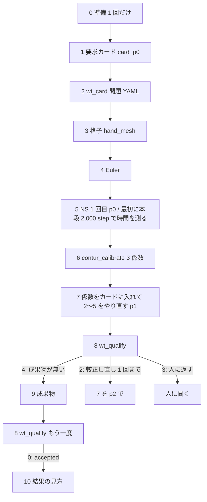

# 要求カードから成果物まで — 他の PC で回す手順書 (M5.5 燃焼ガス風洞ノズルの変形)

case/71 の M5.5 燃焼ガス風洞ノズル (`case/71.m55_combustion_wt`) の**入口条件と寸法を変えた**ノズルを、AWS を使わずにその PC の GPU で、
要求カードから成果物 (STEP・メッシュ・Fluent・Excel・報告) まで作る手順。コマンドはそのまま打てる形で書く。

- 読み手: この手順書のコマンドを打つ AI と、その AI に値を渡し判断する人。
- 流れの出所: plan [`tooling-nozzle-card-local-mesh`](../plans/active/tooling-nozzle-card-local-mesh.md) §4.3・§5.1 #6a〜#6c (2026-10-16 ユーザ決定)。
  NS の 1 回目の壁は CONTUR の積分の式のまま (係数なし)。その NS の δ_E で 3 係数を較正 (`contur_calibrate`) → 新しい壁で Euler → NS 2 回目 →
  判定 (`wt_qualify`) → 成果物 → 判定。較正し直しは規則どおり 1 回まで。
- 道具の詳しい説明は [`nozzle-design-workflow.md`](nozzle-design-workflow.md)・skill `nozzle-design` にある。この手順書はその中の 1 本の道筋だけを書く。

## この手順書の使い方 (コマンドを打つ AI へ)

1. コマンドの塊は、最初の行 `source ~/forge/qs_env.sh` から最後の行までをそのまま打つ。塊をまたいでシェルの変数は残らない前提で書いてある。
2. 各段の「成功の印」を確かめてから次の段へ進む。印と違ったら次へ進まず、その段の「止まったら人に見せるもの」を人に見せて指示を待つ。
3. 自分で直さない。設定・カードの「変えてはいけない欄」・コード・閾値を変えない。エラーを避けるための別の手 (オプションを足す、ファイルを手で直す、
   別の名前の run で回し直す) を試さない。
4. ソルバ (forge) は Python の道具が起動する。forge を直接起動しない。
5. 既にある `run_*`・ファイルを上書き・削除しない (道具は既にあると止まる)。消すのは手順書に `rm` が書いてあるものだけ。
6. git の commit・push・pull をしない (人に言われたときだけ)。
7. 数値を人に伝えるときは、読んだファイルの名前を添える。
8. Claude Code で使うとき、リポジトリのフック (`.claude/settings.json`) がターン終了を止めたら (例「収束チェックしていない run がある」)、その文面を人に見せる。

## 全体の流れ



| 段 | 内容 | GPU | 時間の目安 (実測) |
| --- | --- | --- | --- |
| 0 | 準備 (clone・ビルド・Python 環境・FreeCAD) | ビルドに nvcc | float のビルド 2 分 46 秒 (手元 RTX 3060・4 並列)、Python 環境 1 分 |
| 2 | `wt_card` (M_knot の自動を含む) | なし | 1〜5 分 (手元 12 コア; 長さ合わせの自動調整があると数分; §2 の表) |
| 3 | 格子 (`hand_mesh.py`) | なし (変換器は CPU で動く) | build 24 s・check 40 s (手元) |
| 4 | Euler (前の段 6,000 step + 本段 12,000 step) | 使う | 準備 20 s (手元)。計算は AWS g5.xlarge (A10G)・float で約 2 分 (試走 A)、FP64 で 227 s (case/71 run_0001_euler) |
| 5 | NS (前の段 6,000 step + 本段は停止規則まで、上限 200,000 step) | 使う | 準備 26 s (手元)。計算は AWS g5.xlarge・float で前の段を含め 10〜13 分 (試走 A: 本段 42,060・30,088 step で停止、15.3 ms/step; FP64 は case/71 run_0011_ns_v2 で約 23 分)。この PC の値は §5.1 で測る |
| 6・8 | `contur_calibrate`・`wt_qualify` | なし | 数秒 (試走: 0.5 s・2.6 s) |
| 9 | 成果物 (`deliverables`) | なし (FreeCAD) | 約 2 分 (AWS g5.xlarge の試走、付録) |

GPU の段 (4・5) の時間は GPU で大きく変わる (既定は float のビルド、§0.4)。§5.1 の試しの値で見積もり直し、人に伝える。

## 0. 準備 (1 回だけ)

### 0.1 必要なもの

- Linux (Ubuntu 22.04・24.04 か WSL2 の Ubuntu)、NVIDIA の GPU とドライバ (`nvidia-smi` が動く)、CUDA toolkit 12.x か 13.x (`nvcc`; 手元は 12.0、AWS の試走は 13.2)。
  CUDA 13.x は thrust・cub の置き場 (`include/cccl`) が変わっているが、§0.3 のビルドの台本が自分で足す (ログに `CUDA 13: add …/include/cccl` と出る)。
- 空きディスク 20 GB 以上 (Euler 1 本で全場 13 枚・約 1.3 GB、NS 1 本で約 1 GB、ビルド 2 本で約 1 GB、FreeCAD 約 2 GB)。
- apt のパッケージ (管理者の権限が要る。無ければ人に頼む):

```bash
sudo apt-get update
sudo apt-get install -y git curl cmake ninja-build gcc-12 g++-12 libyaml-cpp-dev libhdf5-dev libmetis-dev libboost-dev python3-venv
```

- ビルドの台本は `gcc-12` があればそれを、無ければシステムの `gcc` を使う。CUDA 12.x は gcc 13 以降を受けないので `gcc-12` が要る。
  CUDA 13.x ならシステムの gcc (Ubuntu 24.04 は 13.3) でよい (AWS の試走で確かめた)。

確認:

```bash
nvidia-smi --query-gpu=name,compute_cap,memory.total --format=csv,noheader
nvcc --version | tail -n 2
python3 --version
df -h ~ | tail -n 1
```

- **成功の印**: GPU の名前と compute capability (例 `8.6`) が出る。`nvcc` が `release 12.x`。Python は 3.12 (手元と同じ。違えば人に聞く)。
- **止まったら人に見せるもの**: 上の 4 つのコマンドの出力。

### 0.2 clone

```bash
cd ~
git clone -b feature/card-local-mesh https://github.com/forger-yuwa/forge.git forge
cd ~/forge
git submodule update --init --recursive
git config core.hooksPath solver_density_cuda/tools/git-hooks
git log --oneline -1
```

- ブランチは今 `feature/card-local-mesh`。main に入ったら (人が知らせる) `-b main` にする。置き場所は `~/forge` を前提に書いてある (違う場所なら人に聞く)。
- **成功の印**: `git log` が 1 行出る。`solver_density_cuda/third_party/HighFive/include/highfive/highfive.hpp` がある。

### 0.3 ビルド (float)

```bash
cd ~/forge
ARCH=$(nvidia-smi --query-gpu=compute_cap --format=csv,noheader | head -n 1 | tr -d .)
echo "CUDA arch: $ARCH"
FORGE_CUDA_ARCHITECTURES=$ARCH FORGE_BUILD_JOBS=4 solver_density_cuda/tools/build_native_wsl.sh > ~/forge/build_float.log 2>&1; echo "EXIT_CODE=$?"
tail -n 2 ~/forge/build_float.log
ls -la solver_density_cuda/.build-native/relwithdebinfo/forge solver_density_cuda/.build-native/relwithdebinfo/convertGmshToForge
```

- **成功の印**: `EXIT_CODE=0`、ログの最後に `[build_native_wsl] Built: …/forge`、`forge` と `convertGmshToForge` の 2 つのファイルがある。
- **止まったら人に見せるもの**: `tail -n 40 ~/forge/build_float.log`。メモリ不足で落ちたら `FORGE_BUILD_JOBS=2` にしてよいか人に聞く。

### 0.4 ビルド (FP64、任意)

**既定は float のビルド (§0.3)** (2026-10-16 ユーザ決定; case/71 の float と FP64 の比較は plan `tooling-nozzle-card-local-mesh` §6 V8)。
FP64 は、壁の局所の熱流を節点ごとに使う場面で確かめるときだけ作る (人に言われたとき)。この節は飛ばしてよい。

FP64 は `solver_density_cuda/flowFormat.hpp` の typedef 4 行を書き換えてビルドし直したもので、実行時のスイッチではない。
float と別のビルドの置き場 (`.build-native/fp64`) に最初から作る (差分ビルドを使い回さない)。書き換えたファイルはビルドの後に元に戻す。

```bash
cd ~/forge
sed -i -e 's/^typedef float flow_float;/typedef double flow_float;/' \
       -e 's/^typedef float geom_float;/typedef double geom_float;/' \
       -e 's/^typedef float3 flow_float3;/typedef double3 flow_float3;/' \
       -e 's/^typedef float3 geom_float3;/typedef double3 geom_float3;/' solver_density_cuda/flowFormat.hpp
grep -n '^typedef' solver_density_cuda/flowFormat.hpp
ARCH=$(nvidia-smi --query-gpu=compute_cap --format=csv,noheader | head -n 1 | tr -d .)
FORGE_NATIVE_BUILD_DIR=$HOME/forge/solver_density_cuda/.build-native/fp64 FORGE_CUDA_ARCHITECTURES=$ARCH FORGE_BUILD_JOBS=4 \
    solver_density_cuda/tools/build_native_wsl.sh > ~/forge/build_fp64.log 2>&1; echo "EXIT_CODE=$?"
git checkout -- solver_density_cuda/flowFormat.hpp
git status --short solver_density_cuda/flowFormat.hpp
ls -la solver_density_cuda/.build-native/fp64/forge solver_density_cuda/.build-native/fp64/convertGmshToForge
```

- **成功の印**: `grep` が `typedef double flow_float;`・`typedef double geom_float;`・`typedef double3 flow_float3;`・`typedef double3 geom_float3;` を含む行を出す
  (`typedef int` の 2 行も出る)。`EXIT_CODE=0`。`git status` が何も出さない (元に戻った)。`fp64/` に 2 つのファイルがある。
- FP64 のビルドを作り直すときは、この塊を最初の `sed` から打ち直す (`git checkout` の後に `fp64/` だけをビルドし直すと float に戻る)。

### 0.5 design の Python 環境 (`design/.venv-opt`)

版は手元の `design/.venv-opt` の `pip freeze` (2026-10-16) に合わせる。numpy・scipy の版で境界層の厚みの積分 (CONTUR) が 1e−6 r_t の桁で動くので、版を変えない。
numba・llvmlite は numpy を入れ替えないよう `--no-deps` で入れる。threadpoolctl が無いと M_knot の自動の並列の評価が遅くなる (§2)。

```bash
cd ~/forge
python3 -m venv design/.venv-opt
design/.venv-opt/bin/pip install numpy==2.5.2 scipy==1.18.0 h5py==3.16.0 PyYAML==6.0.3 matplotlib==3.11.1 threadpoolctl==3.6.0
design/.venv-opt/bin/pip install --no-deps numba==0.68.0 llvmlite==0.50.0
design/.venv-opt/bin/python -c "import numpy, scipy, h5py, yaml, matplotlib, numba, threadpoolctl; print('ok', numpy.__version__, scipy.__version__, numba.__version__)"
```

- **成功の印**: `ok 2.5.2 1.18.0 0.68.0`。

### 0.6 成果物の外部の Python (`.venv-mesh`・`.venv-pptx`)

成果物の道具は、リポジトリ直下の `.venv-mesh` (gmsh・meshio・h5py・numpy) と `.venv-pptx` (python-pptx・xlsxwriter) を探して使う。

```bash
cd ~/forge
python3 -m venv .venv-mesh
.venv-mesh/bin/pip install gmsh==4.15.2 meshio==5.3.5 h5py==3.16.0 numpy==2.5.0
python3 -m venv .venv-pptx
.venv-pptx/bin/pip install python-pptx==1.0.2 xlsxwriter==3.2.9
.venv-mesh/bin/python -c "import gmsh, meshio, h5py; gmsh.initialize(); print('gmsh', gmsh.__version__); gmsh.finalize()"
.venv-pptx/bin/python -c "import pptx, xlsxwriter; print('pptx ok', xlsxwriter.__version__)"
```

- **成功の印**: `gmsh 4.15.2` と `pptx ok 3.2.9`。
- `import gmsh` が `libGLU.so.1` などの共有ライブラリが無いと言って落ちたら、`sudo apt-get install -y libglu1-mesa libxcursor1 libxft2 libxinerama1` を人に頼む。

### 0.7 FreeCAD と日本語のフォント

STEP の書き出しは FreeCAD の `freecadcmd` を使う (手元は 1.1.1)。報告の図の日本語は `~/.fonts/NotoSansCJKjp-Regular.otf` を使う (無いと文字が四角になる)。

```bash
mkdir -p ~/opt && cd ~/opt
curl -L -O https://github.com/FreeCAD/FreeCAD/releases/download/1.1.1/FreeCAD_1.1.1-Linux-x86_64-py311.AppImage
chmod +x FreeCAD_1.1.1-Linux-x86_64-py311.AppImage
./FreeCAD_1.1.1-Linux-x86_64-py311.AppImage --appimage-extract > /dev/null
~/opt/squashfs-root/usr/bin/freecadcmd --version
mkdir -p ~/.fonts
curl -L -o ~/.fonts/NotoSansCJKjp-Regular.otf https://github.com/notofonts/noto-cjk/raw/main/Sans/OTF/Japanese/NotoSansCJKjp-Regular.otf
ls -la ~/.fonts/NotoSansCJKjp-Regular.otf
```

- **成功の印**: `FreeCAD 1.1.1 …` と出る。フォントは 16,467,736 バイト。
- `~/opt/squashfs-root` が既に別の AppImage のものなら、上書きせずに人に聞く。

### 0.8 共通の環境のファイル `~/forge/qs_env.sh`

以後のコマンドの塊は、最初にこのファイルを読む。`CASE` は §1.1 で、`T` は §7 で書き換える。

```bash
cat > ~/forge/qs_env.sh <<'EOF'
# procedures/design-chain-quickstart.md の共通の環境。コマンドの塊の最初に source する。
export FORGE=$HOME/forge
export CASE=$FORGE/case/NN.name                   # このノズルの case (§1.1 で書き換える)
export T=p0                                       # 壁の版 (§7 で書き換える): p0 = CONTUR の式のまま / p1 = 較正した壁 / p2 = 較正し直した壁
export PY=$FORGE/design/.venv-opt/bin/python
export FORGE_BUILD=$FORGE/solver_density_cuda/.build-native/relwithdebinfo   # float (既定)。FP64 で確かめるときだけ $FORGE/solver_density_cuda/.build-native/fp64 (§0.4)
export FORGE_BIN=$FORGE_BUILD/forge
export FORGE_CONVERTER=$FORGE_BUILD/convertGmshToForge
export FORGE_CUDA_BLOCKSIZE=128                   # 流束のカーネルのレジスタの上限 (procedures/development-environment.md)。float・FP64 とも要る
export FREECADCMD=$HOME/opt/squashfs-root/usr/bin/freecadcmd
export PYTHONDONTWRITEBYTECODE=1
unset FORGE_TRANSPORT_TABLE FORGE_DIAG_FACE_H_DOUBLE
export HAND_MESH=$FORGE/case/71.m55_combustion_wt/_mesh/hand_mesh.py
# 壁の版ごとの run の名前・前の run・係数の断片 (変えない)
case $T in
  p0) export EU=run_0001_euler_p0 NS=run_0003_ns_p0 PREV= ITER=1 RECAL=0 COEF= ;;
  p1) export EU=run_0004_euler_p1 NS=run_0005_ns_p1 PREV=run_0003_ns_p0 ITER=2 RECAL=0 COEF=$CASE/run_0003_ns_p0/contur_calibrate/contur_overrides.yaml ;;
  p2) export EU=run_0006_euler_p2 NS=run_0007_ns_p2 PREV=run_0005_ns_p1 ITER=3 RECAL=1 COEF=$CASE/run_0005_ns_p1/wt_qualify/contur_overrides.yaml ;;
  *) echo "qs_env.sh: T=$T は p0・p1・p2 のどれか"; return 1 ;;
esac
cd $FORGE/design
EOF
source ~/forge/qs_env.sh && $PY -c "import forge_design.intake.wt_card, forge_design.feedback.deltastar_loop, forge_design.feedback.contur_calibrate, forge_design.feedback.wt_qualify, forge_design.export.deliverables; print('import ok')"
ls -la $FORGE_BIN $FORGE_CONVERTER $FREECADCMD
```

- **成功の印**: `import ok` と 3 つのファイルが出る。
- FP64 で確かめるとき (§0.4、人に言われたときだけ) は、`FORGE_BUILD` の行を `export FORGE_BUILD=$FORGE/solver_density_cuda/.build-native/fp64` にする。

## 1. 要求カード

### 1.1 case を作る

case の番号と名前は**人に決めてもらう** (他の PC・ブランチで使っている番号と重ねないため。例 `72.m55_variant`)。決まったら `NN.name` を置き換えて打つ。

```bash
sed -i 's|^export CASE=.*|export CASE=$FORGE/case/NN.name|' ~/forge/qs_env.sh
source ~/forge/qs_env.sh
mkdir -p $CASE/_log && echo "$CASE"
```

case の `README.md` に run の一覧を置く (AGENTS.md「case の run 索引」)。run を起動したら「状態」を `active`、終わったら結果と `ref` (次の段の入力) か `破棄予定` に書き換える。

```bash
source ~/forge/qs_env.sh
cat > $CASE/README.md <<'EOF'
# <case の名前> — case/71 (M5.5 燃焼ガス風洞ノズル) の入口条件と寸法を変えたノズル

手順: procedures/design-chain-quickstart.md。要求は card_p0.yaml (係数を入れたカードは card_p1.yaml・card_p2.yaml)。

## 計算 run 一覧

| run | 目的・主要設定差分 | 主要結果・成果物 | 状態 |
| --- | --- | --- | --- |
| `run_0001_euler_p0` | Euler (壁 p0 = CONTUR の式のまま、problem_p0_euler.yaml) | | 予定 |
| `run_0002_ns_timing` | NS の時間の試し (壁 p0、本段 2,000 step、停止規則なし) | | 予定 (終わったら破棄予定) |
| `run_0003_ns_p0` | NS 1 回目 (壁 p0、停止規則 v2) | | 予定 |
| `run_0004_euler_p1` | Euler (壁 p1 = run_0003 で較正した 3 係数) | | 予定 |
| `run_0005_ns_p1` | NS 2 回目 (壁 p1、初期場 run_0003) | | 予定 |
EOF
```

### 1.2 カードを書く

case/71 の `card_m55_3coef.yaml` から 3 係数を抜き、コメントを整理したもの。人から受け取った値を `# ←` の欄に入れる。

```bash
source ~/forge/qs_env.sh
cat > $CASE/card_p0.yaml <<'EOF'
# 要求カード (forge.wt_card/v1)。case/71 の M5.5 燃焼ガスの風洞ノズル (card_m55_3coef.yaml) の写しで、入口条件と寸法を変えたもの。
# 手順: procedures/design-chain-quickstart.md §1。長さ・径は実寸 [m]、圧力 [Pa]、温度 [K]。
format: forge.wt_card/v1
name: m55_variant                                                    # ← 名前
gas: {species: {CO2: 0.1677, H2O: 0.0858, O2: 0.0220, N2: 0.7245}}   # ← 組成 (質量分率、和 1)
conditions: {Pt: 3.5e6, Tt: 1250.0}                                  # ← 全圧 [Pa]・全温 [K]
M_exit: 5.5
throat: {diameter_physical_m: 0.200, curvature_radius_m: 0.500}     # ← 物理スロート径 [m]・スロートの曲率半径 [m]
inlet: {radius_m: 0.300, pipe_length_m: 0.50, contraction_length_m: 0.50}   # ← 入口の配管の半径・直管の長さ・縮流部の長さ [m]
divergent_length_m: 8.0                                              # ← 設計スロート (x = 0) → 物理出口の長さ [m]
wall: {thermal: isothermal, Tw: 350.0}                               # ← 壁温 [K] (一様)
p_ambient: design
tolerances: {length_m: 1.0e-3, diameter_m: 2.0e-5}                   # ← 寸法の公差 [m] (聞いて無ければこのまま)
recipe: axismach_final_v1
overrides:
  mesh.ni: 3000                          # 問題 YAML を作るためだけ (格子は §3 の hand_mesh.py が作り直す)。変えない
  deltastar_initializer.model: contur    # 1 回目は CONTUR の積分の式のまま (係数なし)。係数は §7 で足す
EOF
```

| 欄 | 変えてよいか | 注意 |
| --- | --- | --- |
| `name` | よい | 英数字と `_` |
| `gas.species` | よい | 内蔵の種の名前だけ (知らない種は `wt_card` が止まる)。和は 1 |
| `conditions.Pt`・`Tt` | よい | 絶対圧 [Pa]・[K] |
| `throat.diameter_physical_m` | よい | **物理**スロート径 (境界層込みの実際の穴)。設計 (非粘性) の径を言われたら人に確認 |
| `throat.curvature_radius_m` | よい | 曲率半径 / r_t が 0.5 未満だと止まる |
| `inlet.radius_m`・`pipe_length_m`・`contraction_length_m` | よい | 縮流部が長すぎると μ > 20 で止まる |
| `divergent_length_m` | よい | 設計スロート → 物理出口。出口の後ろの直管ではない |
| `wall.Tw` | よい | 一様の等温壁だけ。壁温の分布・断熱は `hand_mesh.py` が受けない (人に聞く) |
| `tolerances` | よい | 人の値。寸法の出荷の関門に使う |
| `M_exit` | 変えない | 5.5 以外を言われたらこの手順書の範囲の外 (人に聞く) |
| 出口径 | 書く欄が無い | 出口径は M_exit とスロート径で決まる。出口径を指定されたら人に聞く |
| `format`・`p_ambient`・`recipe` | 変えない | |
| `overrides.mesh.ni: 3000` | 変えない | 問題 YAML を作るためだけの値 |
| `overrides.deltastar_initializer.*` | 1 回目は `model: contur` だけ | 3 係数は §7 で道具の出力を写す (手で書かない) |

### 1.3 カードを確かめる

case/71 のカードと比べ、変えてよい欄以外が変わっていないことを確かめる。

```bash
source ~/forge/qs_env.sh
$PY - $FORGE/case/71.m55_combustion_wt/card_m55_3coef.yaml $CASE/card_$T.yaml <<'PYC'
import sys, yaml
from forge_design.intake.wt_card import load_card
def flat(d):
    out = {}
    for k, v in d.items():
        if k == "overrides":
            out.update({("overrides", kk): vv for kk, vv in (v or {}).items()})
        elif isinstance(v, dict):
            out.update({(k,) + kk: vv for kk, vv in flat(v).items()})
        else:
            out[(k,)] = v
    return out
a, b = (flat(yaml.safe_load(open(f))) for f in sys.argv[1:3])
FREE = {"name", "conditions.Pt", "conditions.Tt", "throat.diameter_physical_m", "throat.curvature_radius_m", "inlet.radius_m",
        "inlet.pipe_length_m", "inlet.contraction_length_m", "divergent_length_m", "wall.Tw", "tolerances.length_m", "tolerances.diameter_m"}
COEF = {"overrides.deltastar_initializer." + k for k in ("delta_scale", "delta_scale_slope_per_m", "delta_offset_m")}
changed, bad = [], []
for k in sorted(set(a) | set(b)):
    key, va, vb = ".".join(k), a.get(k, "<無し>"), b.get(k, "<無し>")
    if va == vb:
        continue
    (changed if (key in FREE or key in COEF or key.startswith("gas.species.")) else bad).append(f"  {key}: {va} → {vb}")
load_card(sys.argv[2])                  # 書式の検査 (不正なら例外で止まる)
print("case/71 から変えた欄:\n" + "\n".join(changed))
print("変えてはいけない欄の変更:", "なし" if not bad else "\n" + "\n".join(bad))
sys.exit(1 if bad else 0)
PYC
echo "EXIT_CODE=$?"
```

- **成功の印**: `変えてはいけない欄の変更: なし` と `EXIT_CODE=0`。1 回目は 3 係数が「→ <無し>」と出る (case/71 のカードにはあり、p0 には無い)。
- **人に見せる (止まらなくても)**: 「case/71 から変えた欄」の一覧を人に見せ、この値で進めてよいかを確かめてから §2 へ。

## 2. 要求カード → 問題 YAML (`wt_card`)

物理スロート径から r_t を解き、長さを r_t で割り直し、M_knot を自動で選ぶ。forge は起動しない。時間が掛かるので裏で回す。

```bash
source ~/forge/qs_env.sh
nohup bash -c '(time $PY -m forge_design.intake.wt_card $CASE/card_$T.yaml --out $CASE/problem_${T}_card.yaml); echo "EXIT_CODE=$?"' \
    > $CASE/_log/wt_card_$T.log 2>&1 &
```

終わったかの確認 (数分おきに打つ。`EXIT_CODE=` が出たら終わり):

```bash
source ~/forge/qs_env.sh
grep -E '^EXIT_CODE|^real|^寸法|^→|M_knot: 自動|M_knot の所要|^[A-Za-z_.]+Error: ' $CASE/_log/wt_card_$T.log || tail -n 2 $CASE/_log/wt_card_$T.log | cut -c1-200
```

- **成功の印**: `EXIT_CODE=0`、`M_knot: 自動 … → geometry.M_knot X`、`寸法 (設計壁から): PASS`、`→ …/problem_p0_card.yaml` と `→ …/problem_p0_card_euler.yaml`。
- 次の警告は出てよい (§3 の格子で置き換える): 「実際の格子 (ni 3000) の AR の最大 … が ar_max 5000 を超える」、
  「wall_first_frac_throat … < 1e-06 — float32 の座標では …」、「雛形のブレンド … に決め直した」。
- **長さ合わせ**: 出口の位置を決める特性線を、x_E を挟む 2 本の補間で取る (plan `tooling-nozzle-card-local-mesh` §4.5、2026-10-16)。
  長さ合わせ (`from_length`) は網 2400・カードの公差のまま収束する。網を細かくしたり許容差を緩めたりする自動の調整は無い。
- **止まったら人に見せるもの**: 上の確認の出力 (例外の行を含む) と `tail -n 40 $CASE/_log/wt_card_$T.log` (M_knot の掃引の表)。特に次は人の判断が要る:
  - `ValueError: from_length の固定点反復が改善しなくなって止まった … 網の倍化・許容差の緩和はしない` (長さ合わせの未収束。想定外なので、
    カードの値を変えずに人に見せる)。
  - `寸法 (設計壁から): FAIL` (`EXIT_CODE=2`)。カードの公差を変えるか、そのまま進めるかは人が決める。
  - `MknotSelectionError: M_knot を選べない …` (制約による不成立: 成立点が無い・候補が無い・谷の中心が制約で落ちる)。
  - `μ = … > 20`、`R < 0.5` などのカードの値の不整合。
  - `MemoryError`・`Killed` (メモリ不足)。環境変数 `FORGE_MKNOT_WORKERS=1` で M_knot の評価の並列を 1 にできる (遅くなる)。付けて打ち直してよいかを人に聞く。

| カード (2026-10-16、手元 12 コア・メモリ 12 GB、終端の特性線の補間の後) | 結果 | 時間 |
| --- | --- | --- |
| case/71 の `card_m55.yaml` (変えない) | M_knot 2.80、調整なし、寸法 PASS (拡大部の長さ +0.00012 mm) | 59 s |
| 試走 A: case/71 から全圧 −10 %・全温 −5 %・物理スロート径 +5 %・拡大部の長さ −5 % | M_knot 2.65、調整なし、寸法 PASS (−0.00012 mm) | 57 s |
| 試走 B: A の拡大部の長さを 8.0 m に戻す | M_knot 2.70、調整なし、寸法 PASS (−0.00015 mm) | 57 s |
| 試走 C: 全圧 −10 %・全温 −5 % だけ (寸法は case/71 のまま) | M_knot 2.85、調整なし、寸法 PASS (−0.00005 mm) | 58 s |
| (補間の前、#6d の自動調整あり) 試走 A・B・C | 網 4800 への切り替え・許容差の緩和が起き、B は寸法 FAIL (−1.366 mm) | 2 分 37 秒〜4 分 47 秒 |
| threadpoolctl の無い環境で A | 粗い掃引 (86 点) が 3 分で終わらず止めた (入れた後は 14 s) | — |

AWS g5.xlarge (4 コア) での試走 A は、補間の前のコードで 5 分 43 秒 (網 4800 に切り替わった)。記録は plan `tooling-nozzle-card-local-mesh` §6 V9。

## 3. 格子 (`hand_mesh.py`)

`case/71.m55_combustion_wt/_mesh/hand_mesh.py` は case/71 のために書いた台本で、`wt_card` が作った問題 YAML の格子 (`mesh`・`mesh_euler`) を、
場所ごとの第一層の表・流れ方向の密度の表・壁に直交する近壁層の格子に置き換える (plan `tooling-nozzle-card-local-mesh` §5.1 #3a・#3b)。
第一層の係数 (配管 1.0・縮流部 0.6・スロート付近 0.5・拡大部 0.49) は M6 の生産の格子との比から決めた経験の値で、寸法が近いノズルにそのまま使う。
`build` が問題 YAML を書き、`check` が格子を作って変換し、forge を起動せずに品質を確かめる。

```bash
source ~/forge/qs_env.sh
mkdir -p $CASE/_mesh_$T
$PY $HAND_MESH build --design $FORGE/design --card $CASE/card_$T.yaml --problem $CASE/problem_${T}_card.yaml \
    --out-yaml $CASE/problem_$T.yaml --record $CASE/_mesh_$T/build_record.json --plan-item "§5.1 #6c" --axis-cap-frac 0.03 \
    > $CASE/_log/hand_mesh_build_$T.log 2>&1; echo "EXIT_CODE=$?"
tail -n 3 $CASE/_log/hand_mesh_build_$T.log | cut -c1-300
ls -la $CASE/problem_$T.yaml $CASE/problem_${T}_euler.yaml
```

```bash
source ~/forge/qs_env.sh
rm -rf $CASE/_mesh_$T/check
$PY $HAND_MESH check --design $FORGE/design --card $CASE/card_$T.yaml --problem $CASE/problem_$T.yaml \
    --record $CASE/_mesh_$T/check_record.json --run-dir $CASE/_mesh_$T/check > $CASE/_log/hand_mesh_check_$T.log 2>&1; echo "EXIT_CODE=$?"
grep -E 'VERDICT|違反|節点|超える断面|y1\+ の最大' $CASE/_log/hand_mesh_check_$T.log | cut -c1-300
```

- **成功の印**: 2 つとも `EXIT_CODE=0`。`check` の出力に `VERDICT: PASS` が 2 回 (NS・Euler)、`AR 緩和 違反 0`、`超える断面 0`。
  `problem_p0.yaml` (NS 用) と `problem_p0_euler.yaml` (Euler 用) がある。`出口面 非平面 (出口の x の広がり …)` は出てよい (case/71 も 0.62 mm で記録だけ)。
- **人に知らせる (止まらなくても)**: NS と Euler の節点数 (`check` の出力の `NS: 節点 …`・`Euler: 節点 …`)。case/71 は NS 442,520 点・Euler 466,570 点。
  NS が 600,000 点を超えたら、次へ進まずに人に聞く (計算時間が延びる)。
- **止まったら人に見せるもの**: `tail -n 40` の 2 つのログ。品質の関門 (`VERDICT: FAIL`・`違反` が 0 でない・`RuntimeError`) で止まったら、
  係数や格子の作り方を変えずに人に聞く (この台本は case/71 用で、外れた寸法では関門に掛かりうる)。

## 4. Euler (`runner_axismach`)

Euler (非粘性) の場は、NS の境界層の厚み δ_E を測る基準になる。前の段 6,000 step と本段 12,000 step で止まる (停止規則は無い)。

### 4.1 準備だけ確かめる (任意、forge を起動しない)

GPU の無い PC で手順を確かめるときや、GPU を使う前に格子の作り方を確かめたいときに使う。本番 (§4.2) も同じ準備をするので、飛ばしてよい。

```bash
source ~/forge/qs_env.sh
$PY -m forge_design.evaluate.runner_axismach $CASE/problem_${T}_euler.yaml $CASE/_dry/euler_$T --prepare-only \
    > $CASE/_log/euler_prepare_$T.log 2>&1; echo "EXIT_CODE=$?"
tail -n 1 $CASE/_dry/euler_$T/MESH_QUALITY.txt
rm -rf $CASE/_dry/euler_$T
```

- **成功の印**: `EXIT_CODE=0` と `VERDICT: PASS`。

### 4.2 本番

```bash
source ~/forge/qs_env.sh
nohup bash -c '$PY -m forge_design.evaluate.runner_axismach $CASE/problem_${T}_euler.yaml $CASE/$EU; echo "EXIT_CODE=$?"' \
    > $CASE/_log/euler_$T.log 2>&1 &
```

進み具合 (数分おき):

```bash
source ~/forge/qs_env.sh
grep '^EXIT_CODE' $CASE/_log/euler_$T.log || tail -n 1 $CASE/$EU/forge_run.log | cut -c1-200
```

`forge_run.log` の行は `step N | X ms/step elapsed … eta …`。前の段 (soft 3,000・mid 3,000) と本段 (12,000) で別に数え直す。

終わったら:

```bash
source ~/forge/qs_env.sh
grep -E '^forge exit|^EXIT_CODE' $CASE/_log/euler_$T.log
tail -n 1 $CASE/$EU/MESH_QUALITY.txt
$PY - $CASE/$EU <<'PYC'
import json, sys
from pathlib import Path
import h5py, numpy as np
R = Path(sys.argv[1])
with h5py.File(R / "res_12000.h5", "r") as h:
    bad = {k: int((~np.isfinite(np.asarray(h["VALUE/" + k][:], float))).sum()) for k in h["VALUE"]}
print("非有限の数 (res_12000.h5):", {k: v for k, v in bad.items() if v} or 0)
m = json.loads((R / "metrics.json").read_text())
print({k: m.get(k) for k in ("res_file", "M_axis_exit", "dM_max_rel_Md", "overshoot_rel")})
PYC
sha256sum $CASE/$EU/res_12000.h5
```

- **成功の印**: `forge exit=0`・`EXIT_CODE=0`、`VERDICT: PASS`、非有限の数 0、`M_axis_exit` が M_exit に近い
  (case/71 は 5.50021、`dM_max_rel_Md` 0.00057)。`res_12000.h5` が NS の Euler の参照になる (§5 が sha256 を自動で取る)。
- `CONVERGENCE_VERDICT.txt` の `NOT CONVERGED (stalled/plateau)` は出てよい (case/71 の Euler も残差は 1.5〜2.5 桁で横ばい。M6 の Euler と同じ型)。
- **止まったら人に見せるもの**: `tail -n 40 $CASE/_log/euler_$T.log`、`tail -n 5 $CASE/$EU/forge_run.log`、上の Python の出力。
  `too many resources requested for launch` が出たら `FORGE_CUDA_BLOCKSIZE` が 128 になっているかを確かめて人に聞く。
  `M_axis_exit` が M_exit から 0.05 % 以上ずれる・`dM_max_rel_Md` が 0.005 を超えるときも、次へ進まずに人に見せる。

## 5. NS (`deltastar_loop --init-integral`、停止規則 v2)

壁は `deltastar_initializer` (p0 は CONTUR の式のまま) で作る。前の段 (soft 3,000・mid 3,000 step) の後、本段は B0 (ライン陰解法) で回り、
停止規則 v2 (流量の収支と目的の量が落ち着いたか) を満たしたところで止まり、その場から δ_E を 1 回抽出する。上限は本段 200,000 step。
判定の基準は雛形の既定 (`evaluate.settle` のプリセット; 残差を外した `wt_nozzle_v3` に替わる予定) で、**残差は監視しない、発散の見張りだけ**。

### 5.1 最初に本段 2,000 step で時間を測る (p0 のときだけ)

1 次元の初期場から始めるので、前の段 6,000 step を省けない。前の段 + 本段 2,000 step を停止規則なしで回し、本段の 1 step の時間を測る。
本段の step 数は NS の出力の間隔 (`evaluate.ns_output.outStepInterval` 2,000) の倍数でないと準備が止まるので、1,000 ではなく 2,000 にする。

```bash
source ~/forge/qs_env.sh
nohup bash -c 'EUSHA=$(sha256sum $CASE/$EU/res_12000.h5 | cut -d" " -f1); FORGE_NO_DESIGN_REPORT=1 $PY -m forge_design.feedback.deltastar_loop \
    --problem $CASE/problem_$T.yaml --euler-ref $CASE/$EU --euler-ref-res res_12000.h5 --euler-ref-sha256 $EUSHA \
    --init-integral --no-stop-rule --steps 2000 --run-dir $CASE/run_0002_ns_timing; echo "EXIT_CODE=$?"' > $CASE/_log/ns_timing.log 2>&1 &
```

終わったら (`EXIT_CODE=` が出たら):

```bash
source ~/forge/qs_env.sh
grep -E '^EXIT_CODE|NS wall time' $CASE/_log/ns_timing.log
grep '^Time =' $CASE/run_0002_ns_timing/forge_run.log
$PY - $CASE <<'PYC'
import re, sys
c = sys.argv[1]
ms = float(re.findall(r"Time = [\d.]+ s \(wall, \d+ steps, ([\d.]+) ms/step\)", open(f"{c}/run_0002_ns_timing/forge_run.log").read())[-1])
wall = float(re.findall(r"NS wall time (\d+) s", open(f"{c}/_log/ns_timing.log").read())[-1])
print(f"本段 1 step {ms:.1f} ms、前の段 + 本段 2,000 step で {wall / 60:.1f} 分")
for n in (50_000, 200_000):
    print(f"NS 1 本の見込み (本段 {n:,} step で止まったとき): {(wall + (n - 2000) * ms / 1000) / 3600:.1f} 時間")
PYC
```

- **成功の印**: `EXIT_CODE=0` か `EXIT_CODE=3` (停止規則を使わないので受け渡しの関門が「止める」を返すのが正常)、`Time = … ms/step` の行がある。
- **人に知らせる**: 本段の ms/step と見込み。case/71 は本段 46,202 step で止まった (上限 200,000)。p0・p1 (・p2) の NS が 2〜3 本と Euler が 2〜3 本要る。
  見込みが長すぎると人が判断したら、この先の進め方を人が決める。
- **止まったら人に見せるもの**: `tail -n 40 $CASE/_log/ns_timing.log`、`tail -n 5 $CASE/run_0002_ns_timing/forge_run.log`。
- この run は時間を測るだけ。README の状態は「破棄予定」。消すのは人に言われたとき。

### 5.2 本番を裏で起動する

```bash
source ~/forge/qs_env.sh
nohup bash -c 'EUSHA=$(sha256sum $CASE/$EU/res_12000.h5 | cut -d" " -f1); $PY -m forge_design.feedback.deltastar_loop \
    --problem $CASE/problem_$T.yaml --euler-ref $CASE/$EU --euler-ref-res res_12000.h5 --euler-ref-sha256 $EUSHA \
    --init-integral ${PREV:+--ic-from $CASE/$PREV} --run-dir $CASE/$NS; echo "EXIT_CODE=$?"' > $CASE/_log/ns_$T.log 2>&1 &
```

- p0 は 1 次元の等エントロピーの初期場から始める (`PREV` が空なので `--ic-from` が付かない)。p1・p2 は前の NS の最後の場から補間して始める
  (Euler の場からは始められない: 化学種の記録が違い、補間が拒否する)。

### 5.3 途中の確認 (30 分〜1 時間おき)

```bash
source ~/forge/qs_env.sh
grep '^EXIT_CODE' $CASE/_log/ns_$T.log || echo "実行中"
test -e $CASE/$NS/MAIN_STAGE_STARTED && echo "本段に入った" || echo "前の段"
tail -n 1 $CASE/$NS/forge_run.log | cut -c1-200
grep -ciE '\bnan\b|\binf\b' $CASE/$NS/forge_run.log
```

- 起動の直後 (1〜2 分、格子の変換と準備の間) は `forge_run.log` がまだ無く、`tail`・`grep` が `No such file or directory` を出す。これは止まった印ではない。
  数分後に打ち直す。5 分たっても無ければ `tail -n 40 $CASE/_log/ns_$T.log` を人に見せる。
- 最後の数が 0 でない (残差に nan・inf が出た) なら人に見せる。`DIVERGED` の行がログに出たときも同じ。
- 本段の `eta` は上限 200,000 step までの時間で、停止規則で止まればそれより早く終わる。

### 5.4 終わったら

```bash
source ~/forge/qs_env.sh
grep -E '^EXIT_CODE|^forge rc|^handoff gate|^\[stop_rule v2\]' $CASE/_log/ns_$T.log | cut -c1-300
$PY - $CASE/$NS <<'PYC'
import json, sys
from pathlib import Path
import h5py, numpy as np
R = Path(sys.argv[1])
st = json.loads((R / "STOP_RULE_STATE.json").read_text())
print("停止規則:", st.get("method"), st.get("status"), "停止の step", st.get("stop_step"), "δ_E の抽出", (st.get("delta_E") or {}).get("status"))
g = json.loads((R / "HANDOFF_GATE.json").read_text())
print("受け渡しの関門:", "進む" if g.get("proceed") else "止める", g.get("blocked_by") or "")
print("delta_r_next.csv:", (R / "delta_r_next.csv").exists())
cv = (R / "CONVERGENCE_VERDICT.txt").read_text().splitlines()
print("収束の判定:", cv[0], "/", ([l for l in cv if l.startswith("VERDICT")] or ["VERDICT の行が無い"])[-1])
f = R / f"res_{st.get('stop_step')}.h5"
with h5py.File(f, "r") as h:
    bad = {k: int((~np.isfinite(np.asarray(h["VALUE/" + k][:], float))).sum()) for k in h["VALUE"]}
print(f"非有限の数 ({f.name}):", {k: v for k, v in bad.items() if v} or 0)
print("報告:", len(list((R / "report").glob("fig_*.png"))), "枚の図", sorted(p.name for p in (R / "report").glob("*.pptx")))
PYC
```

- **成功の印**: `EXIT_CODE=0`、停止規則 `v2 REACHED`・δ_E の抽出 `ok`、受け渡しの関門「進む」、`delta_r_next.csv: True`、
  収束の判定 `TOOL: check_settled.py …` / `VERDICT: SETTLED …`、非有限の数 0、報告の図が 9 枚と pptx が 1 つ (pptx は `.venv-pptx` があるとき)。
  case/71 run_0014_chain_v2 (AWS g5.xlarge・FP64) はこの形で、本段 46,171 step・24.8 ms/step で止まった。
- **止まったら人に見せるもの**: `EXIT_CODE=3` (関門で止めた) や停止規則が `CENSORED` (上限まで止まらなかった)・`FAILED` のとき、上の出力と
  `tail -n 60 $CASE/_log/ns_$T.log`。上書きのオプション (`--allow-*`) は人の指示が無ければ使わない。

## 6. 3 係数の較正 (`contur_calibrate`、p0 の NS の後)

p0 の NS の δ_E (停止規則が止めた場から抽出した値) に、CONTUR の式の境界層の厚みを δ = (c₀ + c₁·x_m)·δ_C + δ₀ の 3 係数で合わせる
(スロートと出口で等式、c₁ は x ≥ 0 の Δx 重みの最小二乗; plan §4.3)。

```bash
source ~/forge/qs_env.sh
$PY -m forge_design.feedback.contur_calibrate $CASE/$NS > $CASE/_log/contur_calibrate_$T.log 2>&1; echo "EXIT_CODE=$?"
cat $CASE/_log/contur_calibrate_$T.log
cat $CASE/$NS/contur_calibrate/contur_overrides.yaml
```

- **成功の印**: `EXIT_CODE=0`、`今の係数 … (pass 0)` と `新しい係数: c₀ … c₁ … δ₀ …`、`contur_overrides.yaml` に 4 行
  (`deltastar_initializer.model: contur` と 3 係数)。
- **人に知らせる**: 新しい係数と、今の壁と較正後の射影の誤差の要約 (ログの「誤差」の行)。
  参考: case/71 の 3 係数は c₀ 0.678・c₁ 0.0210 /m・δ₀ −0.306 mm (2 係数の壁の NS から)、2 係数は c 0.852・δ₀ −0.322 mm (CONTUR の式のままの NS から)。
  c₀ が 0.3〜1.5 の外、|δ₀| が 2 mm を超えるなら、次へ進まずに人に見せる。
- **止まったら人に見せるもの**: `cat $CASE/_log/contur_calibrate_$T.log`。

## 7. 係数をカードに入れて §2〜§5 をやり直す (p1)

### 7.1 壁の版を進める

`qs_env.sh` の `T` を書き換える (p0 → p1。§8 で較正し直しになったときは p1 → p2)。

```bash
sed -i 's|^export T=p0 |export T=p1 |' ~/forge/qs_env.sh
source ~/forge/qs_env.sh && echo "T=$T EU=$EU NS=$NS PREV=$PREV COEF=$COEF" && ls -la $COEF
```

(p2 のときは `sed -i 's|^export T=p1 |export T=p2 |' ~/forge/qs_env.sh`。)

- **成功の印**: `T=p1 EU=run_0004_euler_p1 NS=run_0005_ns_p1 PREV=run_0003_ns_p0` と、`COEF` のファイルがある。

### 7.2 係数を入れたカード `card_p1.yaml`

`card_p0.yaml` の `deltastar_initializer.*` の行を、道具が書いた断片 (`COEF`) の 4 行に置き換える。値は手で写さない。
断片の数は PyYAML が数として読む書き方 (`-5.0e-05` など; `contur_calibrate.yaml_float`、plan §5.1 #6d) で書かれている。下の台本は行をそのまま写し、
読み直して断片と同じ値・数であることを確かめる。

```bash
source ~/forge/qs_env.sh
$PY - $CASE/card_p0.yaml $COEF $CASE/card_$T.yaml <<'PYC'
import sys, yaml
src, frag, out = sys.argv[1:4]
KEYS = ("deltastar_initializer.delta_scale", "deltastar_initializer.delta_scale_slope_per_m", "deltastar_initializer.delta_offset_m")
lines = [l for l in open(src).read().splitlines() if not l.strip().startswith("deltastar_initializer.")]
if not lines[-1].strip().startswith("mesh.ni: 3000"):
    sys.exit("card_p0.yaml の最後が overrides の mesh.ni の行でない (§1.2 の雛形どおりでない) — 人に見せる")
add = [l for l in open(frag).read().splitlines() if l.startswith("  deltastar_initializer.")]
ov = yaml.safe_load(open(frag))["overrides"]
if len(add) != 4 or sorted(ov) != sorted(("deltastar_initializer.model",) + KEYS) or ov["deltastar_initializer.model"] != "contur":
    sys.exit(f"{frag} の行・キーが想定と違う ({sorted(ov)}) — 人に見せる")
open(out, "w").write("\n".join(lines + [f"  # 3 係数: {frag} をそのまま写した (procedures/design-chain-quickstart.md §7.2)"] + add) + "\n")
back = yaml.safe_load(open(out))["overrides"]
bad = [k for k in KEYS if not isinstance(back[k], float) or back[k] != ov[k]]
print({k: back[k] for k in KEYS})
sys.exit(f"読み直した値が数でない・断片と違う: {bad} — 人に見せる" if bad else 0)
PYC
echo "EXIT_CODE=$?"
```

- **成功の印**: 3 係数が数で出て `EXIT_CODE=0`。
- 続けて §1.3 の確かめ (`card_$T.yaml` = `card_p1.yaml` が対象になる) を打つ。3 係数が「case/71 の値 → 新しい値」と出て、変えてはいけない欄の変更が無いこと。

### 7.3 §2〜§5 をもう一度

§2 (`wt_card`) → §3 (格子) → §4.2 (Euler) → §5.2〜§5.4 (NS) を、書いてあるコマンドのまま打つ (`T=p1` なので名前が自動で p1 になる)。
§5.1 (時間の試し) と §6 はやらない。r_t は係数で変わる (スロートの δ が変わる) ので、格子と Euler も作り直す。M_knot の自動ももう一度回る。
NS は `--ic-from` に p0 の NS が自動で付き、リミッタの基準値も p0 の NS から引き継ぐ。

README の run の一覧に p1 の 2 行の状態を書き足す。p2 に進んだら `run_0006_euler_p2`・`run_0007_ns_p2` の行を足す。

## 8. 設計の判定 (`wt_qualify`、p1・p2 の NS の後)

出口コア M (V5b、許容 ±0.05 %)・近軸の線 r/r_w = 0.03 の一様性 (V5c、最大偏差 ≤ 0.1 %・片振幅 ≤ 0.05 %)・壁解像・計算の成立 (停止規則)・
寸法の関門・成果物を 1 本の NS で判定し、次の手を返す。

```bash
source ~/forge/qs_env.sh
$PY -m forge_design.feedback.wt_qualify $CASE/$NS --card $CASE/card_$T.yaml --problem $CASE/problem_$T.yaml --prev-run $CASE/$PREV \
    --iteration $ITER --max-iterations 3 --recalibrations-done $RECAL > $CASE/_log/wt_qualify_$T.log 2>&1; echo "EXIT_CODE=$?"
cat $CASE/_log/wt_qualify_$T.log
```

| 終了コード | 判定 (`判定: … 次の手: …`) | 次にやること |
| --- | --- | --- |
| 4 | `incomplete`・`make_deliverables` (流れの判定は合格、成果物だけが無い) | §9 の成果物 → §9 の最後の `wt_qualify` |
| 4 | `incomplete`・`escalate` (判定に要るものが欠けた) | 人に聞く |
| 2 | `back_to_correction`・`recalibrate` (較正し直しの規則に当たる) | §7 を p2 で (`COEF` は `$NS/wt_qualify/contur_overrides.yaml`)。1 回まで |
| 3 | `back_to_correction`・`rejected` → `escalate` (公差に届かず、規則で決まらない) | 人に聞く。人が「成果物を作る」と言えば §9 |
| 0 | `accepted` | 成果物があるときだけ出る。§10 |
| 1 | 入力の不備 | 人に聞く |

- **人に見せるもの (どの終了コードでも)**: `cat $CASE/_log/wt_qualify_$T.log` の全部 (V5b・V5c の値と許容、壁解像、較正し直しの規則の (a)〜(e))。
- 較正し直しの規則の (c) の閾値 (`--recal-min-reduction`、既定 0.5) は plan に数値の無い暫定の値。変えるのは人。
- case/71 は 3 係数の壁で V5b (出口コア M 5.50284、+0.052 %)・V5c (片振幅 0.057 %) が FAIL、規則の (c) に当たらず `escalate` だった
  (plan §5.1 #6b)。同じ型になりうる。

## 9. 成果物 (`deliverables`)

```bash
source ~/forge/qs_env.sh
nohup bash -c '$PY -m forge_design.export.deliverables $CASE/$NS --card $CASE/card_$T.yaml --problem $CASE/problem_$T.yaml; echo "EXIT_CODE=$?"' \
    > $CASE/_log/deliverables_$T.log 2>&1 &
```

終わったら (`EXIT_CODE=` が出たら):

```bash
source ~/forge/qs_env.sh
grep -E '^VERDICT|^EXIT_CODE' $CASE/_log/deliverables_$T.log
ls $CASE/$NS/deliverables/
$PY -c "import json; d=json.load(open('$CASE/$NS/deliverables/DIMENSIONS.json')); print('寸法の関門:', d.get('verdict'))"
$PY -m forge_design.feedback.wt_qualify $CASE/$NS --card $CASE/card_$T.yaml --problem $CASE/problem_$T.yaml --prev-run $CASE/$PREV \
    --iteration $ITER --max-iterations 3 --recalibrations-done $RECAL --out-dir $CASE/$NS/wt_qualify_final \
    > $CASE/_log/wt_qualify_final_$T.log 2>&1; echo "EXIT_CODE=$?"
cat $CASE/_log/wt_qualify_final_$T.log
```

- **成功の印**: `VERDICT: PASS`・`EXIT_CODE=0`、`deliverables/` に `README.md`・`MANIFEST.json`・`DIMENSIONS.json`・`cad/`・`mesh/`・`fluent/`・`excel/` がある、
  寸法の関門 `PASS`。最後の `wt_qualify` は、流れの判定が合格なら `EXIT_CODE=0` (`accepted`)。§8 で人に返した run なら `3` のままでよい (人の判断で作った成果物)。
- **止まったら人に見せるもの**: `tail -n 40 $CASE/_log/deliverables_$T.log`。CAD (STEP) が失敗したら `FREECADCMD` のファイルがあるかを確かめて人に見せる。

## 10. 結果の見方

`$CASE/$NS` (最後の壁の NS) の中を見る。

| 見たいこと | ファイル | 見るところ |
| --- | --- | --- |
| 設計の判定 | `wt_qualify_final/WT_QUALIFICATION.json` (成果物の前は `wt_qualify/`) | `result`・`next`・`show` (V5b の出口コア M、V5c の最大偏差・片振幅、壁解像) |
| 寸法の出荷の関門 | `deliverables/DIMENSIONS.json`・`deliverables/README.md` の冒頭 | `verdict` と寸法ごとのカードとの差 |
| 成果物の一覧 | `deliverables/MANIFEST.json` | `verdict`・`failed_parts`・`skipped` |
| 壁の熱量を熱設計に使えるか | `deliverables/excel/wall_cfd_nodes.status.json` (README の冒頭にも出る) | `thermal_use.verdict` が `PASS` か (`未評価` なら理由の `reason`・`convergence` を人に見せる) |
| 計算が止まった理由 | `STOP_RULE_STATE.json` | `status` (`REACHED` が正常)・`stop_step` |
| 収束の判定 | `CONVERGENCE_VERDICT.txt` (1 行目が使った道具、最後の `VERDICT:` の行が判定)・`SETTLE_VERDICT.json` の `verdict` | 停止規則 v2 の判定 (流量の収支・目的の量; 残差は発散の見張りだけ)。`SETTLED` が正常 |
| 報告 (図と PowerPoint) | `report/<run>_report.pptx`・`report/fig_*.png`・`report/report.json` | コンタ、軸・出口・壁の線グラフ、評価量 ([`nozzle-design-outputs.md`](nozzle-design-outputs.md)) |
| 残差 | `residual_history.png` | |
| 境界層の厚みの較正 | p0 の NS の `contur_calibrate/CONTUR_CALIBRATION.json` | 係数と、今の壁・較正後の射影の誤差 |
| 格子 | `$CASE/_mesh_$T/check_record.json` | 節点数・AR・第一層・径方向の配点 |

人に結果を伝えるときは、少なくとも `wt_qualify` の判定の行・V5b・V5c・壁解像・寸法の関門・`thermal_use` を、読んだファイルの名前と一緒に書く。
README の run の一覧の「主要結果・成果物」と「状態」も書き足す。

## 付録: 試走の記録 (2026-10-16)

GitHub から素の clone (`feature/card-local-mesh`、1de17d21) を作業用の一時ディレクトリに作り、この手順書のコマンドを (置き場所の `~/forge` だけを
読み替えて) 打った。手元は WSL2・RTX 3060 (compute capability 8.6)・CUDA 12.0・12 コア・メモリ 12 GB。forge は起動していない (GPU の段は未試走)。

| 段 | 結果 |
| --- | --- |
| §0.2〜§0.6・§0.8 | 通った。float のビルド 2 分 46 秒、FP64 のビルド 2 分 34 秒 (`flowFormat.hpp` は元に戻った)。§0.7 の FreeCAD・フォントは手元の既存のものを使った (URL は 2026-10-16 に存在を確かめた) |
| §1 | 通った。試走のカード A は case/71 から全圧 3.15 MPa (−10 %)・全温 1,187.5 K (−5 %)・物理スロート径 0.210 m (+5 %)・拡大部の長さ 7.6 m (−5 %)。§1.3 の確かめは、診断で足した `geometry.n_axis_inv` を「変えてはいけない欄の変更」として止めた |
| §2 | 最初の試走では A・B・C とも `MknotSelectionError` で止まった (M_knot の選択の中に長さ合わせの自動調整が無かった)。plan §5.1 #6d でコードを直した後は 3 枚とも選択を通った (A・C は寸法 PASS、B は許容差を緩めた結果の寸法 FAIL で人に返す型; §2 の表)。case/71 のカードは前と同じ M_knot 2.80 |
| §3〜§4.1・NS の準備 | §2 を `n_axis_inv` 4800 の診断のカードで通した後に続けて通した: 格子 NS 411,240 点 (ni 4,470 × nj 92)・Euler 433,590 点、品質 PASS・AR 緩和 違反 0、Euler の準備 PASS、NS の準備 (時間の試しと本番の両方の設定) PASS |
| §5.4・§6・§8 の確認の塊 | case/71 の run の写し (run_0009_euler・run_0014_chain_v2) で打ち、Euler の確認・停止規則 v2 の確認・3 係数の較正・判定 (`escalate`、case/71 の結果と同じ) が出た |

試走で直した所:

- §0.5 に threadpoolctl を足した (無いと M_knot の並列の評価がスレッドを取り合い、粗い掃引が 3 分で終わらなかった。入れた後は 14 s)。
- §5.1 の時間の試しを本段 1,000 step から 2,000 step にした (本段の step 数が出力の間隔 2,000 の倍数でないと準備が `ValueError` で止まった)。
- §2 の確認のコマンドに例外の行 (`…Error: …`) を出すようにした (`tail` では M_knot の掃引の表しか見えなかった)。
- 係数の断片の数の書き方: 絶対値が 0.0001 未満の値は `repr` の形 `-5e-05` だと PyYAML が文字列と読む。最初は §7.2 の台本で書き直したが、
  plan §5.1 #6d で `contur_calibrate`・`wt_qualify` が `-5.0e-05` の形で書くように直したので、§7.2 は行をそのまま写して確かめるだけにした。
- M_knot の選択の中の長さ合わせの停止を `wt_card` が自動で調整するようにした (plan §5.1 #6d、§2)。
- ビルドの既定を float にした (2026-10-16 ユーザ決定; FP64 は §0.4 の任意の手順)。判定は残差を監視せず発散の見張りだけ (§5)。

### GPU の段までの通しの試走 (2026-10-16、AWS B)

AWS g5.xlarge (A10G、compute capability 8.6、CUDA 13.2、gcc 13.3、4 コア・メモリ 16 GB) を他の PC に見立て、HOME を空のディレクトリ
(`/home/ubuntu/qs_trial`) に替えて素の clone からこの手順書のコマンドを打った。case は `90.qs_trial_a` (試走の名前)、カードは試走 A。
B の clone は a36a87ff で始め、p1 の §2 の前に eabbab97 (終端の特性線の補間)、§9 のやり直しの前に 77aa8abf (成果物の float の対応) に `git pull` した。

| 段 | 結果 | 時間 |
| --- | --- | --- |
| §0 準備 | 通った。ビルドの台本が CUDA 13 の `include/cccl` を自分で足した (a36a87ff)。apt の段は共有の機械なので打たなかった (gcc-12 以外は入っていた) | ビルド 4 分 52 秒 (4 並列)、Python 環境 1 分 15 秒、FreeCAD 30 秒 |
| §1・§2 (p0) | 通った。M_knot 2.65、寸法 PASS。このときは補間の前のコードで、網を 4800 に上げて選び直した | 5 分 43 秒 |
| §3 (p0) | NS 411,240 点・Euler 433,590 点、品質 PASS、AR 緩和 違反 0 | 2 分 |
| §4 (p0) | 出口の軸の M 5.50017、`dM_max_rel_Md` 0.0006、非有限 0 | 121 s (本段 5.55 ms/step) |
| §5.1 | 本段 15.4 ms/step、見込み 0.2〜0.9 時間 | 1.6 分 |
| §5.2〜§5.4 (p0) | 停止規則 v2 REACHED (本段 42,060 step)、関門「進む」、SETTLED、非有限 0、図 9 枚と pptx | 13 分 |
| §6 | c₀ 0.688・c₁ 0.0215 /m・δ₀ −0.31 mm (case/71 は 0.678・0.0210・−0.306 mm)。今の壁の誤差 最大 7.88 mm → 較正後の射影 0.64 mm | 数秒 |
| §7 (p1) | `wt_card` は補間の後のコードで自動調整なし、M_knot 2.70 (r_t 0.10490 → 0.10525 m で隣の値に移った)、寸法 PASS。格子・Euler (出口の軸の M 5.50039) も通った | `wt_card` 2 分 9 秒、格子 2 分、Euler 116 s |
| §5 (p1) | 停止規則 v2 REACHED (本段 30,088 step)、関門「進む」、SETTLED、非有限 0 | 10 分 |
| §8 | `back_to_correction`・`escalate` (終了コード 3)。V5b 出口コア M 5.503596 (+0.065 %、許容 ±0.05 %) FAIL、V5c 片振幅 0.0610 % (許容 0.05 %) FAIL・最大偏差 0.0646 % PASS、壁解像 PASS、較正し直しの規則の (c) に当たらない (case/71 と同じ型) | 数秒 |
| §9 | 1 回目は `VERDICT: FAIL` (excel: float の壁ダンプの座標が倍精度の節点と 2.4e−7 m ずれて 1 対 1 に対応づけられない、mesh: 変換器の終了時の既知の `GPUassert` を失敗と数えた)。道具を直して (77aa8abf) やり直し、`VERDICT: PASS`、寸法の関門 PASS、`thermal_use` PASS | 約 2 分 (CAD 60 s・格子 25 s・Fluent 11 s・Excel 9 s・寸法 10 s) |

準備を除いて、カードから成果物まで実時間で約 1 時間 (p0・p1 の NS が 23 分)。§8 の判定が人に返す型なので、受け入れるか・公差を決めるかは人が決める。
